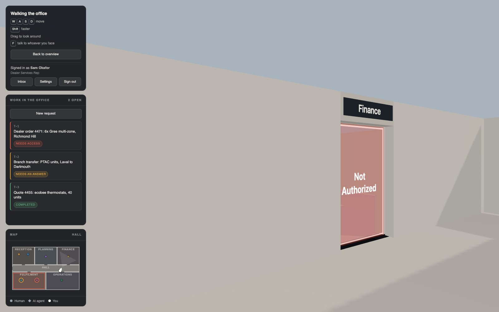
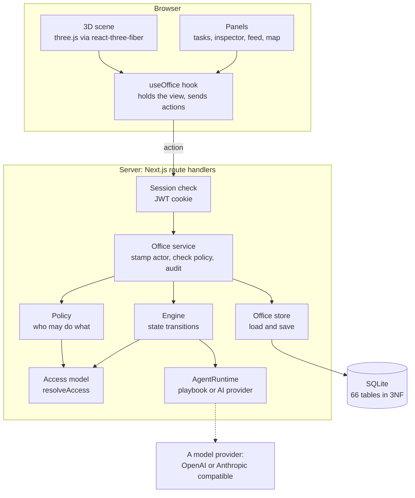

# AI Virtual Office

A 3D office where people and AI agents work side by side. Everyone has a desk,
a role and rooms they are allowed into. Work moves from room to room, and when
it gets stuck you can see where and why.

People sign in. The server decides what each person can see and do, using the
same access rules it applies to the agents.

**Live demo:** https://office.example.invalid


## Overview

The product is a 3D office in the browser. Each agent and each person has a
desk, a role, and a set of rooms they may enter, read and act in. Work comes in
as a request and goes through five stages: intake, planning, execution, review
and completion. Every stage has an owner and a status, and you can watch each
handoff happen.

The core idea is that a room is a permission boundary. If an agent needs something
from a room it may not use, it has to stop and say so. The stop has a place:
the room turns red, and the screen names the rule that decided it. To find
out why work is stuck, a supervisor looks at the floor.

In daily use, someone files a request. The agents carry it forward
and hand it on by themselves. A person is needed at five points:

- an agent asks a question;
- an agent needs access it does not have;
- an agent wants to do something in an outside system that needs approval;
- the final review;
- after a rejection, to say what happens to an order or a booking the task
  had already made.

Everything else moves without a click. A summary at the top of the screen
says how much work is open and what is waiting for a person.

### What to try first

1. Open the [live demo](https://office.example.invalid) and enter as Dana, the
   operations manager. No password is needed.
2. The dealer order **T-1** is halted at the Finance door. Click **Grant
   read on Finance, for this task only**.
3. The agent asks whether it may place the order in the storefront. Click
   **Approve**. A real order is placed in the mock storefront, and
   the task moves to review by itself.
4. Click **Approve** to complete it.
5. Click **Walk the office** to go through it on foot. Enter as Sam instead
   to meet the doorways Sam may not pass.

### What is real and what is not

The access rules, the workflow, sign-in,
the database, the audit trail and the calls to the five mock services are
real and run on the server. The demo's agents follow written playbooks, and
the screen says so. Agents on a real language model work too, in any office
with a provider connected, and have been run end to end on the live site. The
business data is made up. The full list is under
[What is real, simulated and proposed](#what-is-real-simulated-and-proposed).



## Contents

- [Overview](#overview)
- [Where to find things](#where-to-find-things)
- [The problem](#the-problem)
- [What it does](#what-it-does)
- [Everyday use](#everyday-use)
- [Example workflow](#example-workflow)
- [Architecture](#architecture)
- [Design decisions](#design-decisions)
- [Tech stack](#tech-stack)
- [A production version](#a-production-version)
- [What is real, simulated and proposed](#what-is-real-simulated-and-proposed)
- [Limitations](#limitations)
- [Run it](#run-it)
- [Verification](#verification)
- [More documentation](#more-documentation)

## Where to find things

| If you are looking for | It is here |
| --- | --- |
| A 3D office you can move through, with agents in recognisable roles | The [live demo](https://office.example.invalid): five agents and two people at desks in five rooms. See [Everyday use](#everyday-use). |
| A task going from request to completion, with its owner, status and handoffs | [Example workflow](#example-workflow). In the demo, T-3 is already complete, so its thread shows the whole path. |
| Starting a task, inspecting an agent, following progress and reading outputs | *New request*, a click on any figure, and the task panel. The [user guide](docs/user-guide.md) covers each. |
| How a team uses it day to day, and how a person supervises and steps in | [Everyday use](#everyday-use) |
| What is real and what is mock | [What is real, simulated and proposed](#what-is-real-simulated-and-proposed), and the labels on screen |
| Architecture, who does what, data flow and the stack | [Architecture](#architecture), [Design decisions](#design-decisions), [Tech stack](#tech-stack) |
| How it would run in production | [A production version](#a-production-version) |
| What it cannot do | [Limitations](#limitations) |
| How to run it and how it was checked | [Run it](#run-it), [Verification](#verification) |

## The problem

When a team gives AI agents a part in its order flow, a manager's first
question changes. It used to be whether the agent can do the work. Now it is
what the agent is allowed to see, and who decided that. The answer usually
lives in configuration files that only engineers read.

This project draws the access policy as a floor plan. Each room is a
permission boundary. An agent that needs pricing data kept in Finance has to
get through the Finance door. If the rules say no, the task stops in that
room, the room turns red, and the task panel shows which rule decided it. A
manager can walk through the office and point at the policy.

Two things follow from that, and they shape the whole system.

1. Access control is the orchestration mechanism. Work moves between rooms and
   rooms have permissions, so a permission failure is a visible event with a
   location.
2. A task halts only where a person is needed. Its owner lacks permission,
   or it lacks something only a person can give: an answer, an approval or
   the final decision. The office draws the first two differently: red for
   access, amber for a question.

The model is generic. The demo data is specific to an HVAC distributor with
several branches: dealer orders, inter-branch stock transfers, dealer tier
pricing, and a finance approval before a quote goes out.

## What it does

- People and agents share one access model. It has three scopes per room
  (enter, read, act), roles, per-person overrides and a fixed order of
  precedence, and every decision comes with an explanation.
- The workflow stops where a person is needed. Agents record their guesses
  as assumptions, ask when they cannot proceed, and escalate when they need a
  room they may not use.
- There are two kinds of agent. An AI agent asks a language model at each
  step and is shown only what it may read. A playbook agent follows when-then
  steps that a person writes in Settings, with no model involved.
- Agents keep working between clicks. Each has a queue of its own and takes
  its next step by itself: after an answer, after a colleague's note, and
  when a stage is finished. A task runs until it reaches a real halt, which
  is a question, missing access, an approval or the review. A click never
  waits for a model.
- The office shows its work. Each desk has a lamp in the colour of what its
  occupant is doing and names the tasks it holds. A handoff, a question, an
  answer or a note is seen crossing the office to the desk it is for.
- A summary is always in view. The top of the screen counts open work, what
  waits for a person and who is at work, and says in a sentence or two what
  that work is.
- Signing in comes with real enforcement. Each person receives only the
  messages their access lets them read, and the server refuses actions their
  role does not allow.
- Each room keeps records and can be connected to an outside system whose
  records are read live. `read` on the room shows both. `act` lets an agent
  do something there, such as placing an order, and a system can hold each
  action for a person's approval. Five mock services run beside the office to
  show it.
- A rejected task settles what it already did. An order that was placed is
  still an order after the task is rejected, so whoever rejects it is asked
  what should happen to it, and the agents carry the answer out.
- Every action goes into an audit log with who did it and why. Every access
  grant also issues a signed, scoped token that a program can use to read a
  room, and that stops working when the grant does.
- Everything is set up in the interface: rooms, people, agents, roles,
  permissions, access rules, AI providers and connected systems, each behind
  its own permission. An account can hold many offices and invite people into
  them.
- The office can be walked. There is an overview from above and a
  first-person walk with a map, by keyboard or by touch.

The full list is in [What it does](docs/features.md). It adds urgent work,
work that waits for a day, standing work, documents on a request, notes
between agents, the inbox and the report.

## Everyday use

The seeded office has five rooms along a hall: one for each of the four working
stages of a dealer order, and an operations office for the supervisor. Every
room opens onto the hall and onto nothing else, and the way in from outside is
at one end of it. Every role may walk the hall. No work happens there.

```
        ┌───────────┬───────────┬───────────┐
        │ Reception │ Planning  │  Finance  │
        ├─────┬─────┴─────┬─────┴─────┬─────┤
way in →             H a l l                │
        ├────────┬────────┴───────┬─────────┤
        │   Fulfilment    │    Operations   │
        └─────────────────┴─────────────────┘
```

| Room | Stage | Who sits there | What happens |
| --- | --- | --- | --- |
| Reception | Intake | Iris (agent), Sam Okafor (dealer services rep) | A dealer request is parsed and matched to an account. Iris asks before guessing about anything that changes the price. |
| Planning | Planning | Atlas (agent) | The request is broken into line items and a shipment, with a lead time. |
| Fulfilment | Execution | Vera (inventory agent), Quill (quoting agent) | Stock is checked across branches, transfers are proposed, the quote is assembled. |
| Finance | Review | Ledger (agent) | Dealer tier and credit standing are confirmed. A person approves or rejects. |
| Operations | Supervision | Dana Reyes (operations manager) | Escalations land here. Dana has access to every room. |
| Hall | none | nobody | The corridor every room opens onto. Everyone may walk it. |

A dealer services rep files a request and the agents carry it forward. Orders
that need nothing unusual go straight through to review. The supervisor's job
is the exceptions, and the office is built so they are the first thing on
screen:

- The work list on the left holds every task with its state, with a
  search box and filters once there are more than a few.
- The summary at the top centre counts open work, what waits for a person
  and who is at work. Under it, a briefing says which tasks need a person and
  what each needs.
- A room outlined in amber means an agent asked a question it could not
  answer itself. Someone picks an answer and the task continues.
- A room outlined in red means an agent needed data in a room it may not
  read. The supervisor can grant access for that one task, revoke the rule
  that blocked it, or hand the work to someone who already has access.
- Assumptions are the guesses agents made in order to keep going, such as
  which branch will fill the order. Each is listed on the task with its
  reasoning. Marking one wrong halts every task that rests on it.
- Review always ends with a person, who approves the work, rejects it, or
  sends it back with what has to change. A request can also be rejected at
  any earlier point.

Every permission change records who made it and why. A grant made for one task
counts only for work on that task and expires when the task closes, so an
exception does not turn into standing access.

The [user guide](docs/user-guide.md) goes through every panel and every
setting.

## Example workflow

A quote blocked at the Finance door, from the halt to completion.

If the demo has been used and T-1 is no longer halted, open Settings,
General, and click **Reset the demo**. That puts back the seeded people, rules
and three tasks for every visitor. It also puts the mock services back to
their starting data, so the order T-1 places is placed afresh each time. The
mock services are shared by every office on the server that connects to them,
so a reset clears what those offices did there as well.

Enter as Dana. Task **T-1** is selected: a dealer order for six multi-zone
heads. It has already moved through Reception, Planning and Fulfilment,
collecting three assumptions on the way. Quill is assembling the quote and
needs the dealer's pricing tier, which lives in Finance. Quill's role,
Fulfilment, explicitly denies Finance. The task is halted and Fulfilment is
outlined in red.

1. Read *Your move*. Quill explains what it needs and names the rule that
   stopped it.
2. Click **Grant read on Finance, for this task only**. An individual allow
   outranks a role deny, so the task returns to *in progress*. A permission
   token for Quill appears in Quill's inspector. Quill takes its step again
   now that it can read Finance: its draft quote lands in the thread, it
   leaves Ledger a note about tier pricing, and it asks whether it may place
   the order in the storefront connected to Fulfilment. The task waits.
3. Click **Approve** under the question. The order is placed, the thread
   shows the order number, and Laval's stock of that product drops by six
   under Settings, Connected systems. Quill's step is now finished, so
   within a second or two the task moves to Finance by itself and Ledger
   picks it up. Nobody clicks Advance.
4. Click **Approve**. The task completes, the grant from step 2 expires with
   it, and Quill's token stops working.

Four more are in [Example workflows](docs/example-workflows.md): a grant that
does not work and why, two people who see different things, a program reading
a room with a token, and a task waiting on an answer.

## Architecture

The browser draws the office and sends actions. Every rule lives on the
server. The core (model, engine, policy) is plain TypeScript with no framework
in it, which is why the check scripts can run it without a browser or a
server.



### Who does what

| Part | Its job |
| --- | --- |
| Browser | Draws the office and the panels from the view it was sent, and sends actions. It decides nothing. |
| API routes | Check the session and hand the action to the office service. |
| Office service | Stamps who is acting from the session, checks the policy, runs the engine, and stores the new state with its audit entry in one transaction. It returns the office as that person may see it. |
| Policy and access model | One resolver answers every "may this one enter, read or act in that room", for people and agents alike, and names the rule that decided. |
| Engine | A pure function from a state and an action to a new state: handoffs, halts, waits, reviews and rejections. |
| Agent runtime | One interface with a playbook agent or an AI agent behind it. One step goes in and one checked result comes out. |
| Office store | Maps the office to 66 SQLite tables and back. |

### How a task moves

1. A person files a request. It is stored, and the agent for the first stage
   finds it on its queue.
2. The agent takes one step. It is shown the thread and the records as far as
   its access allows, and answers with a status line, any output, questions,
   assumptions, rooms it needs, actions in a connected system and notes.
3. The engine checks that answer against the access rules. A question, a room
   the agent may not use, or an action that needs approval halts the task
   where it is, and the room shows it.
4. A person answers, grants access or approves. The agent takes its step
   again and the task moves to the next room by itself.
5. At review a person approves, rejects or sends the work back. Every step on
   the way is in the thread and in the audit log.

Actions are applied one at a time, and none of them waits for a model: an AI
agent's step is taken in the background, outside the turn that changes the
office.

In depth: [Architecture](docs/architecture.md) covers the access model, the
workflow's states, both kinds of agent, sign-in, permission tokens and the
API. [Database](docs/database.md) documents every table.

## Design decisions

The choices that shaped the product, each with what it cost.

| Decision | Why | What it costs |
| --- | --- | --- |
| Rooms are the permission boundary | A manager already understands "who is allowed in that room". Putting access on a floor plan makes a policy something you can point at. | Work has to be modelled as moving between rooms, which suits staged work better than free-form chat. |
| A task halts only for a person-shaped reason | A question, missing access, an approval and the review are the four places where a person adds something an agent cannot. Halting anywhere else is noise. | Agents must settle everything else themselves, which took the notes between agents and the waiting loop to make work. |
| The model is never the guard | A model is told its limits, and it is also never shown what it may not read, its reply is checked field by field, and an action is carried out only if the engine finds it allowed. | More code than trusting a prompt. It is why a planted instruction in a request cannot place an order by itself. |
| The engine is a pure function | State and an action go in, a new state comes out. The whole workflow runs under Node without a browser, a server or a model, which is how more than a thousand checks run in seconds. | Anything with a side effect (a model call, an outside system) has to be passed in from outside. |
| One interface for every kind of agent | A playbook agent and an AI agent answer through the same `AgentRuntime`. The demo runs with no model and no key, and switching an agent to a real model is a change of setting. | The interface has to stay narrow: one step in, one structured result out. |
| Every exception is scoped and explained | A grant can be for one task and expires with it. Every decision names the rule that made it. | The resolver carries precedence and expiry rules that a simple allow-list would not need. |
| Simulated things say so | The brief asks for honesty about what is real. Each agent is labelled AI or Playbook, and each playbook output is marked. | Nothing, beyond the discipline of keeping the labels true. |
| A 3D office, drawn as a cutaway | The walls are low from above so every room stays visible, and full height on foot. A halt has to be visible from anywhere. | Less realism than a closed building. |

## Tech stack

Each choice is here because it removed something to run or to explain.

| Part | Choice | Why this one |
| --- | --- | --- |
| Framework | Next.js 16, App Router, as a Node server | One project holds the page, the API and the server logic, so the demo deploys as a single container. Route handlers are plain functions, which keeps the API easy to read. |
| Language | TypeScript 7, strict | The access model and the engine are mostly types and pure functions. Strict types catch a wrong room id or a missing field before anything runs. |
| 3D | three.js through @react-three/fiber and drei | The scene is declared as React components next to the panels that describe it, and it re-renders from the same state. No separate game loop to keep in step with the UI. |
| Database | SQLite through Node's built-in `node:sqlite` | One file, no server to host, nothing native to compile, and free to run anywhere. The schema is still fully relational (66 tables in third normal form), so moving to Postgres is a change of driver. |
| Sign-in | jose for signed tokens, Node's scrypt for passwords | Small, standard and dependency-light. No outside identity service is needed for the demo to be public. |
| AI providers | The Anthropic SDK for services that speak the Messages interface, and plain `fetch` for those that speak the OpenAI chat interface | Two connection styles cover nearly every hosted and self-hosted model, so an office is not tied to one vendor. Both are set up the same way and no service is assumed. zod checks every reply before the engine sees it. |
| Checks | tsx running plain scripts | No test framework to learn. Each script prints what it checks in a sentence, and the Docker image refuses to build unless all of them pass. |
| Hosting | Docker, behind a reverse proxy | Runs on any host that runs containers, with no paid service. The deployed site is six small containers on one server. |

## A production version

Much of what the brief asks about for production is already built. This is
what exists, and what a real deployment would add.

| Area | In this repository | A production version would add |
| --- | --- | --- |
| Orchestration | The engine applies one action at a time. After each one the work it leaves goes onto the queues of the agents concerned, who work through them side by side. Models and connected systems are asked outside the turn that changes the office. | A job queue several servers can share. Today each agent's queue lives in one server's memory, with every item also written to the database so that it survives a restart. |
| State updates | Every change goes through the server, is checked against the person's permissions, stored, and written to the audit log. Browsers re-read every five seconds, or every second and a half while agents work. | Updates pushed to the browser over a WebSocket or server-sent events, so a change shows the moment it happens. |
| Persistence | SQLite, with migrations that bring an older database forward on start. | Postgres, for more than one server process, point-in-time backups and row-level locking. The schema carries over as it is. |
| Real AI | Working today: several providers per office or per account, a model per agent, structured replies that are validated, a retry on an unreadable reply, and limits enforced outside the model. | Streaming, so a long step shows progress. Per-office spending limits and usage reports. Tools an agent can call during a step, in place of a fixed snapshot of each system. |
| Outside systems | Any service that describes itself, read and write, behind the room's access rules, with per-action approval and repeat-safe requests. Tested against five mock services. | Connectors for named products such as Shopify or an accounting package, and retries with backoff when a system is down. |
| Identity | Password accounts, sign-up, sessions, invites and a public demo sign-in. | Single sign-on, password reset by email, and two-factor sign-in. |
| Operations | A container that checks itself before it builds, a health check, an audit log. | Metrics, alerting, log shipping and a staging environment. |

## What is real, simulated and proposed

### Real

The access rules and the workflow engine. Sign-in, sessions,
invites and enforcement on the server. The database and the audit log. The
settings screens. Playbook agents. AI agents on real models through both
provider interfaces, which have taken requests through every stage on the
live site. Connected systems, including actions that wait for approval and
are taken back when a task is rejected. Agents working in the background, the
summary and the briefing. The 3D office, with everything that moves in it
drawn from real tasks and messages.

### Simulated

- The demo office's agents are playbook agents. Their playbooks were written
  for a dealer order of multi-zone heads and answer any request that way. The
  demo says so on its title card and on its request form.
- All business data: dealers, branches, stock, pricing tiers, people.
- The five mock services: storefront, freight carrier, accounts ledger,
  supplier portal and service desk. They are real HTTP services with keys,
  validation and refusals, and the office talks to them as it would to any
  other. What they hold is made up, and returns to its starting state when a
  service restarts, once a day, and when the demo is reset. An office
  connected to any of them says so on its title card in every view.

Every agent is labelled as an AI agent or a playbook agent, on screen and in
the stored data.

### Not verified

- The office ending a wait by itself on the day, on the live site. The check
  scripts cover it with a clock of their own.
- An agent that cannot be reached while a rejected task is wound up, on the
  live site. The check scripts cover it.
- A real phone or tablet. The phone layout and walking by touch were run in
  a desktop browser set to a phone's size and touch input.

### Proposed

- Adapters for named products such as Shopify or an accounting package, each
  a small service in front of the product that describes it to the office.
- Lookups an AI agent chooses for itself during a step. Today it is shown a
  fixed snapshot of each system it may read.
- A small tool-calling model, such as Needle from Cactus Compute, to pick the
  right operation when an agent can reach many. Today every operation of
  every system an agent may use is listed in its step. The shortlist would be
  drawn only from what the agent's access allows, and the engine would still
  check the action.
- Workflows with a different number of stages, and more playbook conditions.
- A drag-and-drop floorplan editor.
- Live updates pushed to the browser in place of polling.

The full list, with what was run on the live site and what came of it, is in
[What is functional, simulated and proposed](docs/real-and-simulated.md).

## Limitations

- The workflow always has the same five stages, though each office chooses
  which room hosts each one.
- An AI agent reads what its rooms and their connected systems hold and
  replies. It cannot search a system or page through it.
- A connected system has to describe itself in the format the mock services
  use. No existing ordering, accounting or carrier system does, so each would
  need a small adapter in front of it, and none has been tried.
- The agents' queues are held in one server's memory, with each item also
  written to the database so that it survives a restart. SQLite suits one
  server process.
- Browsers poll for changes every five seconds, and every second and a half
  while agents are at work.
- Some of what keeps an AI agent sensible is an instruction to a model, such
  as when it may set a task to wait for a day. The limits that must hold,
  access and approval, are enforced outside the model.
- There is no password reset and no email. An email given at sign-up is not
  verified.
- On a phone, walking is by taps on the map. There is no way to move a step
  at a time without a keyboard.
- The mock services are shared by every office on the server and return to
  their starting data once a day, so a task that waits longer than that
  finds its earlier orders gone.

The full list, and a comparison with what a real office has that this one
lacks, is in [Limitations](docs/limitations.md). [Security](docs/security.md)
says how sign-in, keys, sessions and what a model is shown are protected.

## Run it

Requires Node 24 or later, for the built-in SQLite module.

```bash
npm install
npm run dev       # http://localhost:3000
npm run verify    # type check, then all eleven check scripts
npm run services  # the five mock services, on ports 8081 to 8085
npm run build     # production server in .next/standalone
```

The database is created at `./data/office.db` on first run, with the demo
office in it. With Docker, the whole stack of six containers starts with one
command:

```bash
docker compose up -d --build    # http://localhost:8080
```

[Running and deploying it](docs/deployment.md) has the settings, how to give
the local demo its mock services, and how the live site is deployed.

## Verification

Every check is a plain script that runs under Node and prints what it checks,
one sentence a line. Nothing leaves the machine: where a script needs a model
or an outside system, it starts a stand-in on a local port.

| What | Command | Result |
| --- | --- | --- |
| Access rules: which rule wins, expiry, what may be read. Walking, doorways, and picking a place on the map | `npm run check` | 51 of 51 pass |
| One order from request to approval, including the grant that fails | `npm run scenario` | 22 of 22 pass |
| Saving and loading the office after every action and every set-up change | `npm run store` | 48 of 48 pass |
| Passwords, sessions, limits on repeated tries, policy, input parsing, what each person is sent, permission tokens | `npm run auth` | 47 of 47 pass |
| What an agent is shown and how its reply is read, desk states, conversations, notes, the summary and the briefing, rejecting before review, the report | `npm run agents` | 256 of 256 pass |
| Playbook steps, and AI agents through both provider interfaces against stand-in services | `npm run providers` | 56 of 56 pass |
| Set-up changes and their refusals, permissions, playbooks, rooms, a person leaving, an office built from nothing | `npm run admin` | 127 of 127 pass |
| Several offices in one database: isolation, providers and their keys, invitations, accounts, the briefing, removal | `npm run offices` | 206 of 206 pass |
| The five mock services and what each refuses, live records, actions held for approval, messages and notes, and a demo reset that puts the services back | `npm run systems` | 181 of 181 pass |
| Agents working between clicks: queues, waits, restarts, urgent work, standing work | `npm run loop` | 118 of 118 pass |
| A rejected task that had placed orders, and taking them back | `npm run windup` | 61 of 61 pass |
| Types | `npx tsc --noEmit` | clean under `--strict` |
| Production build | `npm run build` | standalone server |

That is 1,173 checks.

`npm run verify` runs all of the above except the build. The Docker image
refuses to build unless it passes.

## More documentation

| Document | What is in it |
| --- | --- |
| [What it does](docs/features.md) | Every feature, one paragraph each |
| [User guide](docs/user-guide.md) | Daily use, every panel, walking, messages, the inbox and every settings page |
| [Example workflows](docs/example-workflows.md) | Five walkthroughs in the demo office |
| [Architecture](docs/architecture.md) | Layers, the access model, the workflow's states, agents, sign-in, tokens, the API |
| [Database](docs/database.md) | All 66 tables, with diagrams |
| [What is functional, simulated and proposed](docs/real-and-simulated.md) | The full list, with what was run on the live site |
| [Security](docs/security.md) | Passwords, sessions, keys, what a model is shown, and the defaults to change |
| [Limitations](docs/limitations.md) | Every known limit, and what a real office has that this one lacks |
| [Running and deploying it](docs/deployment.md) | Local set-up, settings, Docker and the live deployment |
