# AI Virtual Office

A 3D office where people and AI agents hold desks, roles and room permissions.
Work moves from room to room and stops at the point where its owner lacks
access or information, so a supervisor can see where to step in and why.

People sign in. What each person can see and do is decided on the server by
the same access rules that govern the agents.

**Live demo:** https://office.example.invalid


## Contents

- [The problem](#the-problem)
- [What it does](#what-it-does)
- [Everyday use](#everyday-use)
- [User guide](#user-guide)
- [Example workflows](#example-workflows)
- [Architecture](#architecture)
- [Database](#database)
- [Tech stack](#tech-stack)
- [What is functional, simulated and proposed](#what-is-functional-simulated-and-proposed)
- [Security](#security)
- [Limitations](#limitations)
- [Run it](#run-it)
- [Verification](#verification)

## The problem

When a team adds AI agents to its order flow, the question a manager has to
answer changes. Whether the agent can do the work matters less than what the
agent is allowed to see, and who decided that. Today the answer usually sits in
configuration files that only engineering reads.

This project puts the access policy on a floor plan. Every room is a permission
boundary. An agent that needs pricing data held in Finance has to get through
the Finance door. When the rules say no, the task stops in the room where it
happened, the room turns red, and the inspector shows which rule decided it. A
manager can walk through the office and point at the policy.

Two consequences shape the whole system.

1. Access control is the orchestration mechanism. Work moves between rooms and
   rooms have permissions, so a permission failure is a visible event with a
   location.
2. A task halts for exactly two reasons. Its owner lacks permission, or its
   owner lacks information. Both need a person, for different reasons, and the
   office draws them differently: red for access, amber for a question.

The model is generic. The demo data is specific to an HVAC distributor with
several branches: dealer orders, inter-branch stock transfers, dealer tier
pricing, and a finance approval before a quote goes out.

## What it does

- **One access model for people and agents.** Three scopes per room (enter,
  read, act), roles, per-person overrides, and a fixed order of precedence.
  Every decision comes with an explanation.
- **A workflow that stops where a person is needed.** Agents record their
  guesses as assumptions, ask when they cannot proceed, and escalate when they
  need a room they may not use.
- **Sign-in with real enforcement.** Each person receives only the messages
  their access lets them read, and the server refuses actions their role does
  not allow.
- **Permission tokens.** Every access grant issues a signed, scoped token that
  a program can present to read a room. It stops working the moment the grant
  does.
- **An audit log.** Every action is recorded with who did it, when, and what
  it was about.
- **Two kinds of agent.** An AI agent asks a language model at each step and
  is shown only what it may read. A playbook agent follows when-then steps
  that a person writes in Settings, with no model involved.
- **Several AI providers per office.** Anthropic, and any service that offers
  the OpenAI chat completions interface. Each AI agent names the provider and
  model it uses.
- **Records and connected systems per room.** Each room keeps records that a
  person writes in Settings, and can be connected to an outside system whose
  records are read live. `read` on the room shows both. `act` on the room lets
  an agent do something in the system, such as placing an order.
- **Two sample services in the stack.** A storefront and a freight carrier run
  as their own containers beside the office. The demo office is connected to
  both, and its agents place a real order in the storefront.
- **Granular role permissions.** Ten separate permissions, such as managing
  access, deciding reviews or inviting people, ticked per role in a table.
- **Many offices.** An account can add offices, switch between them and remove
  them. Each office is separate, and a new one starts empty.
- **Invites.** Someone whose role may invite adds a person, who gets a desk
  and sets their own password.
- **Settings.** Rooms, people and agents, roles and their permissions, access
  rules and AI providers are all set up in the interface, each behind its own
  permission.
- **A walkable office.** An overview from above, and a first-person mode with
  a map.

## Everyday use

The seeded office has five rooms: one for each of the four working stages of a
dealer order, and an operations office for the supervisor.

| Room | Stage | Who sits there | What happens |
| --- | --- | --- | --- |
| Reception | Intake | Iris (agent), Sam Okafor (dealer services rep) | A dealer request is parsed and matched to an account. Iris asks before guessing about anything that changes the price. |
| Planning | Planning | Atlas (agent) | The request is broken into line items and a shipment, with a lead time. |
| Fulfilment | Execution | Vera (inventory agent), Quill (quoting agent) | Stock is checked across branches, transfers are proposed, the quote is assembled. |
| Finance | Review | Ledger (agent) | Dealer tier and credit standing are confirmed. A person approves or rejects. |
| Operations | Supervision | Dana Reyes (operations manager) | Escalations land here. Dana has access to every room. |

A dealer services rep files a request and the agents carry it forward. Orders
that need nothing unusual go straight through to review. The supervisor's job
is the exceptions, and the office is built so they are the first thing on
screen:

- **A room outlined in amber** means an agent asked a question it could not
  answer itself. Someone picks an answer and the task continues.
- **A room outlined in red** means an agent needed data in a room it may not
  read. The supervisor can grant access for that one task, revoke the rule that
  blocked it, or hand the work to someone who already has access.
- **Assumptions** are the guesses agents made in order to keep going, such as
  which branch will fill the order. Each one is listed on the task with its
  reasoning and confidence. Confirming one closes it. Marking one wrong halts
  every task that rests on it and asks for the correct value.
- **Review** always ends with a person. An agent can prepare the pricing sheet,
  and only a human decision completes or rejects the task.

Every permission change records who made it and why. A grant made for one task
expires when that task closes, so an exception does not turn into standing
access.

## User guide

**Signing in.** The sign-in page takes an email and password. An account
signed in this way starts with an empty office of its own.

The page also lists the people of the **demo office** for password-free entry.
The demo office is the seeded distributor described above. It is separate from
every account's own offices and nothing in it carries over to them.

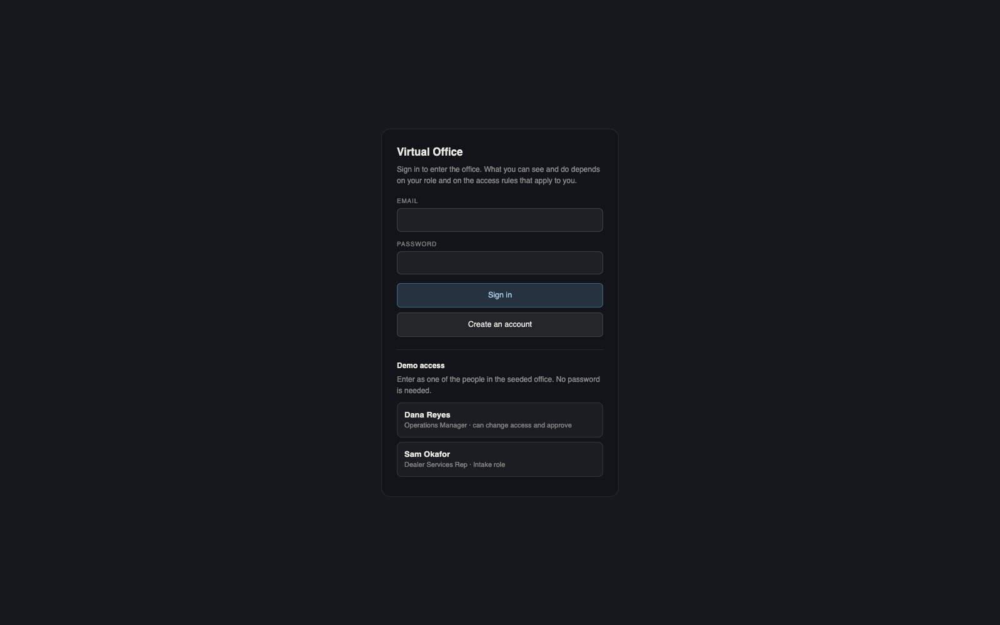

| Demo person | Role | What they can do |
| --- | --- | --- |
| Dana Reyes | Operations Manager, supervises | Everything: grant and revoke access, hand work over, approve, invite people. Reads every room. |
| Sam Okafor | Dealer Services Rep, Intake role | File requests and work in Reception. Cannot read Finance and cannot change access. |

Entering as Sam after Dana is the quickest way to see the enforcement: fewer
messages, disabled controls, and a line on each task saying how many messages
were withheld.

**Moving around.** Drag to orbit, scroll to zoom, right-drag to pan. Walls are
drawn low so every room stays visible from any angle.

**Walking.** *Walk the office* puts you at the front door at eye level. Move
with W A S D or the arrow keys, hold Shift to move faster, drag to look around
and click someone to inspect them. A map in the corner shows where you are.
Escape returns to the overview.

**Reading the office.** Every name tag says Human or AI. People are rounded
figures. Agents are faceted and carry a slowly turning ring. A pulsing marker
above a figure means that figure owns a halted task.

**Work in the office** (left). Every task with its status. Click one to open it.
**New request** files a new dealer request into Reception and opens it.

**Inspector** (right), with a task selected:

- *Your move* lists what you can do at this moment. The buttons change with
  the state of the task and with your own permissions. A control you may not
  use is disabled, with the reason beside it.
- *Assumptions* lists every guess recorded on the task, each with Confirm and
  That's wrong.
- *Thread* is the message history you are allowed to read.

**Inspector**, with a person or agent selected (click a figure in the scene):
role, what they can do, whether a live model backs them, and a table of rooms
against the three access scopes. A cell marked `*` was decided between
competing rules. Hover it for the explanation. Supervisors also see that
participant's permission tokens, with *Copy token* and *Revoke token*.

**Activity** (bottom left) is a plain-language log of what each action did,
limited to rooms you can read.

**Supervisor controls** (title card). *Invite* adds a person. *Settings* opens
the set-up screen described next.

### Settings

How an office is set up can be changed without touching code. Every change is
checked on the server, stored, and written to the audit log.

| Tab | Needs the permission | What you can do |
| --- | --- | --- |
| Offices | none | See every office your account has a seat in. Open another one. Add a new office. Remove one you manage. |
| This office | Manage the office | Rename the office. Clear all work, or remove the office. In the demo office: reset it to how it first loaded. |
| Rooms | Manage rooms | Rename a room or change its purpose. Add a room against a wall of an existing one, with a door between them. Remove an empty room. Choose which room hosts each workflow stage. |
| Records and systems | Manage rooms | Edit the records kept in each room you can read. See what a connected system holds right now. Connect a system to a room, change it, or disconnect it. |
| People and agents | Manage people and agents | Add an AI agent or a playbook agent with a desk and a role. Choose an agent's provider and model, or write its playbook. Rename anyone, change their role, or move their desk. Remove someone who has no history. |
| Roles and permissions | Manage roles | Add, rename or remove a role. Tick each permission per role. Tick allow or deny for each scope in each room. |
| Access rules | Manage access | See every individual rule in a table and revoke one. Add rules for a person or agent by ticking cells and giving a reason. |
| AI providers | Manage AI providers | Add, edit, test and remove providers. Each holds a type, a default model and an API key. |

A tab appears only for someone whose role carries its permission.

**Permissions.** A role carries any of ten permissions, ticked in a table of
permissions against roles:

| Permission | Lets a person |
| --- | --- |
| Manage access | Grant and revoke individual access rules and permission tokens. Escalations go to people with this permission. |
| Hand work over | Give a task to a different owner. |
| Decide reviews | Approve or reject work at the review stage. |
| See everything | Read every message and the whole activity log. |
| Invite people | Add a person to the office with a role and a desk. |
| Manage people and agents | Add, configure and remove agents. Rename people, change roles, move desks. |
| Manage rooms | Add, rename and remove rooms. Choose where each stage happens. Edit the records and connected systems of rooms they can read. |
| Manage roles | Add and remove roles and change what each role may do. |
| Manage AI providers | Add, change and remove AI providers and their API keys. |
| Manage the office | Rename the office, clear all work, or remove the office. |

Nobody can hand out more than they hold. A person can tick only the
permissions their own role carries, and can give or invite into only a role
whose permissions are a subset of their own. Permissions are for people: a
role held by an agent cannot carry any.

**Room access.** Each role has a table with a row per room, and an Allow box
and a Deny box for each of enter, read and act. An empty pair means not set.
Individual rules are added from the same kind of table.

**Agents.** An agent is one of two kinds, chosen when it is added and
changeable afterwards:

- An **AI agent** names one of the office's AI providers and, optionally, a
  model other than the provider's default.
- A **playbook agent** follows an ordered list of steps. Each step has
  conditions under *When* (the stage the work is at, text the request
  contains, who the request is from) and an outcome under *Then* (a line for
  the activity log, an output, a question, an assumption, a need for access to
  a room, something to do in a connected system). The agent takes the first step whose conditions all hold. When no
  step applies it does nothing and says so.

**AI providers.** An office can hold several. A provider is either Anthropic or
OpenAI compatible, which covers any service with the OpenAI chat completions
interface, including a model served on your own machine. An Anthropic provider
takes an optional address, for a gateway or another service that offers the
Anthropic Messages interface under its own model ids. *Test* checks the key
and the model with the provider without generating anything. A key is
encrypted before it is stored and is never sent back to the page: afterwards
the table shows only its last four characters. The shared demo office cannot
hold a key.

**Records and systems.** A room's records are sentences, one per line, such
as a policy or an account's terms. A connected system belongs to one room and
is one of two kinds:

| Kind | Live records | Operations |
| --- | --- | --- |
| Storefront | Products with list price and stock per branch, and recent orders | Place an order, cancel an order |
| Freight carrier | Service levels with their rates, and recent shipments | Book a shipment, cancel a shipment |

The room's access rules cover the system. Someone with `read` on the room is
shown the system's records as they are at that moment. An agent with `act` on
the room may use its operations, and an agent without it halts the task and
asks its supervisor, exactly as it does for a room it cannot read. What the
system answered is written to the thread, including a refusal such as a branch
that does not hold enough stock. A system's address and API key are entered
once, the key is stored encrypted, and neither a manager without `read` on the
room nor any agent ever receives them. The demo office's two systems are fixed.

The screen refuses changes that would leave the office broken, and says why: a
room that hosts a stage or still has people in it cannot be removed, the last
person who can manage roles cannot lose that, and a role still in use cannot
be deleted.

**A new office starts empty**: one room with you in it, two starter roles, no
agents, no work and no rules. Add rooms, assign the stages, add agents and set
the roles from there. Demo access cannot add offices.

## Example workflows

### 1. A quote blocked at the Finance door

If the demo has been used and T-1001 is no longer halted, open Settings, This
office, and click **Reset the demo**. That puts back the seeded people, rules
and three tasks for every visitor. The storefront is a separate service and
keeps the order it already holds for T-1001, so after a reset the thread
reports that order as already placed until the storefront's own daily reset.

Enter as Dana. Task **T-1001** is selected: a dealer order for six multi-zone
heads. It has already moved through Reception, Planning and Fulfilment,
collecting three assumptions on the way. Quill is assembling the quote and
needs the dealer's pricing tier, which lives in Finance. Quill's role,
Fulfilment, explicitly denies Finance. The task is halted and Fulfilment is
outlined in red.

1. Read *Your move*. Quill explains what it needs and names the rule that
   stopped it.
2. Click **Grant read on finance, for this task only**. An individual allow
   outranks a role deny, so the task returns to *in progress*. A permission
   token for Quill appears in Quill's inspector. Quill takes its step again
   now that it can read Finance: its draft quote lands in the thread, and it
   places the order in the storefront connected to Fulfilment. The thread
   shows the order number, and Laval's stock of that product drops by six
   under Settings, Records and systems.
3. Click **Advance to Review**. The task moves to Finance and Ledger picks it
   up.
4. Click **Approve**. The task completes, the grant from step 2 expires with
   it, and Quill's token stops working.

### 2. A grant that does not work

This is the more instructive path, and it starts from a new request.

1. Click **New request**, then **Send to Reception**. Iris takes it, records an
   assumption about the branch, and asks whether the heads are standalone.
2. Answer the question, then advance to Planning and on to Execution.
3. In Fulfilment the task goes to Vera, who needs to read Finance to price the
   order. Vera is blocked.
4. Click **Grant read on finance, for this task only**. The task stays blocked.
5. The reason is on screen. Vera carries two older individual rules: `r-01`
   allows reading Finance (left over from a margin review project) and `r-02`
   denies it (added by a later security review). Deny wins among individual
   rules, so adding another allow changes nothing.
6. Click **Revoke the blocking rule**. With `r-02` gone the task-scoped grant
   applies and the task is unblocked. Advance it to review and approve.

A supervisor learns from step 4 that the policy has a real order of precedence
and that the system will explain it. The same story runs headless under
`npm run scenario`. An abridged trace:

```text
> Advance to Execution
   - T-1 moved to Execution (Fulfilment), owner Vera
   - Vera recorded an assumption: The dealer will accept shipment from Laval
   - Vera blocked on read access to finance. Denied by individual rule r-02 (deny: Security review: fulfilment agents should not read credit data); overrides individual rule r-01 (allow: Needed landed-cost visibility for the margin review project)
   pass  blocked on permission -> blocked_permission

> Dana grants Vera read on Finance
   - r-14: allow read on Finance for Vera (expires with T-1)
   - T-1 still blocked after r-14. Denied by individual rule r-02 (...); overrides individual rule r-01 (...), individual rule r-14 (allow: Dealer tier lookup for this order)
   pass  still blocked, because deny outranks allow -> blocked_permission

> Dana revokes r-02, the blanket security deny
   - r-02 revoked by Dana Reyes
   - T-1 unblocked by revocation of r-02. Advance it to continue.
   pass  unblocked, on the scoped grant alone -> in_progress

> Check Vera's access now the task has closed
   pass  Vera read Finance -> deny
   - Denied by role Fulfilment (deny)
```

### 3. Two people, two views

1. Enter as Dana and open T-1001. The thread shows Quill's escalation, which
   was addressed to Dana.
2. Sign out and enter as Sam. The same task shows one message fewer, with a
   note that it was withheld. The grant buttons are gone, and *Advance* is
   disabled with the reason: Sam cannot act in Fulfilment.
3. Sam can still file a new request, because the Intake role may act in
   Reception.

Nothing here is hidden by the interface alone. The server leaves the messages
out of what it sends to Sam, and it refuses the actions if they are sent by
hand.

### 4. A program reading a room with a token

After the grant in workflow 1, open Quill in the inspector and click
**Copy token**. Then, from a terminal:

```bash
curl -H "Authorization: Bearer <token>" http://localhost:8080/api/rooms/finance/thread
```

The reply holds Finance's records and thread for that task. The same token
against `/api/rooms/operations/thread` is refused, because it names Finance.
Approve T-1001 and call again: refused, because the task has closed.

### 5. A task waiting on an answer

**T-1002** is a branch transfer. Vera asked whether to send four units now or
split the shipment, and the task waits in amber until someone chooses. It is
the same halt as T-1001 with a different cause and a different fix.

**T-1003** is already complete, so the full path from request to approval can
be read in its thread without clicking through anything.

## Architecture

### Layers

The browser draws the office and sends actions. Every rule lives on the
server. The core (model, engine, policy) is plain TypeScript with no framework
in it, which is why the check scripts can run it without a browser or a
server.

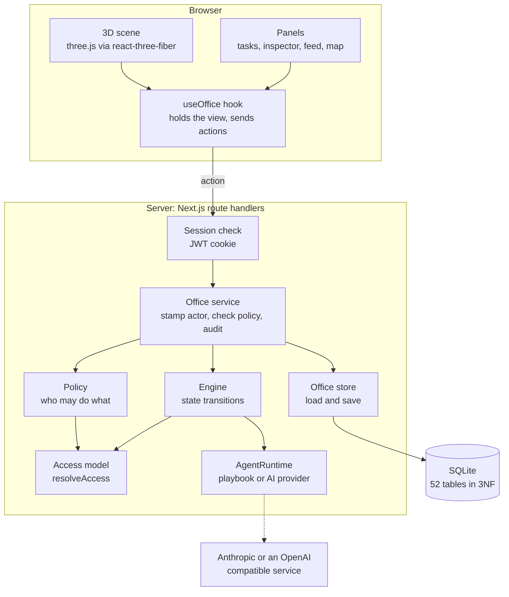

### What happens when someone clicks a button

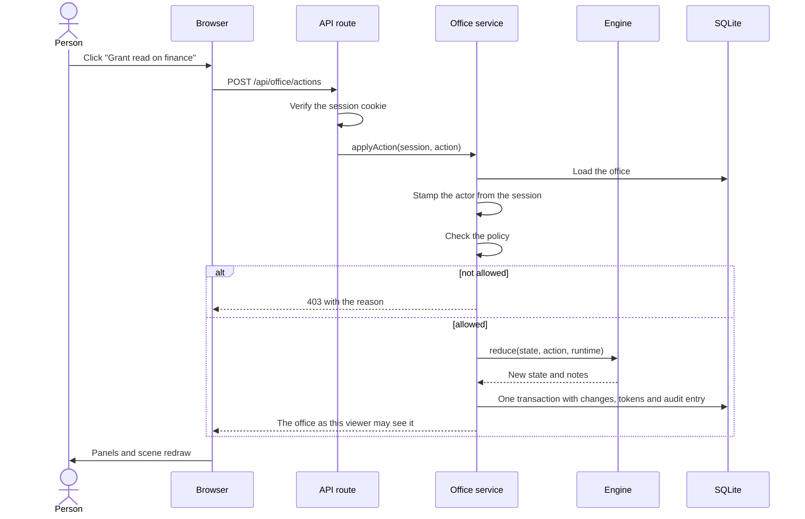

Actions are applied one at a time. A transition can wait on an agent, and the
next action must start from the state the previous one left behind.

### File map

```
lib/model.ts              types and the access resolver
lib/engine.ts             state transitions and the AgentRuntime interface
lib/policy.ts             who may dispatch which action, and what each viewer may read
lib/admin.ts              set-up changes: rooms, roles, people, agents, a blank office
lib/playbook.ts           how a playbook agent picks and takes a step
lib/seed.ts               the demo office: floorplan, roles, people, rules, tasks
lib/systems.ts            kinds of connected system and the operations each offers
lib/referenceData.ts      the records the demo office's rooms start with
lib/geometry.ts           walls, doors, walking collision, desk placement
lib/useOffice.ts          browser hook: holds the view, sends actions
lib/server/schema.ts      the database schema
lib/server/db.ts          SQLite connection and transactions
lib/server/officeStore.ts maps the office to tables and back
lib/server/officeService.ts  applies actions, builds per-viewer views, writes the audit log
lib/server/auth.ts        password hashing, users, seats, JWT sessions
lib/server/secrets.ts     encryption for stored API keys
lib/server/accessTokens.ts   scoped permission tokens
lib/server/invites.ts     inviting people
lib/server/providers.ts   an office's AI providers and the runtime each AI agent gets
lib/server/systems.ts     connected systems: storage, live records, carrying out operations
lib/server/modelRuntime.ts   the AI agent runtime for Anthropic models
lib/server/openaiRuntime.ts  the AI agent runtime for OpenAI compatible services
app/api/                  route handlers
app/page.tsx              the office, for a signed-in person
app/login, app/invite     sign-in and invite pages
components/               3D scene, panels, settings, sign-in and invite forms
scripts/                  nine check scripts
services/storefront, services/carrier   the two sample services, one file each
Dockerfile, compose.yaml  container build and run of the office and both services
```

### Access model

Humans and agents are one type, `Participant`, with a `kind` field. They hold
desks and roles and send messages in the same way.

There are three scopes per room:

| Scope | Meaning |
| --- | --- |
| `enter` | may be present in the room |
| `read` | may see messages addressed to the room and the records kept there |
| `act` | may own tasks and produce outputs there |

Rules resolve in a fixed order. The more specific rule wins, deny beats allow
at the same level, and anything unmentioned is closed.

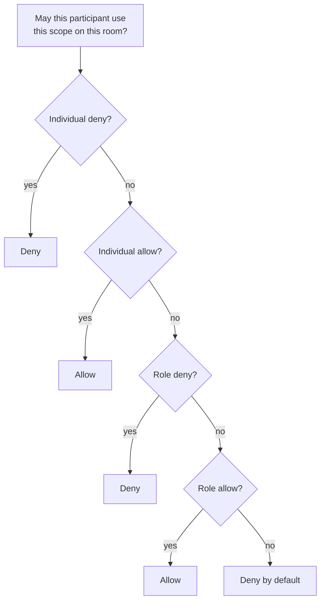

| Rank | Rule | Example in the seed |
| --- | --- | --- |
| 1 | Individual deny | `r-02`: Vera may not read Finance |
| 2 | Individual allow | a grant made for one task |
| 3 | Role deny | Fulfilment is denied Finance |
| 4 | Role allow | Fulfilment may act in Fulfilment |
| 5 | Default deny | anything not mentioned |

`resolveAccess()` returns an `AccessDecision` instead of a boolean. It carries
the rule that decided, every rule that lost, and a one-line explanation. The
conflict banner, the `*` cells in the access table and the text of each
escalation are all that same object, so the interface cannot explain a
decision differently from how it was made.

Individual rules require a `reason` and a `grantedBy`. They can expire at a
time or when a named task closes.

### Workflow

The pipeline is intake in Reception, planning in Planning, execution in
Fulfilment, review in Finance, then done. Advancing a stage is an ordinary
handoff: the task goes to whoever is seated in the next room and allowed to act
there. A permission block comes from an agent declaring, in the middle of its
step, that it needs a scope on another room.

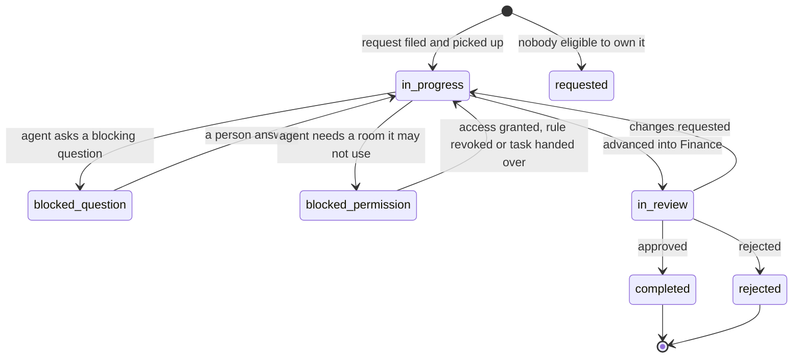

The engine is one function. It never changes its input, and it is
asynchronous because it waits for the agent runtime.

```ts
reduce(state, action, runtime): Promise<{ state, emitted, notes }>
```

Actions: `SUBMIT_REQUEST`, `ADVANCE`, `ANSWER_QUESTION`, `GRANT_ACCESS`,
`REVOKE_RULE`, `REASSIGN`, `RESOLVE_ASSUMPTION`, `DECIDE`.

### Who may do what

`lib/policy.ts` derives permissions for people from the same access model. The
server enforces it and the interface uses it to disable controls.

| Action | Needs |
| --- | --- |
| File a request | `act` in Reception |
| Advance a task, confirm or contradict an assumption | `act` in the room where the task is |
| Answer a question | being the person asked, or `act` in that room |
| Grant or revoke an access rule | the Manage access permission |
| Hand work to another owner | the Hand work over permission |
| Approve or reject at review | the Decide reviews permission |
| Change the office's set-up | the permission for that part: rooms, people and agents, roles, AI providers or the office itself |

The server overwrites every "who did this" field with the signed-in person
before the engine sees the action. An actor id sent by the browser is ignored.

### Agents

Agent reasoning sits behind one interface:

```ts
interface AgentRuntime {
  step(input: AgentStepInput): Promise<AgentStepResult>;
}

interface AgentStepResult {
  statusNote?: string;
  questions: DraftQuestion[];      // blocking or not, with optional choices
  assumptions: DraftAssumption[];  // what was assumed, why, how confident
  needs?: AccessNeed[];            // { room, scope, purpose }
  output?: { label: string; body: string };
}
```

Each agent answers for itself, by its kind:

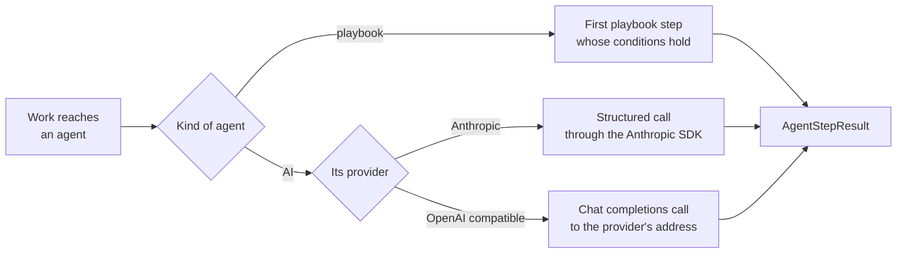

A playbook step is data: conditions (stage, text in the request, who asked) and
an outcome made of the same five parts as `AgentStepResult`. `lib/playbook.ts`
finds the first step that applies and returns its outcome. No model is called.

An AI agent's step is one model call. Both provider types are given the same
prompt and must return the same five fields. An Anthropic provider at its own
address is sent a plain Messages request with the reply format described in
the instructions, because such a service may not enforce one. For an OpenAI compatible service
the reply format is requested as a JSON schema first, then as plain JSON mode,
then with no format at all, because services differ in what they accept. An AI
agent with no working provider stops the action with a message that says which
setting is missing.

What an agent is shown is decided before the runtime is called:

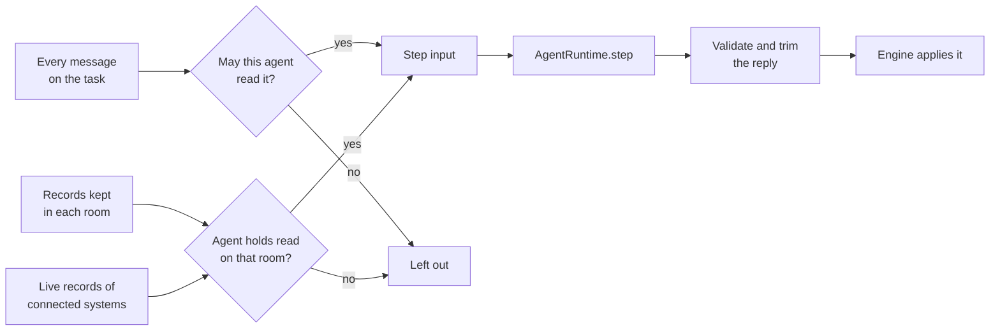

An agent without `read` on Finance never receives Finance's records or
messages, whichever kind of agent it is. If it needs them, it has to say so in
`needs`, which is what halts the task and brings a person in.

A model's reply is validated against a schema and then cleaned: rooms, people
and systems that do not exist are dropped, lists are capped and text is
trimmed.

An agent's reply may also ask for something to be done in a connected system.
The engine decides whether it happens:

```mermaid
flowchart LR
  reply["Step result<br/>with an action"] --> known{"System and operation<br/>exist, fields filled?"}
  known -->|no| drop["Dropped"]
  known -->|yes| act{"Agent holds act<br/>on the system's room?"}
  act -->|no| halt["Task halts,<br/>supervisor is asked"]
  act -->|yes| call["Server calls the system<br/>with the stored key"]
  call --> thread["Outcome written<br/>to the thread"]
  halt -->|"access granted"| again["Agent takes<br/>the step again"]
  again --> act
```

The call carries a key derived from the task and the request, so a step taken
twice places one order.

### Sign-in and sessions

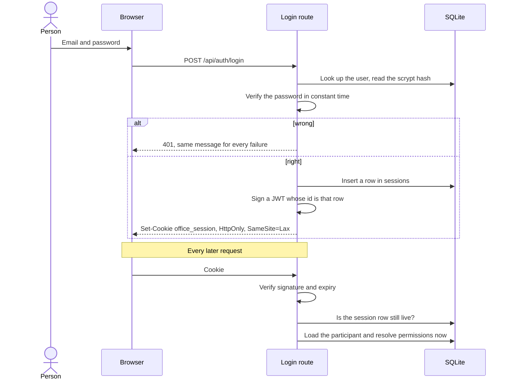

The token identifies the person and nothing else. Permissions are resolved
from the database on every request, so a role change or a revoked rule takes
effect at once. Because each token has a row in `sessions`, signing out
revokes it even though the token itself is stateless.

### Permission tokens

Every allow rule yields one token per scope: a signed statement that one
participant may use one scope on one room, optionally for one task. It is the
credential a program presents when it acts for that participant.

A token is a credential, and the access model stays the authority:

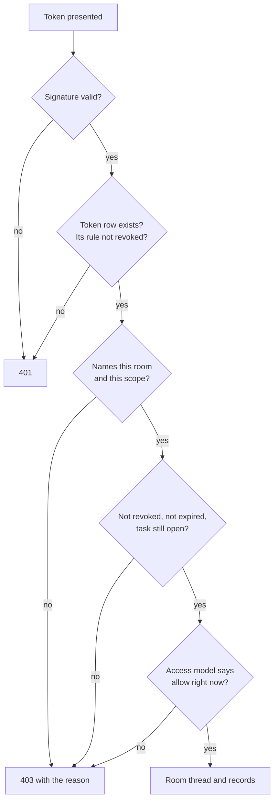

So a token stops working when its rule is revoked, when its task closes, when
it expires, when it is revoked on its own, and when a deny rule outranks it.
Vera's token from the old `r-01` rule exists and is refused for exactly that
last reason, until `r-02` is revoked.

### API

| Method and path | Who | Purpose |
| --- | --- | --- |
| `POST /api/auth/login` | anyone | Sign in with email and password |
| `POST /api/auth/demo` | anyone, when demo sign-in is on | Enter the demo office as one of its people |
| `POST /api/auth/logout` | signed in | Revoke the session |
| `GET /api/office` | signed in | The office as this viewer may see it |
| `POST /api/office/actions` | signed in | Apply one action |
| `POST /api/admin` | the permission for that change | Apply one set-up change |
| `POST /api/admin/providers` | Manage AI providers, password account | Add, change, remove or test an AI provider |
| `POST /api/admin/systems` | Manage rooms, and read on the room | Read a connected system's live records. With a password account: connect, change or disconnect one |
| `POST /api/offices` | signed in | Add an office, switch to another, or remove one. In the demo, with Manage the office: reset it |
| `POST /api/invites` | Invite people | Create a person, a desk and an invite link |
| `POST /api/invites/accept` | invite holder | Set email and password, sign in |
| `POST /api/tokens/:id` | Manage access, or holder to reveal | Reveal or revoke a permission token |
| `GET /api/rooms/:room/thread` | permission token | Read a room's records, its connected systems' live records, and its thread |

### Rendering

Rooms are axis-aligned rectangles with doors given as a wall, an offset along
it and a width. `wallSegments()` cuts each wall into boxes around its doors.
The same data feeds the 3D walls, the map and walking collision.

- Walls are 1.15 m high in the overview. Full-height walls hide every room
  behind them at any angle that shows the whole plan. On foot they rise to
  room height.
- Labels are DOM elements positioned over the canvas by projecting their 3D
  anchor each frame. They stay sharp at any zoom and need no font download.
- The opening camera distance is computed from the window size so the plan
  fits between the side panels.

## Database

SQLite, one file, 52 tables. One database holds many offices. The schema is in
third normal form:

- **Every column holds one value.** Lists such as scopes, capabilities and
  question options are rows in child tables. There are no JSON or delimited
  columns.
- **Every fact is stored once.** A desk's occupant lives only in
  `participants.desk_id`, and a room's desks only in `desks.room_id`, though
  the in-memory model carries both directions for convenience.
- **No column depends on another non-key column.** A permission token stores
  only its rule and scope. The holder and the room are read through the rule.
- **Each message kind has its own table.** The ten kinds carry different
  fields, so the shared part lives in `messages` and the rest in a detail
  table keyed by the message id.
- **A NULL room on a grant or rule means every room.**
- **Schema changes are migrations.** An older database is brought forward on
  open, one version at a time, each step in its own transaction.
- **`position` columns record order.** Rules and grants are evaluated in
  sequence and threads are read in sequence, so order is data.

The store rebuilds the engine's state from these tables and writes back only
what an action changed. The engine never mutates, so anything that is still
the same object as before is left alone.

### Office, people and access

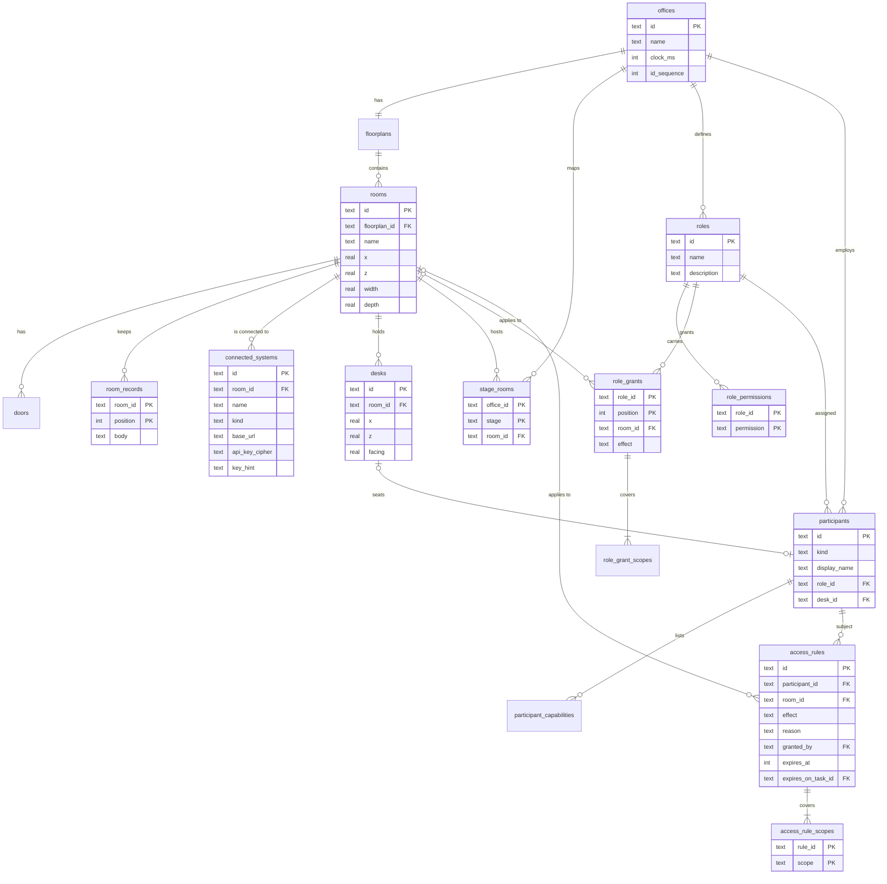

### Agents, providers and playbooks

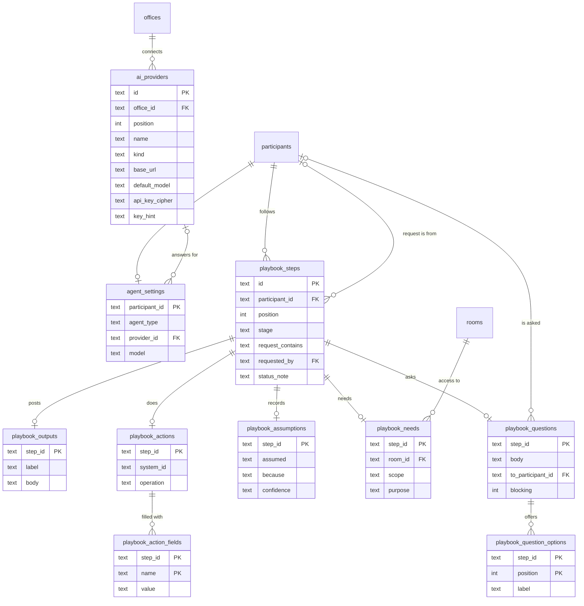

An agent's kind, provider and model live in `agent_settings`, one row per
agent. Removing a provider sets `provider_id` to NULL and leaves the agent in
place. A playbook step keeps its conditions on the step row, where a NULL
stage means any stage and a NULL `requested_by` means anyone. Each part of a
step's outcome has its own table and a row there only when the step does that
thing, so no step carries empty columns for parts it does not use. An action's
`system_id` is deliberately not a foreign key: a step keeps its action when the
system is disconnected, and skips it until a system with that id exists again.

### Work and messages

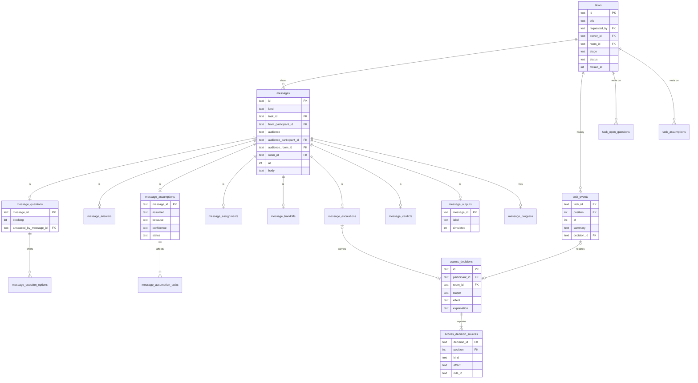

Position 0 in `access_decision_sources` is the rule that decided. The rest
lost, in precedence order. `rule_id` there has no foreign key on purpose: the
decision is kept as evidence after the rule it names has been revoked.

### Accounts, tokens and audit

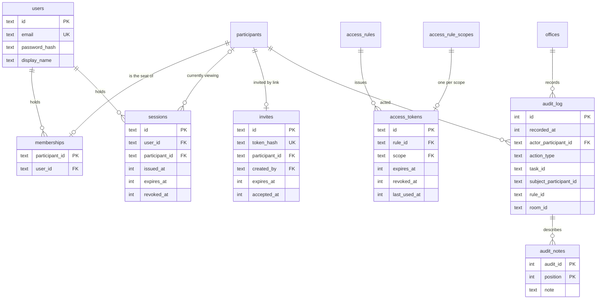

A user is a sign-in and exists apart from any office. A row in `memberships`
is that user's seat in one office: the human participant they are there. A
session points at one seat at a time, which is what selects the office a
request acts on.

The audit log is append-only. Its subject columns are plain text without
foreign keys, so an entry survives the task or rule it describes.

## Tech stack

- Next.js 16 (App Router) running as a Node server, with route handlers for
  the API.
- React 19 and TypeScript 7 in strict mode.
- three.js through @react-three/fiber and @react-three/drei.
- SQLite through Node's built-in `node:sqlite`. No native add-on to compile.
- jose for JWT signing and verification. Node's scrypt for password hashing.
- The Anthropic SDK for Anthropic providers, plain `fetch` for OpenAI
  compatible ones, and zod to validate a model's reply.
- tsx to run the check scripts under Node.
- Docker for self-hosting.

## What is functional, simulated and proposed

**Functional**

- The access resolver: precedence, conflict reporting, expiry by time or task.
- The workflow engine: handoffs, halts on permission and on questions,
  retesting blocked tasks after a rule change.
- Sign-in, sessions, sign-out, invites and password accounts.
- Server-side enforcement: per-viewer message filtering, per-action
  authorization, and a separate permission for each kind of set-up change.
- Permission tokens and the room thread endpoint they open.
- Persistence in SQLite and the audit log.
- The settings screen: rooms, people and agents, roles and permissions, access
  rules and AI providers.
- Playbook agents: the step editor, storage, and the matching of steps to
  work.
- AI agents on an OpenAI compatible provider, end to end. On the deployed
  site, two AI agents on a DeepSeek model took a quote request through every
  stage: each reply came back in 7 to 13 seconds in the expected shape, one
  agent asked for a room it could not read and the task halted until access
  was granted for that task, and the other halted at review because it could
  not read the room the answers were given in. The check scripts cover the
  same path against a stand-in service on the same machine.
- Room records edited in Settings, and connected systems. The office calls the
  two sample services over HTTP with a stored key, reads their records live,
  and places and cancels orders and shipments in them. In the demo office, the
  agent working a dealer order places it in the storefront once its halt for
  Finance is cleared, and the storefront's stock goes down. This was run on
  the deployed site: the grant on T-1001 produced order SO-1001 for six heads
  from Laval, and the storefront's stock there went from 120 to 114.
- Resetting the demo office to its seeded state, without signing anyone out.
- Answering a question by picking one of the agent's choices or by typing an
  answer.
- Several AI providers per office, each with an encrypted, write-only API key
  and a connection test.
- Many offices per account, each isolated, with adding, switching and
  removing.
- The 3D office, walking, the map.

**Simulated**

- The demo office's agents are playbook agents. Their playbooks were written
  for a dealer order of multi-zone heads and answer any request that way. The
  demo says so on its title card and on its request form.
- All business data: dealers, branches, stock, pricing tiers, people. The
  records in `lib/referenceData.ts` are invented.
- The storefront and the carrier. They are real HTTP services with keys,
  validation, refusals and repeat-safe requests, and the office talks to them
  as it would to any other. Their catalogue, stock and rates are invented, and
  they keep their data in memory: it returns to the sample state when a
  service restarts and once a day.

The stored data says which is which. Every agent is labelled as an AI agent or
a playbook agent, and every output message records whether it came from a
playbook.

**Not verified in this repository**

- A live agent step against Anthropic's own service. The Anthropic provider
  type has been run live against a compatible service at its own address,
  where two agents took a request through every stage. Against Anthropic
  itself only the connection test has been run, which correctly reported a
  rejected key. No step has been run with a working Anthropic key, because
  none was available while this was written.

**Proposed**

- Connectors for named products such as Shopify, WooCommerce or an accounting
  package. A new kind is a list of operations in `lib/systems.ts` and an
  adapter in `lib/server/systems.ts`.
- Lookups an AI agent chooses for itself during a step. Today it is shown a
  fixed snapshot of each system it may read.
- More playbook conditions, such as the answer to an earlier question.
- A drag-and-drop floorplan editor. Rooms are added today through a form.
- Workflows with a different number of stages.
- Live updates pushed to the browser. Today each browser re-reads the office
  every five seconds.

## Security

- Passwords are stored as salted scrypt hashes and compared in constant time.
  An unknown email takes as long to reject as a wrong password.
- The session is a signed JWT in an HttpOnly, SameSite=Lax cookie, marked
  Secure over HTTPS. It expires after twelve hours.
- State-changing requests are refused when their Origin header names another
  site.
- Sign-in attempts are throttled per address and email.
- Invite links and permission tokens are never stored. Only a hash of an
  invite token, and only the id of a permission token, are kept.
- Input is parsed into known actions field by field. Unknown fields never
  reach the engine.
- A provider's API key is entered in Settings, encrypted with AES-256-GCM
  under a key derived from the server's signing key, and never sent back to a
  browser. It is not written to the audit log. If the signing key changes,
  stored keys become unreadable and must be entered again.
- A provider's address is fetched by the server. Only http
  and https addresses are accepted, addresses carrying a user name or password
  are refused, and so are link-local addresses, where cloud machines keep
  their metadata service. An address on the server's own network is allowed on
  purpose, for a model served locally, so give Manage AI providers only to
  people you would trust with that.
- Each kind of set-up change needs its own permission, and nobody can grant a
  permission, or give or invite into a role, beyond what they hold.
- Offices are isolated on the server. Every request acts on the office of the
  session's seat, and ids from another office are treated as not existing.
- Demo access cannot add offices, cannot remove the demo office and cannot
  store an API key.
- The signing key comes from `AUTH_SECRET`, or is generated once and kept
  beside the database with owner-only permissions.
- The container runs as a non-root user on a read-only filesystem, with one
  writable volume for data.
- **Demo sign-in is on by default.** It lets anyone enter as a seeded person.
  That suits a public demo and nothing else. Set `DEMO_LOGIN=0` for any office
  that holds something you care about.

## Limitations

- The workflow always has the same five stages, though each office chooses
  which room hosts each one.
- A playbook's conditions are the stage, text in the request and who asked.
  An AI agent reads what its rooms and their connected systems hold and
  replies. It cannot search a system or page through it.
- A connected system is one of two kinds, each with a fixed set of
  operations. A playbook's action has fixed field values.
- A model-backed step takes several seconds, and the interface waits for it.
- Agents take a step when work arrives, and again when a halt for access is
  cleared. An agent that asked a question does not take its step again after
  the answer. The task moves on at the next advance.
- When a connected system refuses or cannot be reached, the thread says so and
  the task carries on. It does not halt.
- No password reset and no email. An administrator would issue a new invite.
- Browsers poll for changes every five seconds.
- SQLite suits one server process. More than one would need a different
  database.
- Rooms are rectangles placed against an existing room's wall. A room cannot
  be moved or resized once it exists.
- A person or agent who appears in tasks or messages cannot be removed until
  the work is cleared.
- On a phone the interface shows one section at a time, chosen from a bar at
  the bottom, and walking is unavailable because it needs a keyboard. Settings
  tables scroll sideways there.
- The demo office shows a fixed demo clock that steps forward three minutes
  per action. Other offices use real time.

## Run it

### Locally

Requires Node 24 or later, for the built-in SQLite module.

```bash
npm install
npm run dev       # http://localhost:3000
npm run verify    # type check, then all nine check scripts
npm run services  # the two sample services, on ports 8081 and 8082
npm run build     # production server in .next/standalone
```

The database is created at `./data/office.db` on first run, with the demo
office in it. Set `ADMIN_EMAIL` and `ADMIN_PASSWORD` to get an account with its
own empty office. Delete the `data` folder to start again.

Started this way the demo office has no connected systems. To give it the two
sample services, run `npm run services` in a second terminal and start the
office with `DEMO_STOREFRONT_URL=http://127.0.0.1:8081`,
`DEMO_CARRIER_URL=http://127.0.0.1:8082` and
`DEMO_SYSTEMS_KEY=local-systems-key`.

### Configuration

All optional. See `.env.example`.

| Variable | Default | Purpose |
| --- | --- | --- |
| `AUTH_SECRET` | generated and kept beside the database | Signs session and permission tokens. At least 32 characters. |
| `ADMIN_EMAIL`, `ADMIN_PASSWORD` | unset | Creates an account at start-up, with an empty office of its own. |
| `DEMO_LOGIN` | `1` | Creates the demo office and allows password-free entry to it. `0` turns that off. |
| `OFFICE_DB_PATH` | `./data/office.db` | Where the SQLite file lives. |
| `ADMIN_NAME` | taken from the email | The administrator's display name. |
| `DEMO_STOREFRONT_URL`, `DEMO_CARRIER_URL` | set by `compose.yaml` | Where the demo office finds the two sample services. Unset, the demo has no connected systems. |
| `DEMO_SYSTEMS_KEY` | `sample-systems-key` in `compose.yaml` | The key the office and the sample services share. |

### Docker

The stack is three containers. The office image runs the checks, builds the
server, and runs it as a non-root user on port 8080, with its data on a named
volume. The storefront and the carrier each run from one file with no
dependencies, also as a non-root user.

```bash
docker compose up -d --build    # http://localhost:8080
```

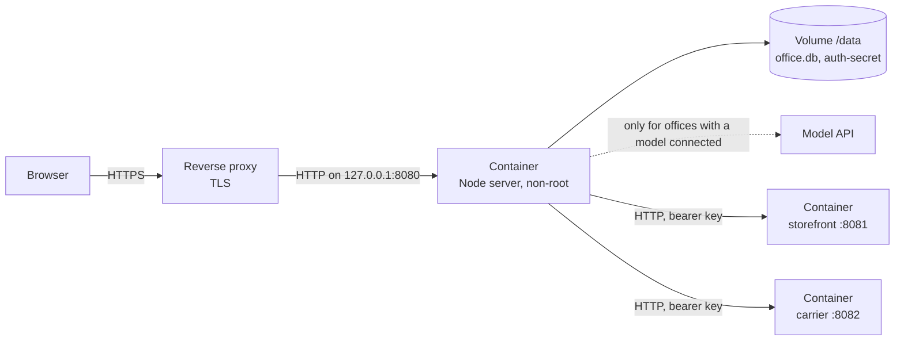

The office listens on localhost only, so a reverse proxy with TLS belongs in
front of it. The two services publish no port: only the office reaches them,
over the stack's own network. An office other than the demo can connect to
them too, at `http://storefront:8081` and `http://carrier:8082` with the value
of `DEMO_SYSTEMS_KEY`. Back up the office by copying the volume.

The deployed site runs the same three containers without compose, as three
applications in one Dokploy project that build from this repository on every
push to `main`. The office builds from `Dockerfile`. Each service builds from
`services/Dockerfile` with the build argument `SERVICE` and has `PORT` and
`API_KEY` in its environment. Neither service has a domain, so only the office
reaches them, by their internal names on Dokploy's network.

### Plesk

With the Docker extension: start the container on the server with the compose
command above, then add a Docker proxy rule on the domain that forwards `/` to
the container's published port. Plesk's nginx terminates TLS and passes the
`X-Forwarded-Proto` header, which is what marks the session cookie Secure.

A static host is no longer enough. The application needs a running server and
a disk that keeps its files, which rules out hosts that give each request a
fresh filesystem.

## Verification

Every script runs under Node and nothing leaves the machine. Six use an
in-memory database and two a temporary database file. One needs no database
and starts a stand-in model service on a local port, and one starts the two
sample services the same way.

| What | Command | Result |
| --- | --- | --- |
| Access precedence, expiry, read gating, walking through doors, desk placement | `npm run check` | 34 of 34 pass |
| A full order from request to approval, including the grant that fails | `npm run scenario` | 22 of 22 pass |
| Database round trip after every action and every set-up change, including playbooks and permissions, foreign keys, integrity | `npm run store` | 43 of 43 pass |
| Passwords, sessions and seats, policy, input parsing, per-viewer views, permission tokens | `npm run auth` | 43 of 43 pass |
| What an agent is shown, cleaning of a model's reply, and halts at review that end in a decision | `npm run agents` | 38 of 38 pass |
| Which playbook step applies, and an AI agent's calls to an OpenAI compatible service and to an Anthropic compatible one | `npm run providers` | 49 of 49 pass |
| Set-up changes, permissions, playbooks, their refusals, and an office built from nothing | `npm run admin` | 77 of 77 pass |
| Several offices in one database: isolation, several AI providers and their keys, what each permission allows, removal | `npm run offices` | 84 of 84 pass |
| The two sample services, connecting a system, live records, orders placed only with `act` on the room, and resetting the demo | `npm run systems` | 65 of 65 pass |
| Types | `npx tsc --noEmit` | clean under `--strict` |
| Production build | `npm run build` | standalone server |

`npm run verify` runs all of the above except the build. The Docker image
refuses to build unless it passes.
