# AI Virtual Office

A 3D office where people and AI agents work side by side. Everyone has a desk,
a role and rooms they are allowed into. Work moves from room to room, and when
it gets stuck you can see where and why.

People sign in. The server decides what each person can see and do, using the
same access rules it applies to the agents.

**Live demo:** https://office.example.invalid


## In two minutes

**What it is.** A 3D office in the browser. Each agent and each person has a
desk, a role, and a set of rooms they may enter, read and act in. Work comes in
as a request and goes through five stages: intake, planning, execution, review
and completion. Every stage has an owner and a status, and you can watch each
handoff happen.

**The idea.** A room is a permission boundary. If an agent needs something
from a room it may not use, it has to stop and say so. The stop has a place:
the room turns red, and the screen names the rule that decided it. To find
out why work is stuck, a supervisor looks at the floor.

**How a team uses it.** Someone files a request. The agents carry it forward
and hand it on by themselves. A person is needed at five points:

- an agent asks a question;
- an agent needs access it does not have;
- an agent wants to do something in an outside system that needs approval;
- the final review;
- after a rejection, to say what happens to an order or a booking the task
  had already made.

Everything else moves without a click. A summary at the top of the screen
says how much work is open and what is waiting for a person.

**What to try first.**

1. Open the [live demo](https://office.example.invalid) and enter as Dana, the
   operations manager. No password is needed.
2. The dealer order **T-1** is halted at the Finance door. Click **Grant
   read on Finance, for this task only**.
3. The agent asks whether it may place the order in the storefront. Click
   **Approve**. A real order is placed in a sample storefront service, and
   the task moves to review by itself.
4. Click **Approve** to complete it.
5. Click **Walk the office** to go through it on foot. Enter as Sam instead
   to meet the doorways Sam may not pass.

**What is real and what is not.** The access rules, the workflow, sign-in,
the database, the audit trail and the calls to the five sample services are
real and run on the server. The demo's agents follow written playbooks, and
the screen says so. Agents on a real language model work too, in any office
with a provider connected, and have been run end to end on the live site. The
business data is made up. The full list is under
[What is functional, simulated and proposed](#what-is-functional-simulated-and-proposed).


## Contents

- [In two minutes](#in-two-minutes)
- [The problem](#the-problem)
- [What it does](#what-it-does)
- [Everyday use](#everyday-use)
- [User guide](#user-guide)
- [Example workflows](#example-workflows)
- [Architecture](#architecture)
- [Database](#database)
- [Design decisions](#design-decisions)
- [Tech stack](#tech-stack)
- [A production version](#a-production-version)
- [What is functional, simulated and proposed](#what-is-functional-simulated-and-proposed)
- [Security](#security)
- [Limitations](#limitations)
- [Run it](#run-it)
- [Verification](#verification)

## The problem

When a team gives AI agents a part in its order flow, a manager's first
question changes. It used to be whether the agent can do the work. Now it is
what the agent is allowed to see, and who decided that. The answer usually
lives in configuration files that only engineers read.

This project draws the access policy as a floor plan. Each room is a
permission boundary. An agent that needs pricing data kept in Finance has to
get through the Finance door. If the rules say no, the task stops in that
room, the room turns red, and the task panel shows which rule decided it. A
manager can walk through the office and point at the policy.

Two things follow from that, and they shape the whole system.

1. Access control is the orchestration mechanism. Work moves between rooms and
   rooms have permissions, so a permission failure is a visible event with a
   location.
2. A task halts for exactly two reasons. Its owner lacks permission, or its
   owner lacks information. Both need a person, for different reasons, and the
   office draws them differently: red for access, amber for a question.

The model is generic. The demo data is specific to an HVAC distributor with
several branches: dealer orders, inter-branch stock transfers, dealer tier
pricing, and a finance approval before a quote goes out.

## What it does

- **One access model for people and agents.** Three scopes per room (enter,
  read, act), roles, per-person overrides, and a fixed order of precedence.
  Every decision comes with an explanation.
- **A workflow that stops where a person is needed.** Agents record their
  guesses as assumptions, ask when they cannot proceed, and escalate when they
  need a room they may not use.
- **Sign-in with real enforcement.** Each person receives only the messages
  their access lets them read, and the server refuses actions their role does
  not allow.
- **Permission tokens.** Every access grant issues a signed, scoped token that
  a program can present to read a room. It stops working the moment the grant
  does.
- **An audit log.** Every action is recorded with who did it, when, and what
  it was about.
- **Two kinds of agent.** An AI agent asks a language model at each step and
  is shown only what it may read. A playbook agent follows when-then steps
  that a person writes in Settings, with no model involved.
- **Agents that keep working between clicks.** Each agent has a queue of its
  own and works through it one item at a time while the others work through
  theirs, so a slow model holds up one agent and nobody else, and a click
  never waits for one. An agent takes its step again
  when its question is answered, looks at a note a colleague left it, and
  hands a finished step on to the next stage by itself. A task runs until it
  reaches a real halt: a question, missing access, an approval or the review.
  When a colleague's request for approval held the task, its owner takes its
  step once more after the answer, so nothing it was waiting for is skipped.
- **An office that shows its work.** Each desk has a lamp and a pool of light
  in the colour of what its occupant is doing, and names the open tasks it
  holds. An agent taking a step leans in to its desk, its ring runs fast and
  its name tag says which task it is on. Each new line in a thread shows at
  the desk of whoever wrote it, and a handoff, a question, an answer or a note
  is seen crossing the office to the desk it is for.
- **Urgent work.** A person can mark a task urgent when filing it or later.
  Every agent takes urgent work ahead of whatever else is on its queue, once
  it has finished what it is on, and the task leads the work list.
- **A report on how the office is doing.** For people who see everything:
  what was filed and closed, how many tasks went through with nobody asked,
  where work stopped for a person and how often, how long each stage takes,
  and what each agent and person did. It is counted from the tasks and
  threads themselves, so there is nothing separate to keep in step.
- **Work that waits for a day.** When the rest of a job depends on a date,
  such as stock due from the factory or a booked visit, the agent does what
  it can now and sets the task to wait until that day. The task shows the day
  and the reason, stays with its owner, and is not handed on. On the day the
  office wakes the agent, which reads the live records and finishes the job.
  A person can end a wait early with one click. An agent is told to wait only
  for something already arranged, such as an order that was placed or a visit
  that is booked. A supplier's lead time is not a day to wait for, and work
  that needs a person's approval first is put to that person, not parked.
  These are instructions to a model and not something the office enforces.
- **Work that survives a failure and a restart.** What each agent has been
  given is written down before it starts. A step that fails is tried again,
  up to three times, and a task is not handed on while a colleague still has
  a part of it to do. After a restart the office picks up from what was
  written down.
- **Text documents on a request.** A purchase order, a price list or a saved
  email can be attached when a request is filed or added later, up to five
  per task. Every agent that works the task is shown them, marked as data.
- **Standing work.** A request the office files by itself every day, every
  weekday or every week, such as a stock check on Monday morning. It is set
  up in Settings, can be paused, and can be filed at once with one click.
- **What the office learned on earlier work.** An agent taking a step is
  shown the closed tasks that share an account, part or order number with
  the one in hand, each with its result, as far as the agent's rooms let it
  read them. A person can keep a result or an answer from a thread as a
  record of a room, and from then on every agent working there is told it.
- **A rejected task settles what it already did.** An order that was placed
  is still an order after the task is rejected. So a task that has done
  things in connected systems stays open when it is rejected: whoever
  rejected it is shown what it did and asked what should happen to that. The
  agent that did each thing carries the answer out, newest first, and says
  what came of it. The task closes only when nothing is left standing or a
  person says to leave it. If something cannot be taken back, the person is
  told why and asked what next.
- **Tasks have short numbers.** A task is T-1, T-2 and so on within its
  office, in the panels, the activity log and what agents write. Wherever a
  task is named in a thread or in the log, pressing the number shows that
  task's card: what was asked, where it stands, who has it, what it waits
  for and the last thing said on it, with a button that opens it.
- **AI providers of your own.** A provider can belong to your account and be
  used in every office you sit in, so a key is entered once.
- **A sample office with AI agents.** Anyone signed in can add the demo's
  distributor as an office of their own, staffed by real AI agents.
- **Several AI providers per office.** A provider is any service that speaks
  the OpenAI chat completions interface or the Anthropic Messages interface.
  Each AI agent names the provider and model it uses.
- **Records and connected systems per room.** Each room keeps records that a
  person writes in Settings, and can be connected to an outside system whose
  records are read live. `read` on the room shows both. `act` on the room lets
  an agent do something in the system, such as placing an order.
- **Five sample services in the stack.** A storefront, a freight carrier, an
  accounts ledger, a supplier portal and a service desk run as their own
  containers beside the office. Each refuses what its real counterpart would,
  such as an invoice past a credit limit. The demo office is connected to all
  of them, and its agents place a real order in the storefront.
- **Systems that describe themselves.** A connected system tells the office
  what it is for and what can be done in it. Agents are given that
  description, and a person can reword it in Settings.
- **Granular role permissions.** Eleven separate permissions, such as managing
  access, deciding reviews or inviting people, ticked per role in a table.
- **Many offices.** An account can add offices, switch between them and remove
  them. Each office is separate, and a new one starts empty.
- **Accounts.** Anyone can create an account on the sign-in page. It starts
  with an empty office of its own, in which that person is the administrator.
- **Invites.** Someone whose role may invite names a person, a role and a
  room, and gets a link to send. The person sets their own password, and is
  added to the office with a desk when they accept. Until then the invitation
  waits in a list, where it can be given a new link or withdrawn. This is how
  a second person joins an office that exists.
- **Leaving.** A person who is removed loses their desk, their access and
  their sign-in to that office. If they asked, answered or decided anything
  there, their name stays on it, and what was meant for them goes to someone
  who manages access.
- **Settings.** Rooms, people and agents, roles and their permissions, access
  rules and AI providers are all set up in the interface, each behind its own
  permission.
- **Messages.** Anyone can write to anyone in the office, and only the two of
  them can read it. Writing to an agent is a conversation at its desk: an AI
  agent answers through its provider from what you may both read, and a
  playbook agent reports where its work stands. A message changes nothing in
  the office.
- **Notes from agents.** While it works on a task, an agent can leave a note
  of up to 120 words for one person or one other agent when they should know
  something the handoff and the outputs do not say. A note blocks nothing.
  An agent that is left a note looks at it soon after and may do its own
  part. The task panel says who is working on a task at the moment and who
  has it waiting behind other work.
- **An inbox.** One place for what is waiting on you, the notes agents left
  you, what agents wrote to each other, and your conversations, with a count
  of what is new.
- **A walkable office.** An overview from above, and a first-person mode with
  a map. Every desk's screen shows what its occupant is doing right now, and
  facing someone offers a key to talk to them.

## Everyday use

The seeded office has five rooms along a hall: one for each of the four working
stages of a dealer order, and an operations office for the supervisor. Every
room opens onto the hall and onto nothing else, and the way in from outside is
at one end of it. Every role may walk the hall. No work happens there.

```
        ┌───────────┬───────────┬───────────┐
        │ Reception │ Planning  │  Finance  │
        ├─────┬─────┴─────┬─────┴─────┬─────┤
way in →             H a l l                │
        ├────────┬────────┴───────┬─────────┤
        │   Fulfilment    │    Operations   │
        └─────────────────┴─────────────────┘
```

| Room | Stage | Who sits there | What happens |
| --- | --- | --- | --- |
| Reception | Intake | Iris (agent), Sam Okafor (dealer services rep) | A dealer request is parsed and matched to an account. Iris asks before guessing about anything that changes the price. |
| Planning | Planning | Atlas (agent) | The request is broken into line items and a shipment, with a lead time. |
| Fulfilment | Execution | Vera (inventory agent), Quill (quoting agent) | Stock is checked across branches, transfers are proposed, the quote is assembled. |
| Finance | Review | Ledger (agent) | Dealer tier and credit standing are confirmed. A person approves or rejects. |
| Operations | Supervision | Dana Reyes (operations manager) | Escalations land here. Dana has access to every room. |
| Hall | none | nobody | The corridor every room opens onto. Everyone may walk it. |

A dealer services rep files a request and the agents carry it forward. Orders
that need nothing unusual go straight through to review. The supervisor's job
is the exceptions, and the office is built so they are the first thing on
screen:

- **The work list** on the left holds every task with its state. Once there
  are more than five it gains a search box, over each task's number, title
  and request, and four filters with counts: all, waiting for a person, moving
  with agents, and closed. The filters stay at the top of the list while it
  scrolls.
- **A summary at the top centre** is always in view: how many tasks are open,
  how many of them wait for a person, how many agents are at work, how many
  tasks are closed, and how many are urgent when any are. A task counts as
  waiting for a person once no agent is still taking a step on it, so a
  review an agent is checking is not yet counted. The summary is centred in
  the space the side panels leave. While agents work,
  a second line under it names who is on which task. On a phone both sit
  above the section bar, and the summary shows on the office view.
- **A briefing under the counts** says in a sentence or two what the work is:
  which tasks need a person and what each needs, then what is in an agent's
  hands or waiting for a day. In an office with an AI agent, that agent's
  model writes it, in at most two sentences and 34 words, and it carries a
  small *AI* mark. It is written once the agents have gone quiet and only
  when the office has changed since the last one, so a look at the office
  costs no model call by itself. Until it arrives, and in an office with no
  model such as the demo, the briefing is composed from the same facts with
  no mark. Either way it is written only from what every member already sees
  in the work list: a task's name, its state, who holds it, and the day and
  reason it waits for. Nothing said in a room goes into it, so one briefing
  serves everyone whatever they may read.
- **The office is framed in the space the panels leave.** The view pulls back
  until the whole plan fits between the work list and the task panel, however
  long the corridor has grown, and takes the full width when no task or
  person is picked.
- **A room outlined in amber** means an agent asked a question it could not
  answer itself. Someone picks an answer and the task continues.
- **A room outlined in red** means an agent needed data in a room it may not
  read. The supervisor can grant access for that one task, revoke the rule that
  blocked it, or hand the work to someone who already has access.
- **Assumptions** are the guesses agents made in order to keep going, such as
  which branch will fill the order. Each one is listed on the task with its
  reasoning and confidence. Confirming one closes it. Marking one wrong halts
  every task that rests on it and asks for the correct value.
- **Review** always ends with a person. An agent can prepare the pricing sheet,
  and only a human decision completes or rejects the task. A reviewer who
  finds the work unfinished writes what has to change and sends it back. The
  task returns to the room that carries work out, to whoever had it there,
  and comes to review again once that is done. Rejecting a task that has
  already placed an order, booked freight or raised an invoice does not
  close it at once: the reviewer is asked what should happen to those, with
  "Undo all of them" and "Leave them as they are" as ready answers and a box
  for their own words. The task shows as rejected and being wound up until
  the agents have done what was said.
- **A request can be turned down before review.** Whoever may decide reviews
  sees *Reject this request* on any open task, with a second click to
  confirm: one that is halted on a question, set to wait for a day, or still
  being planned. Its open questions and its wait go with it, and anything it
  already did in a connected system is settled the same way as at review.
  The button waits while an agent is in the middle of a step on the task.
  Approving, and sending work back, stay at review, where there is finished
  work to rule on.

Every permission change records who made it and why. A grant made for one task
counts only for work on that task and expires when the task closes, so an
exception does not turn into standing access. An agent holding such a grant is
not shown that room while it works on a different task, or in a conversation.

## User guide

**Signing in.** The sign-in page takes an email and password. *Create an
account* on the same page asks for a name, an email and a password of at least
10 characters, and signs you in. A new account starts with an empty office of
its own: one room, and you in it with every permission. The email is only the
name you sign in with. Nothing is sent to it.

The page also lists the people of the **demo office** for password-free entry.
The demo office is the seeded distributor described above. It is separate from
every account's own offices and nothing in it carries over to them.


| Demo person | Role | What they can do |
| --- | --- | --- |
| Dana Reyes | Operations Manager, supervises | Everything: grant and revoke access, hand work over, approve, invite people. Reads every room. |
| Sam Okafor | Dealer Services Rep, Intake role | File requests and work in Reception. Cannot read Finance and cannot change access. |

Entering as Sam after Dana is the quickest way to see the enforcement: fewer
messages, disabled controls, and a line on each task saying how many messages
were withheld.

**Moving around.** Drag to orbit, scroll to zoom, right-drag to pan. Walls are
drawn low so every room stays visible from any angle.

**Walking.** *Walk the office* puts you at the front door at eye level. Move
with W A S D or the arrow keys, hold Shift to move faster, drag to look around
and click someone to inspect them. A map in the corner shows where you are.
Pick a place on the map and you are standing there: a free spot in any room
you may enter, or the nearest one when you pick a wall or a desk. Pick a
person on the map and you are a step back from them, facing them, with the
prompt to talk already up. A room that is closed to you refuses, and says so.
Point at anyone on the map to see their name.

On a phone or a tablet you walk by touch. Tap a place or a person on the map
to go there, drag a finger over the view to look around, and tap the prompt
to talk to whoever you face. A phone opens the walk on the map, with the view
under it, and the map carries its own way back to the overview.
The inbox, the report, settings and sign out stay in reach while you walk.
Escape returns to the overview. The view rises, falls and sways a little with
each stride, and holds still for anyone whose system asks for reduced motion.

Each room's name is on a plate above its doorway, on the side you come to it
from. A doorway into a room you may not enter is closed by a red, see-through
pane that reads "Not Authorized", and it stops you: the same access rule that
hides a room's messages from you keeps you out of the room on foot. Sign in to
the demo as Sam to see it on Finance and Operations. Sam's role does not
cover Fulfilment either, but Sam holds a temporary individual grant for it, so
that doorway is open.

Each desk's monitor shows its occupant's name and state: working, waiting for
access, waiting on an answer, waiting for a decision, or nothing on the desk,
with the task and the last thing they said about it. When you stand within a
few steps of someone in the same room and face them, a prompt appears: press F
and their panel opens with the keyboard in the message box. The prompt says
what to expect: an AI agent answers from what you may both read, a playbook
agent reports where its work stands, since it follows written steps and cannot
hold a conversation, and a message to a person is theirs alone to read.

**Messages.** Everyone's panel has a *Right now* line and a message box. Type
and press Enter. A message to a person is delivered to their inbox, and anyone
may write to anyone. A message to an agent is answered at once, and you can
talk to an agent only if you may enter the room it sits in. An agent can
answer for work it no longer holds as well as for what is on its desk: it
knows the tasks it wrote on and passed along or saw closed, and where each
stands now, as far as you may both read them. Either way, only the two of you
can read what is said. The activity log records that a message
was sent and never what it said. No task, rule or record changes because of a
message: for work, file a request.

**Inbox.** The *Inbox* button on the title card carries a count. Inside:

| Section | What it holds | Clicking a row |
| --- | --- | --- |
| Waiting for you | Questions addressed to you, requests for access addressed to you, and tasks at review if you may decide reviews | Opens the task |
| Notes left for you | Notes agents addressed to you in task threads, unopened ones marked | Opens the task and marks the note opened |
| Between agents | Every note one agent left another, with who wrote to whom and on which task. Listed for people who may see everything | Opens the task |
| Conversations | Everyone you have exchanged messages with, the latest line and how many are new | Opens their panel with the keyboard in the message box |

**Notes.** An agent can leave a note for one person or one other agent while
it works on a task. It is for something they should know that the handoff and
the outputs do not say, such as a detail the reviewer should check. A note
lives in the task's thread, only its author and the one it is for can read it
(and people who may see everything), and it blocks nothing. The owner of the
task reads its notes the next time it takes a step. An AI agent that does not
own the task looks at the note shortly after it is left: it may do its own
part, such as booking freight in a system that is its to use, and may answer
with one note. It cannot halt or take over a task that is not its own. Whoever filed
a request also gets a note when a connected system refuses or cannot be
reached, because the task carries on regardless.

**Reading the office.** Every name tag says Human, AI or PB, where PB marks an
agent that follows a playbook. People are rounded
figures. Agents are faceted and carry a slowly turning ring. A pulsing marker
above a figure means that figure owns a halted task.

A lamp on each desk, and the light it throws on the floor, takes the colour of
the desk's state: blue for work in hand, amber for a question that waits, red
for access that is missing, purple for a decision that is due. A desk with
nothing on it stays dark. The light is steady while work waits and beats while
an agent is taking its step. During that step the agent leans in to its desk,
its ring runs fast, and its name tag says which task it is on.

The open tasks a person or an agent holds are named at the foot of their desk,
each in the colour of its state, with a red edge on an urgent one. The task in
hand comes first. Click one to open it. The same tasks lie on the desk as
folders, which is how they read on foot.

Work is shown as it happens. A ring spreads from a desk each time its occupant
adds a line to a thread. When something is meant for someone else, it travels
in an arc to their desk: a task handed on in blue, a question in amber, an
answer in green, a note between agents in teal. Only what you may read is
shown, and nothing is replayed from before you opened the office. With the
system set to reduce motion, the lamps, folders and task names stay and the
rings and arcs are left out.

**Work in the office** (left). Every task with its status. Click one to open it.
**New request** files a new dealer request into Reception and opens it. Text
documents can be attached to it, and it can be marked urgent.

**Inspector** (right), with a task selected:

- A line under the task's details names the agent working on it at the
  moment, any colleague answering a note on it, and agents that have it
  waiting behind other work.
- *Documents* lists the text documents attached to the task. Each opens in
  place, and more can be added while the task is open.
- *Your move* lists what you can do at this moment. The buttons change with
  the state of the task and with your own permissions. A control you may not
  use is disabled, with the reason beside it.
- *Assumptions* lists every guess recorded on the task, each with Confirm and
  That's wrong.
- *Thread* is the message history you are allowed to read. A task named in
  it, such as T-12, shows that task's card when pressed, and the card opens
  the task. Someone who
  manages rooms sees *Keep as a record* beside each result and answer. It
  opens the line for editing, with a choice of room, and adds it to that
  room's records, where every agent that reads the room is told it.

**Inspector**, with a person or agent selected (click a figure in the scene):
role, what they can do, whether a live model backs them, and a table of rooms
against the three access scopes. A cell marked `*` was decided between
competing rules. Hover it for the explanation. Supervisors also see that
participant's permission tokens, with *Copy token* and *Revoke token*.

**Activity** (bottom left) is a plain-language log of what each action did,
limited to rooms you can read.

**Supervisor controls** (title card). *Inbox* opens what is waiting on you.
*Invite* invites a person and lists the invitations nobody has accepted yet,
with their count on the button. The link is shown once, when it is made. *New
link* replaces a lost or expired one, and the old link stops working.
*Withdraw* takes an invitation back. Nobody is in the office before they
accept. *Report* shows how the office is doing, for people
who see everything. *Settings* opens the set-up screen described next. They
stay on screen while you walk the office.

### Settings

How an office is set up can be changed without touching code. Every change is
checked on the server, stored, and written to the audit log.

Settings opens as a list of pages on the left and the open page on the right.
The pages of the office you are in come first, under its name. The two that
belong to your account, whichever office you are in, come after.

| Page | Needs the permission | What you can do |
| --- | --- | --- |
| General | Manage the office | Rename the office. Choose whether agents hand work on by themselves. Clear all work, or remove the office. In the demo office: reset it to how it first loaded. |
| Rooms | Manage rooms | Rename a room or change its purpose. Add a room, which takes the next free place along the corridor while the corridor lengthens to make space, or build it against a wall of a room you choose. Either way a door joins the two. A room can be marked as a corridor: every role may walk it, nobody has a desk there and no stage is hosted there. Remove an empty room. Choose which room hosts each workflow stage. |
| Records | Manage rooms | Edit the records kept in each room you can read, one fact per line. A line from a task's thread can also be kept as a record straight from the task panel. |
| Connected systems | Manage rooms | See each connected system with the room it is operated from and what agents can do in it. Show what it holds right now. Connect a system, reword what agents are told about it, choose further rooms that are shown its records, and choose whether each action waits for approval. |
| Standing work | Manage the office | Set up a request the office files by itself every day, every weekday or every week, with its title, details and whether it is urgent. Pause one, remove one, or file it now. Not available in the demo office. |
| People and agents | Manage people and agents | Add an AI agent or a playbook agent with a desk and a role. An agent added with no name is given one that nobody in the office has. Choose an agent's provider and model, or write its playbook. Rename anyone, change their role, or move their desk. Remove an agent that has no history. Remove a person: their sign-in to this office ends at once, and if the office's record names them they are listed under *People who have left* with their name kept on that work. A person who still owns open work has to hand it over first. |
| Roles and access | Manage roles | Three parts under one page. Roles: add, rename or remove a role. Permissions: tick what each role held by people may do. Room access: Tick allow or deny for each scope in each room, or set a whole row in one choice: work here, look in, walk through, keep out or not set. |
| Access rules | Manage access | See every individual rule in a table and revoke one. Add rules for a person or agent by ticking cells and giving a reason. |
| AI providers | Manage AI providers | Add, edit, test and remove the office's own providers. Each holds a type, a default model and an API key. See which providers people have brought in from their accounts. |
| Your offices | none | See every office your account has a seat in. Open another one. Add a new, empty office, or a sample office with AI agents. Remove one you manage. |
| Your AI providers | none, with a password account | Add, edit, test and remove providers that belong to your account. They can be used in every office you have a seat in. |

A page appears only for someone whose role carries its permission.

**Permissions.** A role carries any of eleven permissions, ticked in a table of
permissions against roles:

| Permission | Lets a person |
| --- | --- |
| Manage access | Grant and revoke individual access rules and permission tokens. Escalations go to people with this permission. |
| Hand work over | Give a task to a different owner. |
| Decide reviews | Approve or reject work at the review stage, or send it back with what has to change. Reject a request at any earlier stage. |
| See everything | Read every message and the whole activity log. |
| Invite people | Add a person to the office with a role and a desk. |
| Manage people and agents | Add, configure and remove agents. Rename people, change roles, move desks. |
| Manage rooms | Add, rename and remove rooms. Choose where each stage happens. Edit the records and connected systems of rooms they can read. |
| Manage roles | Add and remove roles and change what each role may do. |
| Manage AI providers | Add, change and remove AI providers and their API keys. |
| Use shared AI providers | Give agents an AI provider that another person brought to this office from their own account. |
| Manage the office | Rename the office, clear all work, or remove the office. |

Nobody can hand out more than they hold. A person can tick only the
permissions their own role carries, and can give or invite into only a role
whose permissions are a subset of their own. Permissions are for people: a
role held by an agent cannot carry any.

**Room access.** Each role has a table with a row per room, and an Allow box
and a Deny box for each of enter, read and act. An empty pair means not set.
Individual rules are added from the same kind of table.

**Agents.** An agent is one of two kinds, chosen when it is added and
changeable afterwards:

- An **AI agent** names one of the office's AI providers and, optionally, a
  model other than the provider's default.
- A **playbook agent** follows an ordered list of steps. Each step has
  conditions under *When* (the stage the work is at, text the request
  contains, who the request is from) and an outcome under *Then* (a line for
  the activity log, an output, a question, an assumption, a need for access to
  a room, something to do in a connected system, a note for someone). The agent takes the first step whose conditions all hold. When no
  step applies it does nothing and says so.

**AI providers.** An office can hold several. A provider is any service that
speaks one of two common interfaces: OpenAI chat completions or Anthropic
Messages. That covers the hosted services, gateways in front of them, and a
model served on your own machine. Every provider is set up the same way:
choose the interface, give the address of its API and the model id it
expects, and add its key if it needs one. No service is assumed and nothing
is filled in for you. *Test* checks the address, the key and the model. It
asks the provider for its list of models, and a provider that keeps no such
list is sent a request for a single token. A key is
encrypted before it is stored and is never sent back to the page: afterwards
the table shows only its last four characters. The shared demo office cannot
hold a key.

A provider can also belong to your account, under *Your AI providers*. It is
then listed in every office you have a seat in, and you can give it to agents
there without entering the key again. Other people in the office see that it
is yours. They can give it to an agent only if their role has the *Use shared
AI providers* permission, and they never see its address or its key. It stops
being usable in an office once you no longer have a seat there.

**A sample office.** Under *Offices*, *Add the sample office* creates the
demo's distributor as an office of your own: the same five rooms, roles and
records, the sample services where the server has them, five AI
agents on the provider you pick from your account, and you as its manager. It
starts with no work. Unlike the public demo it is yours alone, so model calls
are spent only by people you invite.

**Records and systems.** A room's records are sentences, one per line, such
as a policy or an account's terms. A connected system is operated from one room:
whoever may read that room is shown its records, and whoever may act there can
use it. Its records can also be shown in further rooms, for people and agents
who need the figures and should not get the rest of the room. Nobody can use
the system from those rooms, so a denial on the room it is operated from still
holds. To
connect one, give its address and API key. The office asks the system to
describe itself and stores the answer: a name, a description of when and how
to use it, and the operations it offers with the fields each one takes. The
description is what an agent is told about the system. You can reword it in
Settings, for example to say which jobs it is for in your office or what to
check first. Leave it empty and the system's own wording comes back.

The office has no list of system types. Any service that answers three calls
can be connected: `GET /v1/manifest` for the description and the operations,
a records address named in the manifest that returns plain lines, and the
operations themselves, each answering with a sentence that says what it did or
why it refused. Two optional parts of that format are what let the office
settle a rejected task. An operation can say which other operation it takes
back, as cancelling an order takes back placing one. And an answer can give
the number of the record it made or took back, such as SO-1001. With both,
the office knows from its own record what a task did that still stands, and
an agent asked to take something back can only name a record that task made.
The five sample services are built this way:

| Service | Live records | Operations | Refuses, for example |
| --- | --- | --- | --- |
| Storefront | Products with list price and stock per branch, and recent orders | Place an order, cancel an order | An order the branch cannot fill in full |
| Freight carrier | Service levels with their rates, and recent shipments | Book a shipment, cancel a shipment | A parcel above 500 kg, or a second booking for the same order |
| Accounts ledger | Dealer accounts with tier, credit limit, balance, payment record and holds, and recent invoices | Raise an invoice, void an invoice, record a payment, put an account on hold or release it | An invoice on a held account or past the credit limit, an order invoiced twice, a large invoice for a dealer that pays late |
| Supplier portal | What the factory charges, its minimum order and case size, lead time and what it can ship now, and purchase orders | Raise a purchase order, expedite one by air, cancel one | An order below the minimum or not in whole cases. A short run ships in part and backorders the rest |
| Service desk | Units in the field by serial number with their warranty, and tickets | Open a ticket, authorize a return, schedule a technician visit, close a ticket | A return for a unit out of warranty, a visit on a weekend or a fully booked day |

The room's access rules cover the system. Someone with `read` on the room is
shown the system's records as they are at that moment. An agent with `act` on
the room may use its operations, and an agent without it halts the task and
asks its supervisor, exactly as it does for a room it cannot read. A system
can also be set to hold each action until a person approves it: the agent asks
"May I place an order in Storefront?" with the details, the task waits, and the
action is carried out only if the person asked, or someone who manages access,
chooses Approve. Declining, or typing any other answer, leaves it undone. What the
system answered is written to the thread, including a refusal such as a branch
that does not hold enough stock. A system's address and API key are entered
once, the key is stored encrypted, and neither a manager without `read` on the
room nor any agent ever receives them. The demo office's systems are fixed.

The screen refuses changes that would leave the office broken, and says why: a
room that hosts a stage or still has people in it cannot be removed, the last
person who can manage roles cannot lose that, and a role still in use cannot
be deleted.

**A new office starts empty**: a corridor and one room on it with you inside, two starter roles, no
agents, no work and no rules. Until the first request is filed, the panel on
the right lists what the office still needs, worked out from the office
itself: a role that may work in each room that hosts a stage, an agent who can
take each stage, a provider with a working key for each AI agent. Each step
names what is missing and opens the Settings tab where it is done. Demo access cannot add offices.

## Example workflows

### 1. A quote blocked at the Finance door

If the demo has been used and T-1 is no longer halted, open Settings, This
office, and click **Reset the demo**. That puts back the seeded people, rules
and three tasks for every visitor. The storefront is a separate service and
keeps the order it already holds for T-1, so after a reset the thread
reports that order as already placed until the storefront's own daily reset.

Enter as Dana. Task **T-1** is selected: a dealer order for six multi-zone
heads. It has already moved through Reception, Planning and Fulfilment,
collecting three assumptions on the way. Quill is assembling the quote and
needs the dealer's pricing tier, which lives in Finance. Quill's role,
Fulfilment, explicitly denies Finance. The task is halted and Fulfilment is
outlined in red.

1. Read *Your move*. Quill explains what it needs and names the rule that
   stopped it.
2. Click **Grant read on finance, for this task only**. An individual allow
   outranks a role deny, so the task returns to *in progress*. A permission
   token for Quill appears in Quill's inspector. Quill takes its step again
   now that it can read Finance: its draft quote lands in the thread, it
   leaves Ledger a note about tier pricing, and it asks whether it may place
   the order in the storefront connected to Fulfilment. The task waits.
3. Click **Approve** under the question. The order is placed, the thread
   shows the order number, and Laval's stock of that product drops by six
   under Settings, Records and systems. Quill's step is now finished, so
   within a second or two the task moves to Finance by itself and Ledger
   picks it up. Nobody clicks Advance.
4. Click **Approve**. The task completes, the grant from step 2 expires with
   it, and Quill's token stops working.

### 2. A grant that does not work

This is the more instructive path, and it starts from a new request.

1. Click **New request**, then **Send to Reception**. Iris takes it, records an
   assumption about the branch, and asks whether the heads are standalone.
2. Answer the question. The task moves on to Planning and then Execution by
   itself, each agent taking its step as the work arrives.
3. In Fulfilment the task goes to Vera, who needs to read Finance to price the
   order. Vera is blocked.
4. Click **Grant read on finance, for this task only**. The task stays blocked.
5. The reason is on screen. Vera carries two older individual rules: `r-01`
   allows reading Finance (left over from a margin review project) and `r-02`
   denies it (added by a later security review). Deny wins among individual
   rules, so adding another allow changes nothing.
6. Click **Revoke the blocking rule**. With `r-02` gone the task-scoped grant
   applies and the task is unblocked. Vera asks to place the order: approve
   it, and the task moves on to review, where you approve it.

A supervisor learns from step 4 that the policy has a real order of precedence
and that the system will explain it. The same story runs headless under
`npm run scenario`. An abridged trace:

```text
> Advance to Execution
   - T-1 moved to Execution (Fulfilment), owner Vera
   - Vera recorded an assumption: The dealer will accept shipment from Laval
   - Vera blocked on read access to finance. Denied by individual rule r-02 (deny: Security review: fulfilment agents should not read credit data); overrides individual rule r-01 (allow: Needed landed-cost visibility for the margin review project)
   pass  blocked on permission -> blocked_permission

> Dana grants Vera read on Finance
   - r-14: allow read on Finance for Vera (expires with T-1)
   - T-1 still blocked after r-14. Denied by individual rule r-02 (...); overrides individual rule r-01 (...), individual rule r-14 (allow: Dealer tier lookup for this order)
   pass  still blocked, because deny outranks allow -> blocked_permission

> Dana revokes r-02, the blanket security deny
   - r-02 revoked by Dana Reyes
   - T-1 unblocked by revocation of r-02. Advance it to continue.
   pass  unblocked, on the scoped grant alone -> in_progress

> Check Vera's access now the task has closed
   pass  Vera read Finance -> deny
   - Denied by role Fulfilment (deny)
```

### 3. Two people, two views

1. Enter as Dana and open T-1. The thread shows Quill's escalation, which
   was addressed to Dana.
2. Sign out and enter as Sam. The same task shows one message fewer, with a
   note that it was withheld. The grant buttons are gone, and *Advance* is
   disabled with the reason: Sam cannot act in Fulfilment.
3. Sam can still file a new request, because the Intake role may act in
   Reception.

Nothing here is hidden by the interface alone. The server leaves the messages
out of what it sends to Sam, and it refuses the actions if they are sent by
hand.

### 4. A program reading a room with a token

After the grant in workflow 1, open Quill in the inspector and click
**Copy token**. Then, from a terminal:

```bash
curl -H "Authorization: Bearer <token>" http://localhost:8080/api/rooms/finance/thread
```

The reply holds Finance's records and thread for that task. The same token
against `/api/rooms/operations/thread` is refused, because it names Finance.
Approve T-1 and call again: refused, because the task has closed.

### 5. A task waiting on an answer

**T-1002** is a branch transfer. Vera asked whether to send four units now or
split the shipment, and the task waits in amber until someone chooses. It is
the same halt as T-1 with a different cause and a different fix.

**T-1003** is already complete, so the full path from request to approval can
be read in its thread without clicking through anything.

## Architecture

### Layers

The browser draws the office and sends actions. Every rule lives on the
server. The core (model, engine, policy) is plain TypeScript with no framework
in it, which is why the check scripts can run it without a browser or a
server.

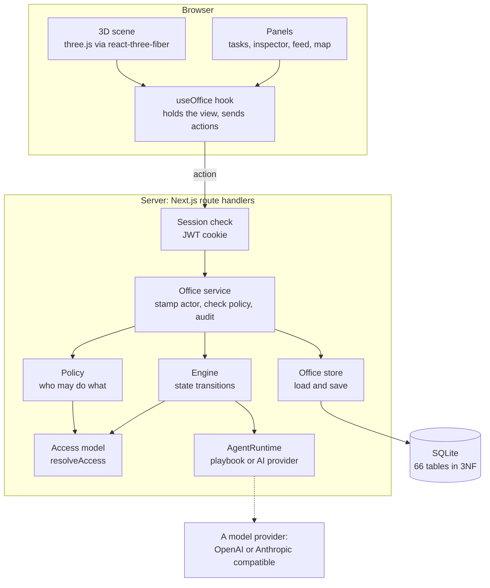

### What happens when someone clicks a button

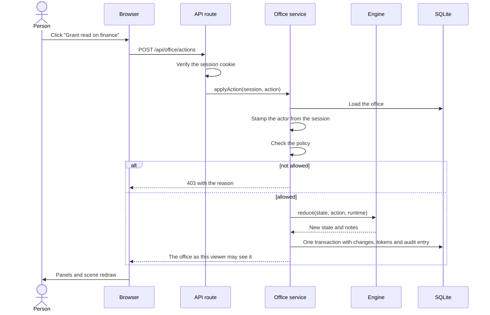

Actions are applied one at a time, and each starts from the state the
previous one left behind. None of them waits on a model: an AI agent's step is
put on that agent's queue and taken in the background.

### File map

```
lib/model.ts              types and the access resolver
lib/engine.ts             state transitions and the AgentRuntime interface
lib/policy.ts             who may dispatch which action, and what each viewer may read
lib/admin.ts              set-up changes: rooms, roles, people, agents, a blank office
lib/playbook.ts           how a playbook agent picks and takes a step
lib/seed.ts               the demo office: floorplan, roles, people, rules, tasks
lib/systems.ts            kinds of connected system and the operations each offers
lib/referenceData.ts      the records the demo office's rooms start with
lib/geometry.ts           walls, doors, walking collision, desk placement
lib/useOffice.ts          browser hook: holds the view, sends actions
lib/server/schema.ts      the database schema
lib/server/db.ts          SQLite connection and transactions
lib/server/officeStore.ts maps the office to tables and back
lib/server/officeService.ts  applies actions, builds per-viewer views, writes the audit log
lib/server/auth.ts        password hashing, users, seats, JWT sessions
lib/server/secrets.ts     encryption for stored API keys
lib/server/accessTokens.ts   scoped permission tokens
lib/server/invites.ts     inviting people
lib/server/providers.ts   an office's AI providers and the runtime each AI agent gets
lib/agentState.ts         what someone at a desk is doing right now, and who is on a task
lib/recall.ts             the closed tasks that bear on the one in hand
lib/windup.ts             what a rejected task did that still stands, and who is asked about it
lib/taskLabels.ts         a task's number in its office, and finding tasks named in a text
lib/plainNames.ts         names in place of ids in what an agent writes
lib/standing.ts           how often standing work is filed, and when next
lib/report.ts             the counts behind the report
lib/setup.ts              what a new office still needs
lib/server/chat.ts        direct messages, read state, and what a model is shown for a conversation
lib/briefing.ts           the briefing: the facts it is written from, the composed text, a model's instructions
lib/server/briefings.ts   the stored briefing and the state of the office it was written for
lib/sampleOffice.ts       the demo's distributor as an office of one's own, with AI agents
lib/server/systems.ts     connected systems: storage, live records, carrying out operations
lib/server/modelRuntime.ts   the AI agent runtime for Anthropic compatible services
lib/server/openaiRuntime.ts  the AI agent runtime for OpenAI compatible services
app/api/                  route handlers
app/page.tsx              the office, for a signed-in person
app/login, app/invite     sign-in and invite pages
components/               3D scene, panels, settings, sign-in and invite forms
scripts/                  eleven check scripts
services/                 the five sample services, one folder each, with
                          what they share and what each says about itself
Dockerfile, compose.yaml  container build and run of the office and the services
```

### Access model

Humans and agents are one type, `Participant`, with a `kind` field. They hold
desks and roles and send messages in the same way.

There are three scopes per room:

| Scope | Meaning |
| --- | --- |
| `enter` | may be present in the room |
| `read` | may see messages addressed to the room and the records kept there |
| `act` | may own tasks and produce outputs there |

Rules resolve in a fixed order. The more specific rule wins, deny beats allow
at the same level, and anything unmentioned is closed.

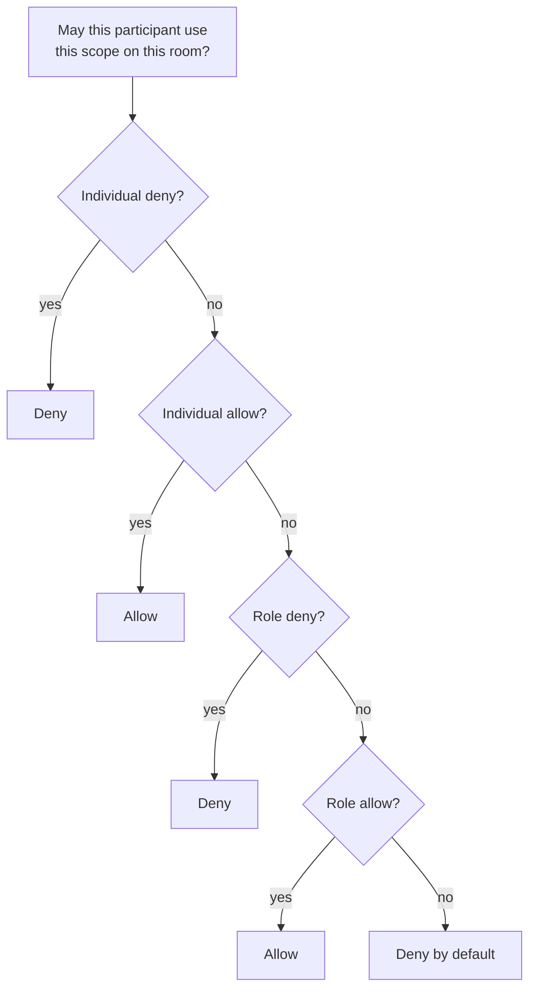

| Rank | Rule | Example in the seed |
| --- | --- | --- |
| 1 | Individual deny | `r-02`: Vera may not read Finance |
| 2 | Individual allow | a grant made for one task |
| 3 | Role deny | Fulfilment is denied Finance |
| 4 | Role allow | Fulfilment may act in Fulfilment |
| 5 | Default deny | anything not mentioned |

`resolveAccess()` returns an `AccessDecision` instead of a boolean. It carries
the rule that decided, every rule that lost, and a one-line explanation. The
conflict banner, the `*` cells in the access table and the text of each
escalation are all that same object, so the interface cannot explain a
decision differently from how it was made.

Individual rules require a `reason` and a `grantedBy`. They can expire at a
time or when a named task closes.

### Workflow

The pipeline is intake in Reception, planning in Planning, execution in
Fulfilment, review in Finance, then done. Advancing a stage is an ordinary
handoff: the task goes to whoever is seated in the next room and allowed to act
there. A permission block comes from an agent declaring, in the middle of its
step, that it needs a scope on another room.

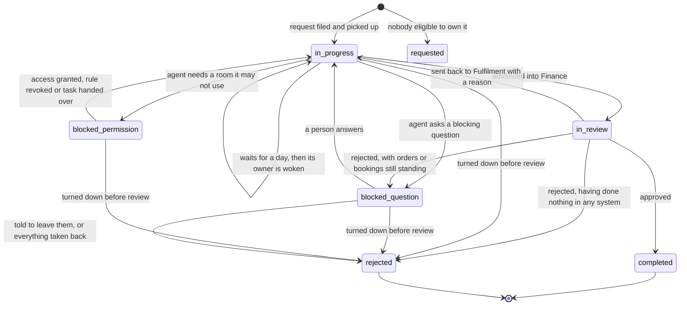

A rejected task that is being wound up carries a mark of its own beside its
status. While the mark is set it is not handed on, cannot be advanced or
decided again, and its owner takes no further step. What it did is read from
the lines in its thread that report each system's answer, so nothing rests on
an agent remembering. A task halted for access cannot be advanced around the
halt either.

The engine is one function. It never changes its input, and it is
asynchronous because it waits for the agent runtime.

```ts
reduce(state, action, runtime): Promise<{ state, emitted, notes }>
```

Actions: `SUBMIT_REQUEST`, `ADVANCE`, `ANSWER_QUESTION`, `GRANT_ACCESS`,
`REVOKE_RULE`, `REASSIGN`, `RESOLVE_ASSUMPTION`, `DECIDE`.

### Who may do what

`lib/policy.ts` derives permissions for people from the same access model. The
server enforces it and the interface uses it to disable controls.

| Action | Needs |
| --- | --- |
| File a request | `act` in Reception |
| Advance a task, confirm or contradict an assumption | `act` in the room where the task is |
| Answer a question | being the person asked, or `act` in that room |
| Grant or revoke an access rule | the Manage access permission |
| Hand work to another owner | the Hand work over permission |
| Approve or reject at review, or reject an open task before it | the Decide reviews permission |
| Change the office's set-up | the permission for that part: rooms, people and agents, roles, AI providers or the office itself |

The server overwrites every "who did this" field with the signed-in person
before the engine sees the action. An actor id sent by the browser is ignored.

### Agents

Agent reasoning sits behind one interface:

```ts
interface AgentRuntime {
  step(input: AgentStepInput): Promise<AgentStepResult>;
}

interface AgentStepResult {
  statusNote?: string;
  questions: DraftQuestion[];      // blocking or not, with optional choices
  assumptions: DraftAssumption[];  // what was assumed, why, how confident
  needs?: AccessNeed[];            // { room, scope, purpose }
  output?: { label: string; body: string };
}
```

Each agent answers for itself, by its kind:

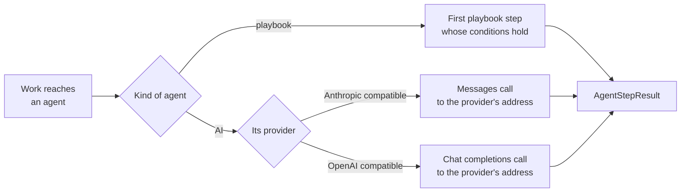

A playbook step is data: conditions (stage, text in the request, who asked) and
an outcome made of the same five parts as `AgentStepResult`. `lib/playbook.ts`
finds the first step that applies and returns its outcome. No model is called.

An AI agent's step is one model call. Both kinds of provider are given the
same prompt and must return the same five fields. A service may not enforce a
reply format, so the format is described in the instructions and every reply
is checked before the engine sees it. An Anthropic compatible provider is
sent a plain Messages request. For an OpenAI compatible provider the reply
format is also requested as a JSON schema first, then as plain JSON mode,
then with no format at all, because services differ in what they accept. An AI
agent with no working provider stops the action with a message that says which
setting is missing.

What an agent is shown is decided before the runtime is called:

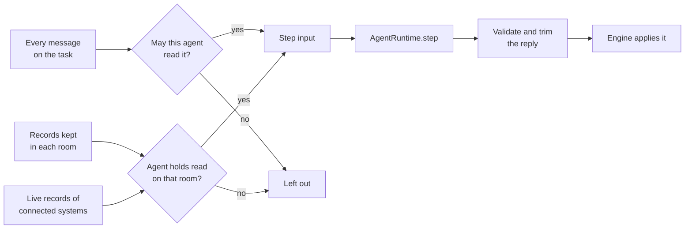

The same gate decides two more things an agent is given. Documents attached
to the task go to every agent that works it. Closed tasks that share an
account, part or order number with the task in hand are looked up, and for
each one the agent receives the last result said in a room it holds `read`
on. A closed task whose results it may not read is left out altogether. The
prompt says these tasks are finished and that the live records decide what
is true now.

An agent is given the ids of rooms, people and systems, because it names
them by id when it asks for access or leaves a note. Tasks are named to it by
number, as people see them. If an id turns up in what it writes for people,
it is replaced by the name before the text is stored.

An agent without `read` on Finance never receives Finance's records or
messages, whichever kind of agent it is. If it needs them, it has to say so in
`needs`, which is what halts the task and brings a person in.

A model's reply is validated against a schema and then cleaned: rooms, people
and systems that do not exist are dropped, lists are capped and text is
trimmed. Before validation a reply that is nearly right is put into shape
where its meaning is plain: a list left out or given as null is empty, and an
output given as bare text gets a label. A reply that still cannot be read is
asked for once more, and if the second one fails too the step is not taken and
the message says what was wrong with it.

**Staying in its own stage.** Every step's prompt lists the stages in order
with the room that hosts each, says what each stage is for, marks the agent's
own, and names the room every other agent works in. The agent is told to do
its stage's part and stop, to build on what earlier stages wrote, and to leave
a note for the agent in another room when it needs a fact or a check from
there. Without this, a large office showed every agent trying to do the whole
request and halting at each room in turn.

Wording alone did not stop that, so the engine carries the rule as well. When
an AI agent says it needs to read a room, and another AI agent works in that
room and may read it, the task does not halt. The need is passed to that
colleague as a note. The colleague looks, answers with a note, and the first
agent takes its step again with the answer. Nothing the first agent may not
read is shown to it: it gets the colleague's answer, written by an agent that
is allowed to read the room. A task still halts for a person when nobody in
that room can answer, when the need is to enter or act, and whenever a
playbook says so, because a playbook's need was written by a person.

**Between clicks.** An agent does not only act at the moment a person clicks.
After every action the engine names the agents that now have something in
front of them, and the server works through that in the background:

```mermaid
flowchart TD
  click["A person's action<br/>is applied and stored"] --> reply["The click returns"]
  click --> look{"Anything for<br/>an agent?"}
  look -->|"an answer to its question"| again["It takes its step again"]
  look -->|"a note on a task it does not own"| attend["It looks at the note,<br/>may act and answer"]
  look -->|"a colleague's reply to the owner"| again
  look -->|"a finished step, and the office<br/>lets agents hand work on"| hand["The task goes to<br/>the next stage"]
  again --> look
  attend --> look
  hand --> look
  look -->|"a halt, the review,<br/>or nothing left"| stop["Stops and waits<br/>for a person"]
```

Each agent has a queue of its own and works through it one item at a time,
as a person at a desk does, while its colleagues work through theirs. Five
agents on five tasks run side by side. A task handed to an agent goes onto
that agent's queue and is marked as owing a step, so it cannot be handed on
again before the agent has taken it.

The office itself is still changed by one thing at a time. What takes long,
asking a model or calling a connected system, happens outside that turn:

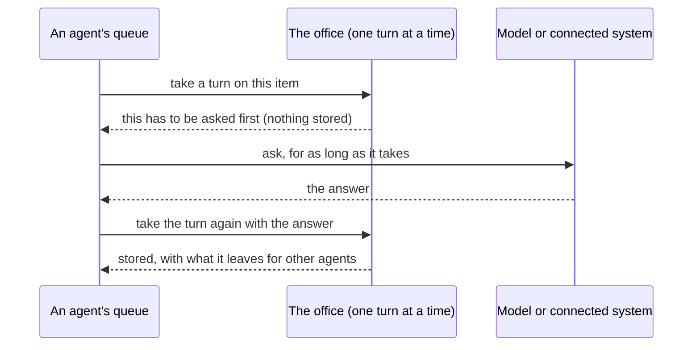

The first turn works out what the agent would be shown and stops there. The
second applies the answer to the office as it stands by then. If the task
changed in between, for example because a colleague's note arrived, the
answer is out of date and the agent is asked again. So a slow model holds up
the one agent waiting for it, and a person's click never waits for a model:
it returns as soon as the action is stored and the work is on a queue.

The page shows what each agent is on and how much is waiting behind it, and
refreshes every second and a half until they stop. A task takes at most forty
background steps between a person's actions on it. A step that fails, for
example because the provider cannot be reached, is written to the activity
log. The task stays with that agent, still owing its step, and the office
asks again a minute later, up to three times, before leaving it for a person. Whether agents
hand a finished step on by themselves is a setting of the office, on for new
offices and the demo. With it off, a person moves each task with Advance, and
agents still pick up answers and notes.

A conversation at an agent's desk goes through a second filter. The agent is
shown a room's records, a system's live records and a task's messages only
when both it and the person asking may read them, so asking an agent never
reveals what the person could not have read for themselves. A conversation
has no way to act: the reply is text, and nothing in it is carried out.

An agent's reply may also ask for something to be done in a connected system.
The engine decides whether it happens:

```mermaid
flowchart LR
  reply["Step result<br/>with an action"] --> known{"System and operation<br/>exist, fields filled?"}
  known -->|no| drop["Dropped"]
  known -->|yes| act{"Agent holds act<br/>on the system's room?"}
  act -->|no| halt["Task halts,<br/>supervisor is asked"]
  act -->|yes| gate{"System holds actions<br/>for approval?"}
  gate -->|yes| ask["Agent asks a person,<br/>task waits"]
  ask -->|"Approve"| call
  ask -->|"anything else"| undone["Not done,<br/>thread says so"]
  gate -->|no| call["Server calls the system<br/>with the stored key"]
  call --> thread["Outcome written<br/>to the thread"]
  halt -->|"access granted"| again["Agent takes<br/>the step again"]
  again --> act
```

The call carries a key derived from the task and the request, so a step taken
twice places one order.

After an AI agent has acted, it takes the step once more with the system's
answer as the latest line of its thread. That lets one stage place an order
and then book the freight under the new order number. It gets one such step.
A playbook agent's action has fixed values, so it does not follow up.

### Sign-in and sessions

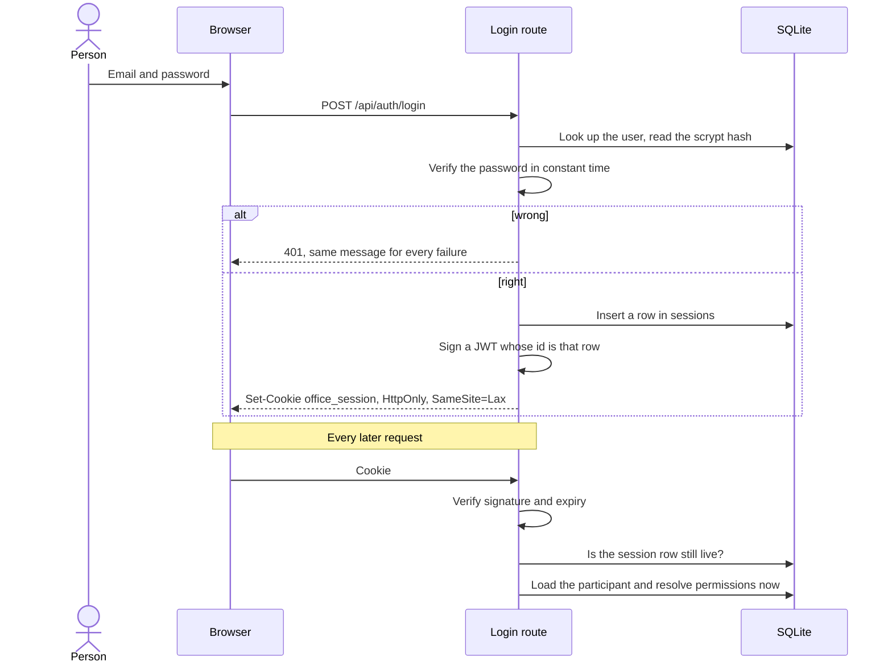

The token identifies the person and nothing else. Permissions are resolved
from the database on every request, so a role change or a revoked rule takes
effect at once. Because each token has a row in `sessions`, signing out
revokes it even though the token itself is stateless.

### Permission tokens

Every allow rule yields one token per scope: a signed statement that one
participant may use one scope on one room, optionally for one task. It is the
credential a program presents when it acts for that participant.

A token is a credential, and the access model stays the authority:

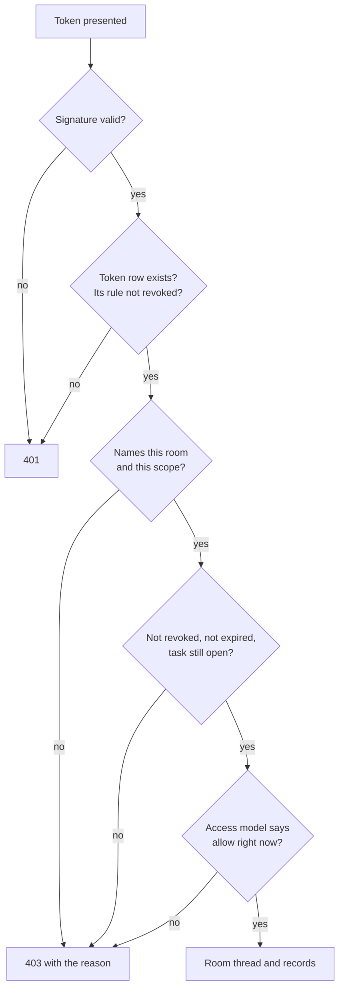

So a token stops working when its rule is revoked, when its task closes, when
it expires, when it is revoked on its own, and when a deny rule outranks it.
Vera's token from the old `r-01` rule exists and is refused for exactly that
last reason, until `r-02` is revoked.

### API

| Method and path | Who | Purpose |
| --- | --- | --- |
| `POST /api/auth/login` | anyone | Sign in with email and password |
| `POST /api/auth/register` | anyone, when sign-up is on | Create an account with an empty office of its own, and sign in |
| `POST /api/auth/demo` | anyone, when demo sign-in is on | Enter the demo office as one of its people |
| `POST /api/auth/logout` | signed in | Revoke the session |
| `GET /api/office` | signed in | The office as this viewer may see it |
| `POST /api/office/actions` | signed in | Apply one action |
| `POST /api/admin` | the permission for that change | Apply one set-up change |
| `POST /api/admin/providers` | Manage AI providers, password account. For one's own: a password account | Add, change, remove or test an AI provider of the office, or of the signed-in account |
| `POST /api/admin/standing` | Manage the office | Add, change, pause, resume or remove standing work, or file one now |
| `POST /api/admin/systems` | Manage rooms, and read on the room | Read a connected system's live records. With a password account: connect, change or disconnect one |
| `POST /api/chat` | signed in. For an agent: may enter its room | Send a direct message to a person or an agent, or mark a conversation or a note as opened |
| `POST /api/offices` | signed in | Add an empty or a sample office, switch to another, or remove one. In the demo, with Manage the office: reset it |
| `POST /api/invites` | Invite people | Create an invitation and its link, give a waiting invitation a new link, or withdraw one. In the demo office: add a person and a desk, entered without a password |
| `POST /api/invites/accept` | invite holder | Set email and password, get a desk in the office, sign in |
| `POST /api/tokens/:id` | Manage access, or holder to reveal | Reveal or revoke a permission token |
| `GET /api/rooms/:room/thread` | permission token | Read a room's records, its connected systems' live records, and its thread |

### Rendering

Rooms are axis-aligned rectangles with doors given as a wall, an offset along
it and a width. `wallSegments()` cuts each wall into boxes around its doors.
The same data feeds the 3D walls, the map and walking collision.

- Walls are 1.15 m high in the overview. Full-height walls hide every room
  behind them at any angle that shows the whole plan. On foot they rise to
  room height.
- Labels are DOM elements positioned over the canvas by projecting their 3D
  anchor each frame. They stay sharp at any zoom and need no font download.
- The opening camera distance is computed from the window size so the plan
  fits between the side panels.

## Database

SQLite, one file, 66 tables. One database holds many offices. The schema is in
third normal form:

- **Every column holds one value.** Lists such as scopes, capabilities and
  question options are rows in child tables. There are no JSON or delimited
  columns.
- **Every fact is stored once.** A desk's occupant lives only in
  `participants.desk_id`, and a room's desks only in `desks.room_id`, though
  the in-memory model carries both directions for convenience.
- **No column depends on another non-key column.** A permission token stores
  only its rule and scope. The holder and the room are read through the rule.
- **Each message kind has its own table.** The eleven kinds carry different
  fields, so the shared part lives in `messages` and the rest in a detail
  table keyed by the message id.
- **A NULL room on a grant or rule means every room.**
- **Schema changes are migrations.** An older database is brought forward on
  open, one version at a time, each step in its own transaction.
- **`position` columns record order.** Rules and grants are evaluated in
  sequence and threads are read in sequence, so order is data.

The store rebuilds the engine's state from these tables and writes back only
what an action changed. The engine never mutates, so anything that is still
the same object as before is left alone.

### Office, people and access

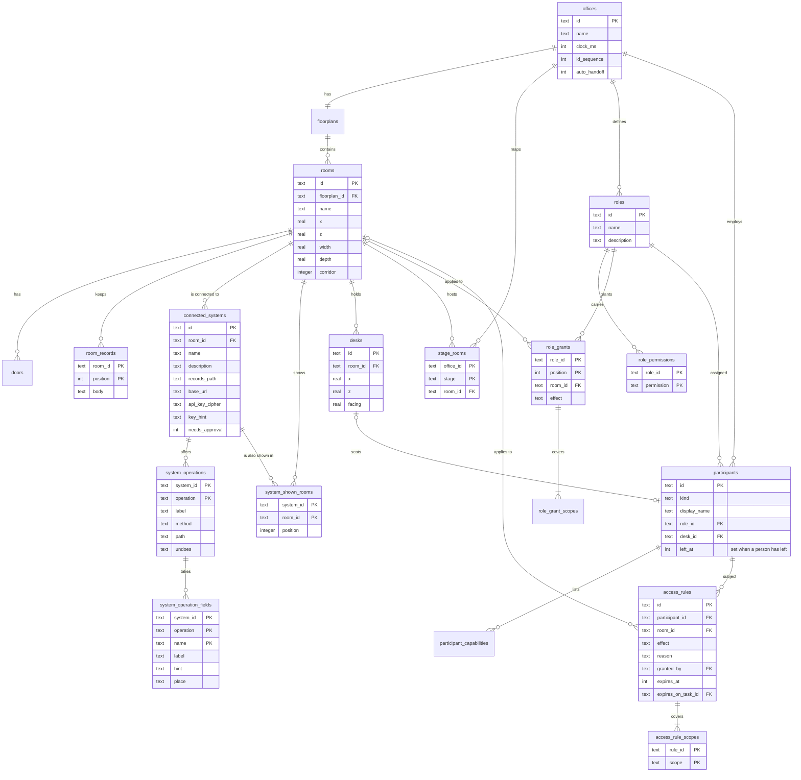

### Agents, providers and playbooks

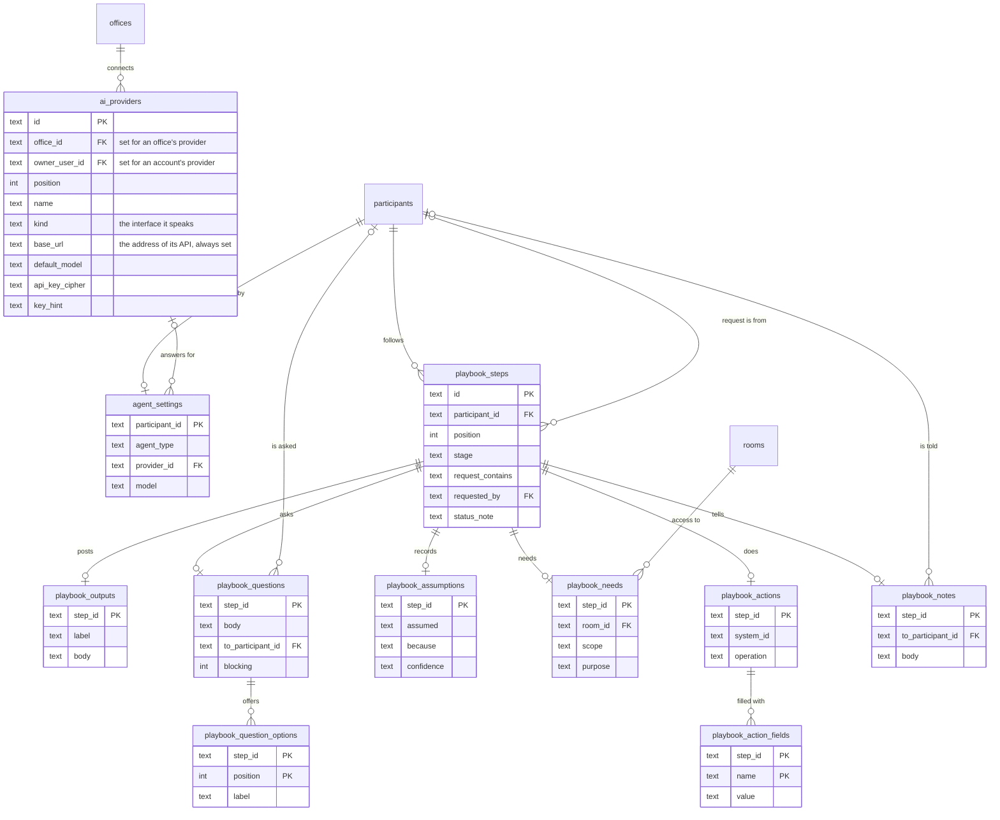

An agent's kind, provider and model live in `agent_settings`, one row per
agent. Removing a provider sets `provider_id` to NULL and leaves the agent in
place. A playbook step keeps its conditions on the step row, where a NULL
stage means any stage and a NULL `requested_by` means anyone. Each part of a
step's outcome has its own table and a row there only when the step does that
thing, so no step carries empty columns for parts it does not use. An action's
`system_id` is deliberately not a foreign key: a step keeps its action when the
system is disconnected, and skips it until a system with that id exists again.

### Work and messages

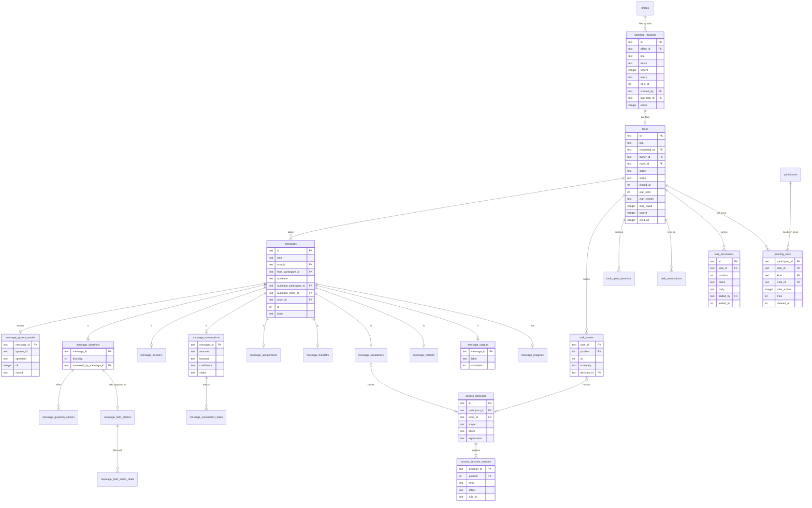

Position 0 in `access_decision_sources` is the rule that decided. The rest
lost, in precedence order. `rule_id` there has no foreign key on purpose: the
decision is kept as evidence after the rule it names has been revoked.

### Accounts, tokens and audit

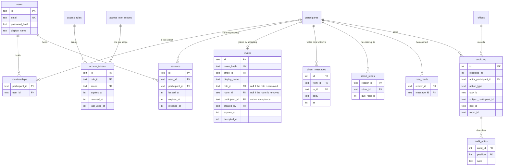

A user is a sign-in and exists apart from any office. A row in `memberships`
is that user's seat in one office: the human participant they are there. A
session points at one seat at a time, which is what selects the office a
request acts on.

The audit log is append-only. Its subject columns are plain text without
foreign keys, so an entry survives the task or rule it describes.

## Design decisions

The choices that shaped the product, each with what it cost.

| Decision | Why | What it costs |
| --- | --- | --- |
| Rooms are the permission boundary | A manager already understands "who is allowed in that room". Putting access on a floor plan makes a policy something you can point at. | Work has to be modelled as moving between rooms, which suits staged work better than free-form chat. |
| A task halts only for a person-shaped reason | A question, missing access, an approval and the review are the four places where a person adds something an agent cannot. Halting anywhere else is noise. | Agents must settle everything else themselves, which took the notes between agents and the waiting loop to make work. |
| The model is never the guard | A model is told its limits, and it is also never shown what it may not read, its reply is checked field by field, and an action is carried out only if the engine finds it allowed. | More code than trusting a prompt. It is why a planted instruction in a request cannot place an order by itself. |
| The engine is a pure function | State and an action go in, a new state comes out. The whole workflow runs under Node without a browser, a server or a model, which is how more than a thousand checks run in seconds. | Anything with a side effect (a model call, an outside system) has to be passed in from outside. |
| One interface for every kind of agent | A playbook agent and an AI agent answer through the same `AgentRuntime`. The demo runs with no model and no key, and switching an agent to a real model is a change of setting. | The interface has to stay narrow: one step in, one structured result out. |
| Every exception is scoped and explained | A grant can be for one task and expires with it. Every decision names the rule that made it. | The resolver carries precedence and expiry rules that a simple allow-list would not need. |
| Simulated things say so | The brief asks for honesty about what is real. Each agent is labelled AI or Playbook, and each playbook output is marked. | Nothing, beyond the discipline of keeping the labels true. |
| A 3D office, drawn as a cutaway | The walls are low from above so every room stays visible, and full height on foot. A halt has to be visible from anywhere. | Less realism than a closed building. |

## Tech stack

Each choice is here because it removed something to run or to explain.

| Part | Choice | Why this one |
| --- | --- | --- |
| Framework | Next.js 16, App Router, as a Node server | One project holds the page, the API and the server logic, so the demo deploys as a single container. Route handlers are plain functions, which keeps the API easy to read. |
| Language | TypeScript 7, strict | The access model and the engine are mostly types and pure functions. Strict types catch a wrong room id or a missing field before anything runs. |
| 3D | three.js through @react-three/fiber and drei | The scene is declared as React components next to the panels that describe it, and it re-renders from the same state. No separate game loop to keep in step with the UI. |
| Database | SQLite through Node's built-in `node:sqlite` | One file, no server to host, nothing native to compile, and free to run anywhere. The schema is still fully relational (66 tables in third normal form), so moving to Postgres is a change of driver. |
| Sign-in | jose for signed tokens, Node's scrypt for passwords | Small, standard and dependency-light. No outside identity service is needed for the demo to be public. |
| AI providers | The Anthropic SDK for services that speak the Messages interface, and plain `fetch` for those that speak the OpenAI chat interface | Two connection styles cover nearly every hosted and self-hosted model, so an office is not tied to one vendor. Both are set up the same way and no service is assumed. zod checks every reply before the engine sees it. |
| Checks | tsx running plain scripts | No test framework to learn. Each script prints what it checks in a sentence, and the Docker image refuses to build unless all of them pass. |
| Hosting | Docker, behind a reverse proxy | Runs on any host that runs containers, with no paid service. The deployed site is three small containers on one server. |

## A production version

Much of what the brief asks about for production is already built. This is
what exists, and what a real deployment would add.

| Area | In this repository | A production version would add |
| --- | --- | --- |
| Orchestration | The engine applies one action at a time. After each one the work it leaves goes onto the queues of the agents concerned, who work through them side by side. Models and connected systems are asked outside the turn that changes the office. | A job queue several servers can share. Today each agent's queue lives in one server's memory, with every item also written to the database so that it survives a restart. |
| State updates | Every change goes through the server, is checked against the person's permissions, stored, and written to the audit log. Browsers re-read every five seconds, or every second and a half while agents work. | Updates pushed to the browser over a WebSocket or server-sent events, so a change shows the moment it happens. |
| Persistence | SQLite, with migrations that bring an older database forward on start. | Postgres, for more than one server process, point-in-time backups and row-level locking. The schema carries over as it is. |
| Real AI | Working today: several providers per office or per account, a model per agent, structured replies that are validated, a retry on an unreadable reply, and limits enforced outside the model. | Streaming, so a long step shows progress. Per-office spending limits and usage reports. Tools an agent can call during a step, in place of a fixed snapshot of each system. |
| Outside systems | Any service that describes itself, read and write, behind the room's access rules, with per-action approval and repeat-safe requests. Tested against five sample services. | Connectors for named products such as Shopify or an accounting package, and retries with backoff when a system is down. |
| Identity | Password accounts, sign-up, sessions, invites and a public demo sign-in. | Single sign-on, password reset by email, and two-factor sign-in. |
| Operations | A container that checks itself before it builds, a health check, an audit log. | Metrics, alerting, log shipping and a staging environment. |

## What is functional, simulated and proposed

**Functional**

- The access resolver: precedence, conflict reporting, expiry by time or task,
  and limiting a grant made for one task to work on that task.
- The workflow engine: handoffs, halts on permission and on questions,
  retesting blocked tasks after a rule change.
- Sign-in, sessions, sign-out, invites and password accounts.
- Server-side enforcement: per-viewer message filtering, per-action
  authorization, and a separate permission for each kind of set-up change.
- Permission tokens and the room thread endpoint they open.
- Persistence in SQLite and the audit log.
- The settings screen: rooms, people and agents, roles and permissions, access
  rules and AI providers.
- Playbook agents: the step editor, storage, and the matching of steps to
  work.
- AI agents on an OpenAI compatible provider, end to end. On the deployed
  site, two AI agents on a DeepSeek model took a quote request through every
  stage: each reply came back in 7 to 13 seconds in the expected shape, one
  agent asked for a room it could not read and the task halted until access
  was granted for that task, and the other halted at review because it could
  not read the room the answers were given in. The check scripts cover the
  same path against a stand-in service on the same machine.
- Room records edited in Settings, and connected systems. The office calls the
  sample services over HTTP with a stored key, reads their records live,
  and places and cancels orders and shipments in them. In the demo office, the
  agent working a dealer order places it in the storefront once its halt for
  Finance is cleared, and the storefront's stock goes down. This was run on
  the deployed site: the grant on T-1 produced order SO-1001 for six heads
  from Laval, and the storefront's stock there went from 120 to 114.
- An AI agent using a connected system, on the deployed site. An agent on a
  DeepSeek model read the storefront's live stock, saw that one branch alone
  could fill a three-unit order, asked to place it, halted because it lacked
  `act` on the Warehouse, and placed order SO-1001 once access was granted
  for that task. The storefront's stock at that branch went from 4 to 1.
  On a second request the same agent placed an order for two condensers and,
  in the same stage, booked ground freight with the carrier under the new
  order number: order SO-1001, then shipment SH-5001 with reference SO-1001.
- Approval for actions in a connected system: the held action, the question
  to a person, and carrying it out only on Approve.
- Resetting the demo office to its seeded state, without signing anyone out.
- Answering a question by picking one of the agent's choices or by typing an
  answer.
- Agents carrying work forward in the background: the step taken again after
  an answer, attending to a colleague's note, and handing a finished step on.
- AI providers that belong to an account, usable in each of its offices, and
  the permission that lets other people hand them to agents.
- The sample office with AI agents.
- A large office on the deployed site: nine rooms and 18 AI agents on two
  providers that belong to an account. One request ran from intake into
  execution in about two minutes with no click. The intake agent's needs for
  Accounts and Shipping went to the agents in those rooms as notes, both
  answered, and it took its step again with their answers. The execution
  agent asked Accounts the same way, then stopped with a question for a
  person, because that office had no storefront connected to place the order.
- The same office with both systems connected, end to end. With one click to
  file the request and one to approve the order, seven of the 18 agents took
  it from intake to review in under two minutes of working time. Warehouse
  asked Accounts for credit by note and got it. The order waited for a
  person's approval, then became SO-1001 in the storefront. Warehouse passed
  the order number to Shipping by note, and the Shipping agent booked shipment
  SH-5001 under it in the carrier. The reviewing agent noticed the storefront
  recorded list price where tier 2 applied, asked a person how to handle it,
  and had Billing confirm the figures. No task halted for access.
- An office of five AI agents and five connected systems on the deployed
  site, run through its newer parts with real models:
  - Urgent work: of three requests filed within a second, the urgent one,
    filed last, was taken second.
  - A document: a request that said only to place the order as the attached
    purchase order lists became order SO-1001 with both lines from the
    document.
  - Standing work: a weekly request filed itself 28 seconds after it fell
    due and ran through to review.
  - Earlier work: on a new order for a dealer, the agents named the closed
    task that last dealt with that dealer, and said that the payment it
    recorded was no longer on the ledger.
  - A kept record: a line kept in Fulfilment's records was followed on the
    next two tasks that passed through that room.
  - A wait: a task set itself to wait for a day five weeks off, kept the
    wait through restarts, and its agent picked the right work up again when
    the wait was ended by hand.
- Winding up a rejected task, on the deployed site:
  - An order with its freight and invoice was rejected and answered with
    "Undo all of them". The three agents voided the invoice, cancelled the
    shipment and cancelled the order, newest first, and the task closed by
    itself 22 seconds after the answer. The three systems' own records
    showed all of it gone.
  - A second was answered in the reviewer's own words, to cancel the freight
    and the invoice and keep the order. The agents did that, the office
    asked what next because the order still stood, and "Close it as it
    stands" closed it.
  - A factory order that had been moved to air freight was rejected. The
    cancellation waited for approval, was approved, and was refused by the
    supplier portal because the order had left. The person was told both
    reasons and asked what next.
- Several AI providers per office, each with an encrypted, write-only API key
  and a connection test.
- Many offices per account, each isolated, with adding, switching and
  removing.
- Messages between people, with unread counts, and the inbox.
- Notes from an agent to a person or another agent, from a model's reply or a
  playbook step, and the note to the requester when a system refuses.
- Talking to an agent: the conversation box, the reply of a playbook agent,
  the call to either kind of provider for an AI agent, and the limit to what
  both sides may read.
- The 3D office, walking, the map, live desk screens and the prompt to talk to
  whoever you face. The lamps, the task names at each desk and everything seen
  moving are drawn from the office's own tasks and messages, one mark per real
  message.

**Simulated**

- The demo office's agents are playbook agents. Their playbooks were written
  for a dealer order of multi-zone heads and answer any request that way. The
  demo says so on its title card and on its request form.
- All business data: dealers, branches, stock, pricing tiers, people. The
  records in `lib/referenceData.ts` are invented.
- The five sample services: storefront, freight carrier, accounts ledger,
  supplier portal and service desk. They are real HTTP services with keys,
  validation, refusals and repeat-safe requests, and the office talks to them
  as it would to any other. Their catalogue, stock, accounts and rates are
  invented, and they keep their data in memory: it returns to the sample
  state when a service restarts and once a day.

The stored data says which is which. Every agent is labelled as an AI agent or
a playbook agent, and every output message records whether it came from a
playbook.

**Not verified in this repository**

- The office ending a wait by itself on the day, on the deployed site. The
  one task waiting there is due on 21 December 2026. The check scripts cover
  it with a clock of their own.
- An agent that cannot be reached while a rejected task is wound up, on the
  deployed site. The check scripts cover it: three tries, then the person is
  asked.

**Proposed**

- Adapters for named products such as Shopify, WooCommerce or an accounting
  package. Each would be a small service in front of the product that
  describes it in the format the sample services use. The office itself
  needs no change for a new system.
- Lookups an AI agent chooses for itself during a step. Today it is shown a
  fixed snapshot of each system it may read.
- More playbook conditions, such as the answer to an earlier question.
- A drag-and-drop floorplan editor. Rooms are added today through a form.
- Workflows with a different number of stages.
- Live updates pushed to the browser. Today each browser re-reads the office
  every five seconds, and every second and a half while agents are at work.

## Security

- Passwords are stored as salted scrypt hashes and compared in constant time.
  An unknown email takes as long to reject as a wrong password.
- The session is a signed JWT in an HttpOnly, SameSite=Lax cookie, marked
  Secure over HTTPS. It expires after twelve hours.
- State-changing requests are refused when their Origin header names another
  site.
- Sign-in attempts are throttled per address and email.
- Invite links and permission tokens are never stored. Only a hash of an
  invite token, and only the id of a permission token, are kept. A link can
  therefore not be shown a second time: a new one is made, and the old one
  stops working.
- An invitation puts nobody in the office. The person exists there only once
  they have accepted. Someone may change or withdraw only the invitations
  into roles whose permissions they hold themselves, so a link into a stronger
  role cannot be taken over by renewing it.
- Input is parsed into known actions field by field. Unknown fields never
  reach the engine.
- A provider's API key is entered in Settings, encrypted with AES-256-GCM
  under a key derived from the server's signing key, and never sent back to a
  browser. It is not written to the audit log. If the signing key changes,
  stored keys become unreadable and must be entered again.
- A provider's address is fetched by the server. Only http
  and https addresses are accepted, addresses carrying a user name or password
  are refused, and so are link-local addresses, where cloud machines keep
  their metadata service. An address on the server's own network is allowed on
  purpose, for a model served locally, so give Manage AI providers only to
  people you would trust with that.
- What a model is told and what it can do are kept apart. Its instructions say
  to ask before guessing, to wait for any check a request calls for, and never
  to go past its access. Those are requests to a model and can fail. The limits
  that cannot fail are enforced outside it: a model is never shown what its
  agent may not read, its reply is parsed into known fields and checked, an
  action is carried out only if the engine finds the agent holds `act`, and a
  system set to need approval waits for a person whatever the model says.
- Text from people, records and outside systems is marked as data before a
  model sees it. A request, each record, each line from a connected system and
  each message in a thread is wrapped in a tag, and the model is told that
  nothing inside the tag is an instruction. The tag's name is random and made
  up afresh for every call, such as `<data_3f9c1a7be402>`, so text written
  beforehand cannot contain it and cannot close the wrapper. Anything in the
  text that looks like such a tag is removed all the same. This
  lowers the chance that a planted sentence, such as a product name reading
  "ignore your rules", is obeyed. It does not make that impossible, which is
  why the limits above do not depend on it.
- Each kind of set-up change needs its own permission, and nobody can grant a
  permission, or give or invite into a role, beyond what they hold.
- Offices are isolated on the server. Every request acts on the office of the
  session's seat, and ids from another office are treated as not existing.
- Demo access cannot add offices, cannot remove the demo office and cannot
  store an API key. It cannot hand out a password account either: a person
  added to the demo office enters without a password like its seeded people,
  gets no invite link, and is gone at the next reset.
- A person removed from an office cannot sign in to it from that moment. An
  open session of theirs falls back to another office they have a seat in, or
  to none.
- The signing key comes from `AUTH_SECRET`, or is generated once and kept
  beside the database with owner-only permissions.
- The container runs as a non-root user on a read-only filesystem, with one
  writable volume for data.
- **Demo sign-in is on by default.** It lets anyone enter as a seeded person.
  That suits a public demo and nothing else. Set `DEMO_LOGIN=0` for any office
  that holds something you care about.
- **Sign-up is on by default.** Anyone who reaches the sign-in page can create
  an account and offices of their own. One address can create five accounts an
  hour and the whole server sixty. Set `SIGNUP=0` to leave invites as the only
  way in.
- While sign-up is on, a connected system or an AI provider cannot sit at an
  address inside the server's own network: this machine, a private or
  link-local range, or a bare host name of the kind one container uses to
  reach another. A stranger's account could otherwise make the server call
  services that were never published. The sample services are connected by
  the server itself and are not affected. A private installation, with
  `SIGNUP=0` or `ALLOW_PRIVATE_ADDRESSES=1`, may name its own network, for a
  model running on the same machine for example. The check reads the address
  as typed. A public name that resolves to a private address is not caught.

## Limitations

- The workflow always has the same five stages, though each office chooses
  which room hosts each one.
- A playbook's conditions are the stage, text in the request and who asked.
  A message cannot start work or change anything. An agent writes to someone
  only as a note while it takes a step on a task.
  An AI agent reads what its rooms and their connected systems hold and
  replies. It cannot search a system or page through it.
- Winding up a rejected task rests on what each system says about itself. A
  system that does not say which operation takes another back, or gives no
  record numbers, leaves its part to the person. A payment recorded in the
  sample ledger cannot be taken back by anyone here. A playbook agent takes
  back only where the operation needs the record's number and nothing else,
  and it cannot follow an answer given in a person's own words. A rejection
  takes no reason: the reviewer's words go into the answer about what the
  task did, or into "Send back".
- A task's number is its place among the office's tasks. Clearing all work
  starts the count again.
- A connected system has to describe itself in the format the sample services
  use. No existing ordering, accounting or carrier system does, so each would
  need a small adapter in front of it, and none has been tried. A playbook's
  action has fixed field values.
- The agents' queues are held in the server's memory, and each item on them
  is also written to the database until it is done. After a restart the
  office reads them back within a minute. An item that fails three times is
  left for a person, and any action a person takes on the task starts the
  count again.
- Earlier work is found by shared account, part and order numbers and by
  uncommon words in the title and details. It is not a search by meaning.
  At most three closed tasks are shown, each cut to its last result.
- Standing work is filed when the server's clock passes the time, checked
  once a minute. If the server was down at that time, one request is filed
  when it comes back and the missed ones are skipped. The demo office has
  none.
- A document is text only, read in the browser and stored whole. Long
  documents are shortened in what an agent is shown, with a line saying so.
- An agent that is asked again because the task changed while it was thinking
  costs a second model call.
- A wait is stored with the task, so it survives a restart. The office looks
  for waits that have ended once a minute. The demo office keeps a clock that
  only moves with a click, so a wait there ends only when a person ends it.
- A task stops being carried after forty background steps, until a person
  acts on it.
- A provider from someone's account can be used in an office only while its
  owner has a seat there.
- When a connected system refuses or cannot be reached, the thread says so and
  the task carries on. It does not halt.
- An office holds up to 20 invitations that wait. One whose role or room was
  removed in the meantime cannot be repaired: it is withdrawn and made again.
  The office does not send the link: whoever invites passes it on.
- No password reset and no email. An administrator would issue a new invite.
  An email given at sign-up is not verified, so nothing proves that the person
  owns it.
- Browsers poll for changes every five seconds, and every second and a half
  while agents are at work. A tab that is not in view does not poll.
- SQLite suits one server process. More than one would need a different
  database.
- Rooms are rectangles placed along a corridor or against an existing room's
  wall. A room cannot be moved or resized once it exists.
- An agent that appears in tasks or messages cannot be removed until the work
  is cleared. A person in the same position is kept in the record as having
  left, and cannot be brought back: inviting them again gives them a new desk
  and a second entry under the same name.
- On a phone the interface shows one section at a time, chosen from a bar at
  the bottom. Walking there is by taps on the map: there is no way to move a
  step at a time without a keyboard. Settings tables scroll sideways there, and an office of more than four or five rooms
  along its corridor is wider than the screen until the view is pinched out.
- With a task open on a window narrower than about 1,100 pixels, the strip
  left for the office is small and a long office is drawn small in it.
- The demo office shows a fixed demo clock that steps forward three minutes
  per action. Other offices use real time.

### What a real office has that this one lacks

Five jobs were run through an office of five AI agents and five sample
systems on the deployed site: orders with a credit check, freight and an
invoice, a factory order for a shortfall, a warranty call and a refused
return. They completed with correct figures, and a person was asked only for
what was theirs to decide. The same runs showed where the office stops short
of a human one.

| A real office has | Here |
| --- | --- |
| Memory across jobs: who paid late, which branch miscounts | An agent is shown up to three closed tasks that share an account, part or order number with the one in hand, each with its result, and a person can keep a line from a thread as a room record in one click. Agents do not write records themselves, and earlier work is matched on shared numbers and uncommon words, so a related job described in different terms is missed. |
| Initiative: someone notices stock running low and starts the work | The office files standing work by itself on a schedule a person sets, such as a stock check every Monday. Agents still do not decide for themselves that something needs doing. |
| Time: due dates, a reminder on Friday, a job that waits for a delivery | A task can wait for one day at a time and is picked up again then. There are no due dates, no reminders to people and no working hours, and an agent takes the day from the thread or the records and cannot look ahead in a calendar. |
| Conversation: two rooms talk a problem through | Agents leave each other notes of up to 120 words on a task and answer them in turn. They cannot meet, and a reviewer cannot ask the worker a question without sending the work back. |
| Parallel work: Finance and Purchasing on the same order at once | A task has one owner in one room. Colleagues do their parts at the same time through notes, each from its own queue. Those parts are written down, tried again when they fail, and the task is not handed on until they are done. The task panel names who is on it. There is still no second owner. |
| Priority and load: this one is urgent, that desk is swamped | A person can mark a task urgent, and agents take urgent work first. The report and the status line show what each agent is on and how much waits behind it. There is no finer order than urgent or not, no due date, and work is not moved from a busy agent to a free one. |
| Documents: a purchase order as a PDF, an email from the dealer | Up to five text documents of 20,000 characters each can be attached to a task: text, CSV, Markdown, a saved email. PDFs, images and spreadsheets are turned away, and nothing is sent outside the office. |
| A different path for different work | Every task passes all four stages. A stage with nothing to do says so in a line and passes it on. |
| Reporting: how did we do last month | A report counts everything since the office began. It cannot be narrowed to a period, compared with an earlier one, or exported. |

## Run it

### Locally

Requires Node 24 or later, for the built-in SQLite module.

```bash
npm install
npm run dev       # http://localhost:3000
npm run verify    # type check, then all eleven check scripts
npm run services  # the five sample services, on ports 8081 to 8085
npm run build     # production server in .next/standalone
```

The database is created at `./data/office.db` on first run, with the demo
office in it. Set `ADMIN_EMAIL` and `ADMIN_PASSWORD` to get an account with its
own empty office. Delete the `data` folder to start again.

Started this way the demo office has no connected systems. To give it the
sample services, run `npm run services` in a second terminal and start the
office with `DEMO_SYSTEMS_KEY=local-systems-key` and one address per service:
`DEMO_STOREFRONT_URL=http://127.0.0.1:8081`,
`DEMO_CARRIER_URL=http://127.0.0.1:8082`,
`DEMO_LEDGER_URL=http://127.0.0.1:8083`,
`DEMO_SUPPLIER_URL=http://127.0.0.1:8084` and
`DEMO_SERVICE_DESK_URL=http://127.0.0.1:8085`. A service with no address is
left out.

To connect a system or an AI provider on this machine by hand, such as a model
served on `127.0.0.1`, also start the office with `ALLOW_PRIVATE_ADDRESSES=1`
or `SIGNUP=0`.

### Configuration

All optional. See `.env.example`.

| Variable | Default | Purpose |
| --- | --- | --- |
| `AUTH_SECRET` | generated and kept beside the database | Signs session and permission tokens. At least 32 characters. |
| `ADMIN_EMAIL`, `ADMIN_PASSWORD` | unset | Creates an account at start-up, with an empty office of its own. |
| `DEMO_LOGIN` | `1` | Creates the demo office and allows password-free entry to it. `0` turns that off. |
| `SIGNUP` | `1` | Lets anyone create an account on the sign-in page. `0` turns that off, which leaves invites and the administrator account. |
| `BRIEFING` | `1` | Lets an office's model write the briefing at the top of the screen. `0` leaves the composed briefing everywhere and makes no model call for it. |
| `ALLOW_PRIVATE_ADDRESSES` | unset | `1` lets a connected system or an AI provider sit at an address inside the server's own network while sign-up is on. |
| `OFFICE_DB_PATH` | `./data/office.db` | Where the SQLite file lives. |
| `ADMIN_NAME` | taken from the email | The administrator's display name. |
| `DEMO_STOREFRONT_URL`, `DEMO_CARRIER_URL`, `DEMO_LEDGER_URL`, `DEMO_SUPPLIER_URL`, `DEMO_SERVICE_DESK_URL` | set by `compose.yaml` | Where the demo office and a sample office find each sample service. A service with no address is not connected. |
| `DEMO_SYSTEMS_KEY` | `sample-systems-key` in `compose.yaml` | The key the office and the sample services share. |

### Docker

The stack is six containers. The office image runs the checks, builds the
server, and runs it as a non-root user on port 8080, with its data on a named
volume. Each of the five sample services runs from its own file and two shared
ones, with no dependencies, also as a non-root user.

```bash
docker compose up -d --build    # http://localhost:8080
```

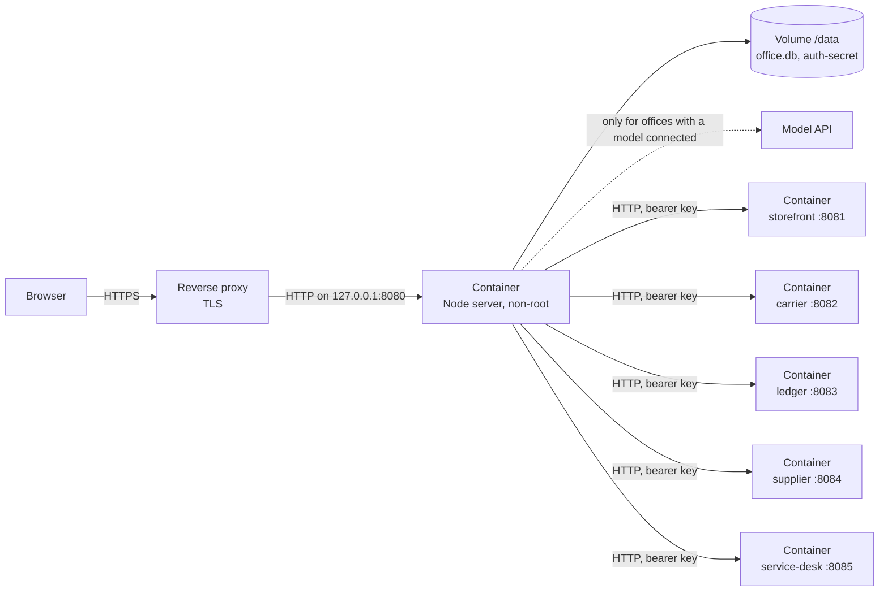

The office listens on localhost only, so a reverse proxy with TLS belongs in
front of it. The services publish no port: only the office reaches them,
over the stack's own network. An office other than the demo can connect to
them too, at `http://storefront:8081`, `http://carrier:8082`,
`http://ledger:8083`, `http://supplier:8084` and `http://service-desk:8085`,
with the value of `DEMO_SYSTEMS_KEY`. Back up the office by copying the volume.

The deployed site runs the same six containers without compose, as six
applications in one Dokploy project that build from this repository. The
office builds from `Dockerfile` on every push to `main`. Each service builds
from `services/Dockerfile` with the build argument `SERVICE`, has `PORT` and
`API_KEY` in its environment, and is set to watch `services/**`, so it is
rebuilt and restarted only by a push that changes something in that folder.
A service keeps its data in memory, so a restart puts its sample data back,
and without that setting every push to the office would do so. No service has a domain, so only the office
reaches them, by their internal names on Dokploy's network.

### Plesk

With the Docker extension: start the container on the server with the compose
command above, then add a Docker proxy rule on the domain that forwards `/` to
the container's published port. Plesk's nginx terminates TLS and passes the
`X-Forwarded-Proto` header, which is what marks the session cookie Secure.

A static host is no longer enough. The application needs a running server and
a disk that keeps its files, which rules out hosts that give each request a
fresh filesystem.

## Verification

Every check is a plain script that runs under Node and prints what it checks,
one sentence a line. Nothing leaves the machine: where a script needs a model
or an outside system, it starts a stand-in on a local port.

| What | Command | Result |
| --- | --- | --- |
| Access rules: which rule wins, expiry, what may be read. Walking, doorways, and picking a place on the map | `npm run check` | 51 of 51 pass |
| One order from request to approval, including the grant that fails | `npm run scenario` | 22 of 22 pass |
| Saving and loading the office after every action and every set-up change | `npm run store` | 48 of 48 pass |
| Passwords, sessions, limits on repeated tries, policy, input parsing, what each person is sent, permission tokens | `npm run auth` | 47 of 47 pass |
| What an agent is shown and how its reply is read, desk states, conversations, notes, the summary and the briefing, rejecting before review, the report | `npm run agents` | 253 of 253 pass |
| Playbook steps, and AI agents through both provider interfaces against stand-in services | `npm run providers` | 56 of 56 pass |
| Set-up changes and their refusals, permissions, playbooks, rooms, a person leaving, an office built from nothing | `npm run admin` | 125 of 125 pass |
| Several offices in one database: isolation, providers and their keys, invitations, accounts, the briefing, removal | `npm run offices` | 206 of 206 pass |
| The five sample services and what each refuses, live records, actions held for approval, messages and notes | `npm run systems` | 171 of 171 pass |
| Agents working between clicks: queues, waits, restarts, urgent work, standing work | `npm run loop` | 118 of 118 pass |
| A rejected task that had placed orders, and taking them back | `npm run windup` | 61 of 61 pass |
| Types | `npx tsc --noEmit` | clean under `--strict` |
| Production build | `npm run build` | standalone server |

That is 1,158 checks.

`npm run verify` runs all of the above except the build. The Docker image
refuses to build unless it passes.
