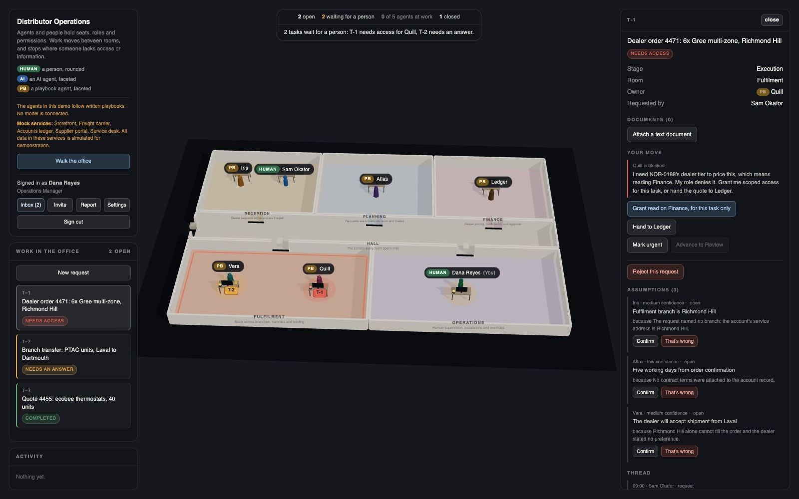

# AI Virtual Office

A 3D office where people and AI agents hold desks, roles and room permissions.
Work moves from room to room and stops at the point where its owner lacks
access or information, so a supervisor can see where to step in and why.



## The problem

When a team adds AI agents to its order flow, the question a manager has to
answer changes. Whether the agent can do the work matters less than what the
agent is allowed to see, and who decided that. Today the answer usually sits in
configuration files that only engineering reads.

This project puts the access policy on a floor plan. Every room is a permission
boundary. An agent that needs pricing data held in Finance has to get through
the Finance door. When the rules say no, the task stops in the room where it
happened, the room turns red, and the inspector shows which rule decided it. A
manager can walk through the office and point at the policy.

Two consequences shape the whole system.

1. Access control is the orchestration mechanism. Work moves between rooms and
   rooms have permissions, so a permission failure is a visible event with a
   location.
2. A task halts for exactly two reasons. Its owner lacks permission, or its
   owner lacks information. Both need a person, for different reasons, and the
   office draws them differently: red for access, amber for a question.

The model is generic. The demo data is specific to an HVAC distributor with
several branches: dealer orders, inter-branch stock transfers, dealer tier
pricing, and a finance approval before a quote goes out.

## Everyday use

The seeded office has five rooms: one for each of the four working stages of a
dealer order, and an operations office for the supervisor.

| Room | Stage | Who sits there | What happens |
| --- | --- | --- | --- |
| Reception | Intake | Iris (agent), Sam Okafor (dealer services rep) | A dealer request is parsed and matched to an account. Iris asks before guessing about anything that changes the price. |
| Planning | Planning | Atlas (agent) | The request is broken into line items and a shipment, with a lead time. |
| Fulfilment | Execution | Vera (inventory agent), Quill (quoting agent) | Stock is checked across branches, transfers are proposed, the quote is assembled. |
| Finance | Review | Ledger (agent) | Dealer tier and credit standing are confirmed. A person approves or rejects. |
| Operations | Supervision | Dana Reyes (operations manager) | Escalations land here. Dana has access to every room. |

A dealer services rep files a request and the agents carry it forward. Orders
that need nothing unusual go straight through to review. The supervisor's job
is the exceptions, and the office is built so they are the first thing on
screen:

- **A room outlined in amber** means an agent asked a question it could not
  answer itself. Someone picks an answer and the task continues.
- **A room outlined in red** means an agent needed data in a room it may not
  read. The supervisor can grant access for that one task, revoke the rule that
  blocked it, or hand the work to someone who already has access.
- **Assumptions** are the guesses agents made in order to keep going, such as
  which branch will fill the order. Each one is listed on the task with its
  reasoning and confidence. Confirming one closes it. Marking one wrong halts
  every task that rests on it and asks for the correct value.
- **Review** always ends with a person. An agent can prepare the pricing sheet,
  and only a human decision completes or rejects the task.

Every permission change records who made it and why. A grant made for one task
expires when that task closes, so an exception does not turn into standing
access.

## User guide

**Moving around.** Drag to orbit, scroll to zoom, right-drag to pan. Walls are
drawn low so every room stays visible from any angle.

**Walking.** *Walk the office* puts you at the front door at eye level. Move
with W A S D or the arrow keys, hold Shift to move faster, drag to look around
and click someone to inspect them. A map in the corner shows where you are.
Escape returns to the overview.

**Reading the office.** Every name tag says Human or AI. People are rounded
figures. Agents are faceted and carry a slowly turning ring. A pulsing marker above a figure means that figure owns a
halted task.

**Work in the office** (left). Every task with its status. Click one to open it.
**New request** files a new dealer request into Reception and opens it.

**Inspector** (right), with a task selected:

- *Your move* lists what a supervisor can do at this moment. The buttons change
  with the state of the task: answer options for an open question, access
  options for a permission block, Approve and Reject at review, and Advance
  otherwise.
- *Assumptions* lists every guess recorded on the task, each with Confirm and
  That's wrong.
- *Thread* is the full message history: requests, questions, answers,
  handoffs, escalations, decisions and outputs.

**Inspector**, with a person or agent selected (click a figure in the scene):
role, what they can do, whether a live model backs them, and a table of rooms
against the three access scopes. A cell marked `*` was decided between
competing rules. Hover it for the explanation. Vera loads with one such
conflict, shown as a banner.

**Activity** (bottom left) is a plain-language log of what each action did.

## Example workflow

### 1. A quote blocked at the Finance door

The office loads with task **T-1001** selected: a dealer order for six
multi-zone heads. It has already moved through Reception, Planning and
Fulfilment, collecting three assumptions on the way. Quill is assembling the
quote and needs the dealer's pricing tier, which lives in Finance. Quill's
role, Fulfilment, explicitly denies Finance. The task is halted and Fulfilment
is outlined in red.

1. Read *Your move*. Quill explains what it needs and names the rule that
   stopped it.
2. Click **Grant read on finance, for this task only**. An individual allow
   outranks a role deny, so the task returns to *in progress*.
3. Click **Advance to Review**. The task moves to Finance and Ledger picks it
   up.
4. Click **Approve**. The task completes, and the grant from step 2 expires
   with it. Quill is back to being denied Finance.

### 2. A grant that does not work

This is the more instructive path, and it starts from a new request.

1. Click **New request**, then **Send to Reception**. Iris takes it, records an
   assumption about the branch, and asks whether the heads are standalone.
2. Answer the question, then advance to Planning and on to Execution.
3. In Fulfilment the task goes to Vera, who needs to read Finance to price a
   transfer. She is blocked.
4. Click **Grant read on finance, for this task only**. The task stays blocked.
5. The reason is on screen. Vera carries two older individual rules: `r-01`
   allows her to read Finance (left over from a margin review project) and
   `r-02` denies it (added by a later security review). Deny wins among
   individual rules, so adding another allow changes nothing.
6. Click **Revoke the blocking rule**. With `r-02` gone the task-scoped grant
   applies and the task is unblocked. Advance it to review and approve.

A supervisor learns from step 4 that the policy has a real order of precedence
and that the system will explain it. The same story runs headless under
`npm run scenario`. An abridged trace:

```text
> Advance to Execution
   - T-1 moved to Execution (fulfilment), owner Vera
   - Vera recorded an assumption: The dealer will accept a split-origin shipment
   - Vera blocked on read access to finance. Denied by individual rule r-02 (deny: Security review: fulfilment agents should not read credit data); overrides individual rule r-01 (allow: Needed landed-cost visibility for the margin review project)
   pass  blocked on permission -> blocked_permission

> Dana grants Vera read on Finance
   - r-14: allow read on finance for Vera (expires with T-1)
   - T-1 still blocked after r-14. Denied by individual rule r-02 (...); overrides individual rule r-01 (...), individual rule r-14 (allow: Dealer tier lookup for this order)
   pass  still blocked, because deny outranks allow -> blocked_permission

> Dana revokes r-02, the blanket security deny
   - r-02 revoked by Dana Reyes
   - T-1 unblocked by revocation of r-02. Advance it to continue.
   pass  unblocked, on the scoped grant alone -> in_progress

> Dana approves
   - T-1 approved by Dana Reyes
   pass  completed -> completed

> Check Vera's access now the task has closed
   pass  Vera read Finance -> deny
   - Denied by role Fulfilment (deny)
```

### 3. A task waiting on an answer

**T-1002** is a branch transfer. Vera asked whether to send four units now or
split the shipment, and the task waits in amber until someone chooses. It is
the same halt as T-1001 with a different cause and a different fix.

**T-1003** is already complete, so the full path from request to approval can
be read in its thread without clicking through anything.

## Architecture

```
lib/model.ts        types and the access resolver
lib/engine.ts       workflow reducer and the AgentRuntime interface
lib/seed.ts         the demo office: floorplan, roles, people, rules, tasks
lib/geometry.ts     floorplan rectangles to wall segments
lib/useOffice.ts    React binding over the reducer
components/         3D scene (Scene, RoomMesh, Desk, Figure) and the panels
app/                Next.js page that composes scene and panels
scripts/check.ts    30 checks on access precedence and walking the plan
scripts/scenario.ts 22 checks on a full workflow
Dockerfile          two-stage image: build and check, then nginx
docker/nginx.conf   static file server config
compose.yaml        one service, published on localhost:8080
```

`model.ts`, `seed.ts` and `engine.ts` import neither React nor three.js. The
whole simulation runs under Node with no browser, which is how both check
scripts work. The 3D scene and the panels are two renderers over the same
state.

### Access model

Humans and agents are one type, `Participant`, with a `kind` field. They hold
desks and roles and send messages in the same way. In the seed a human, Sam,
carries a time-limited individual rule, so the same code path serves both.

There are three scopes per room:

| Scope | Meaning |
| --- | --- |
| `enter` | may be present in the room |
| `read` | may see messages addressed to the room |
| `act` | may own tasks and produce outputs there |

Messages are addressed to rooms, so `read` governs information as well as
movement. A participant who cannot read Finance cannot see the Finance thread.

Rules resolve in this order, highest first:

| Rank | Rule | Example in the seed |
| --- | --- | --- |
| 1 | Individual deny | `r-02`: Vera may not read Finance |
| 2 | Individual allow | a grant made for one task |
| 3 | Role deny | Fulfilment is denied Finance |
| 4 | Role allow | Fulfilment may act in Fulfilment |
| 5 | Default deny | anything not mentioned |

The more specific rule wins, deny beats allow at the same level, and anything
unmentioned is closed.

`resolveAccess()` returns an `AccessDecision` instead of a boolean. It carries
the rule that decided, every rule that lost, and a one-line explanation. The
conflict banner, the `*` cells in the access table and the text of each
escalation are all that same object, so the UI cannot explain a decision
differently from how it was made.

Individual rules require a `reason` and a `grantedBy`. They can expire at a
time or when a named task closes.

### Workflow engine

The engine is a pure function:

```ts
reduce(state, action, runtime) -> { state, emitted, notes }
```

The pipeline is intake in Reception, planning in Planning, execution in
Fulfilment, review in Finance, then done. Advancing a stage is an ordinary
handoff: the task goes to whoever is seated in the next room and allowed to act
there. A permission block comes from an agent declaring, in the middle of its
step, that it needs a scope on another room. The engine resolves that need
against the access model and halts the task if the answer is deny. After any
rule change, every blocked task is tested again against the decision that
stopped it.

Actions: `SUBMIT_REQUEST`, `ADVANCE`, `ANSWER_QUESTION`, `GRANT_ACCESS`,
`REVOKE_RULE`, `REASSIGN`, `RESOLVE_ASSUMPTION`, `DECIDE`.

### Where a real model plugs in

Agent reasoning sits behind one interface:

```ts
interface AgentRuntime {
  readonly kind: "scripted" | "model";
  step(input: AgentStepInput): AgentStepResult;
}

interface AgentStepResult {
  statusNote?: string;
  questions: DraftQuestion[];      // blocking or not, with optional choices
  assumptions: DraftAssumption[];  // what was assumed, why, how confident
  needs?: AccessNeed[];            // { room, scope, purpose }
  output?: { label: string; body: string };
}
```

The demo ships `ScriptedRuntime`, a lookup table keyed by participant and
stage. It returns the same result every run, which keeps the walkthrough
repeatable. A runtime backed by a language model would implement the same
`step` method and return the same five fields. The reducer, the access checks
and the UI would not change.

### Rendering

Rooms are axis-aligned rectangles with doors given as a wall, an offset along
it and a width. `wallSegments()` cuts each wall into boxes around its doors.

- Walls are 1.15 m high. Full-height walls hide every room behind them at any
  angle that shows the whole plan, so the office is drawn as a cutaway model.
- Labels are DOM elements positioned over the canvas. They stay sharp at any
  zoom and need no font download at runtime.
- The opening camera distance is computed from the window size so the plan
  fits between the side panels.

## Tech stack

- Next.js 14 (App Router) with static export. The deployed site is plain files
  with no server code.
- React 18 and TypeScript in strict mode.
- three.js through @react-three/fiber and @react-three/drei.
- tsx to run the two check scripts under Node.
- Docker with nginx for self-hosting.

There is no backend, database or external service.

## What is functional, simulated and proposed

**Functional**

- The access resolver, including precedence, conflict reporting and expiry by
  time or by task.
- The workflow engine: handoffs between rooms, halts on permission and on
  questions, retesting blocked tasks after a rule change.
- Every supervisor action in the inspector: answer, grant, revoke, hand over,
  confirm or contradict an assumption, approve, reject, and filing a new
  request.
- The 3D office, generated from the floorplan data.
- Message threads and the activity log.

**Simulated**

- All agent reasoning. Every agent's status notes, questions, assumptions,
  access needs and outputs come from a fixed script. An agent will respond to
  any new request as if it were a dealer order for multi-zone heads.
- All business data: dealers, branches, stock, pricing tiers, people.

The simulation is marked in the data as well as on screen. `Participant.backing`
is `{ provider, model }` or `null`, where `null` means simulated, and every
output message carries a required `simulated` flag. The inspector reads those
fields to label an agent.

**Proposed**

- A model-backed `AgentRuntime`.
- Persistence, so an office survives a reload and keeps an audit trail.
- Sign-in and multiple viewers, with threads filtered by each viewer's own
  access.
- A visual floorplan and policy editor.
- Connectors to real systems such as the storefront, inventory and accounting.

## Limitations

- State lives in memory and resets on reload.
- There is no sign-in. The viewer acts as Dana, the operations manager.
- The floorplan is data, edited in `lib/seed.ts`. There is no editor for it.
- One office with one fixed pipeline of five stages.
- The layout targets desktop screens. Panels overlap on a phone.
- Tasks change rooms instantly. Nothing animates the handoff.
- The time shown in the office is a fixed demo clock that steps forward three
  minutes per action.

## Run it locally

Requires Node 18.17 or later.

```bash
npm install
npm run dev       # http://localhost:3000
npm run verify    # type check, then both check scripts
npm run build     # static site in ./out
```

## Deploy

The build output in `./out` is a folder of static files, so any web server can
host it.

**Vercel.** Import the repository. No settings are needed.

**Docker.** The image builds the site, runs the checks, and serves the result
with nginx as a non-root user on port 8080.

```bash
docker compose up -d --build    # http://localhost:8080
```

Set `OFFICE_PORT` to publish on a different host port. The container listens
on localhost only, so put a reverse proxy with TLS in front of it on a server.

**Plesk.** Two options:

- Without Docker: run `npm run build` and upload the contents of `out/` to the
  domain's `httpdocs` folder.
- With the Docker extension: start the container on the server with the
  compose command above, then add a Docker proxy rule on the domain that
  forwards `/` to the container's published port.

## Verification

| What | Command | Result |
| --- | --- | --- |
| Access precedence, expiry, read gating, walking through doors | `npm run check` | 30 of 30 pass |
| Full lifecycle, including the grant that fails | `npm run scenario` | 22 of 22 pass |
| Types | `npx tsc --noEmit` | clean under `--strict` |
| Production build | `npm run build` | static export, one page |
