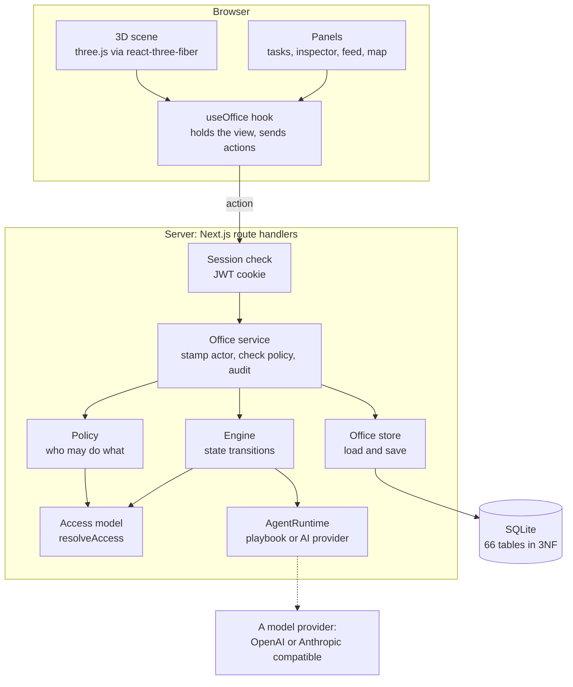
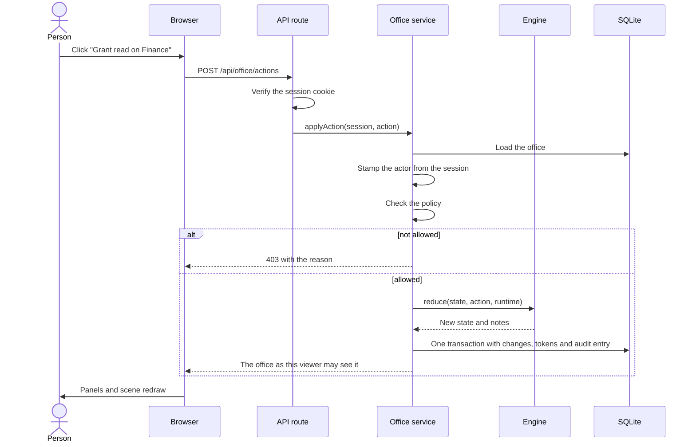
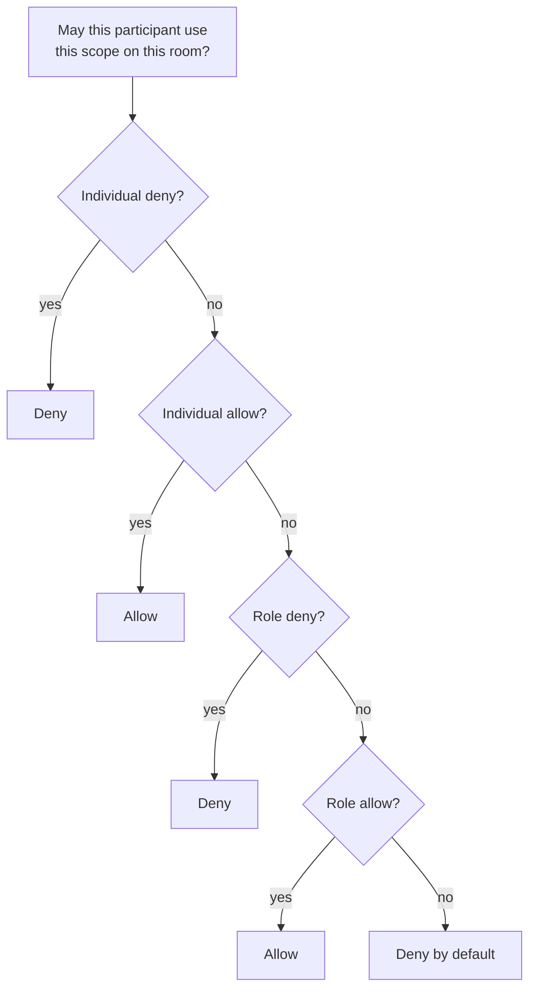
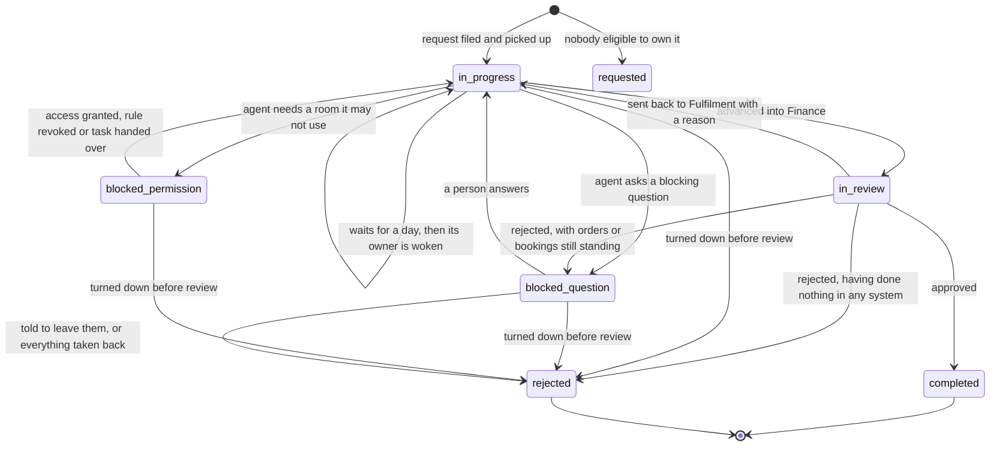
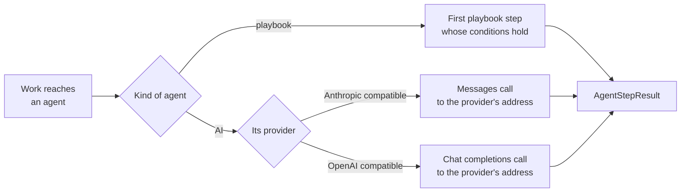
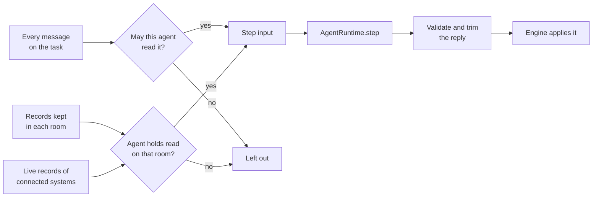
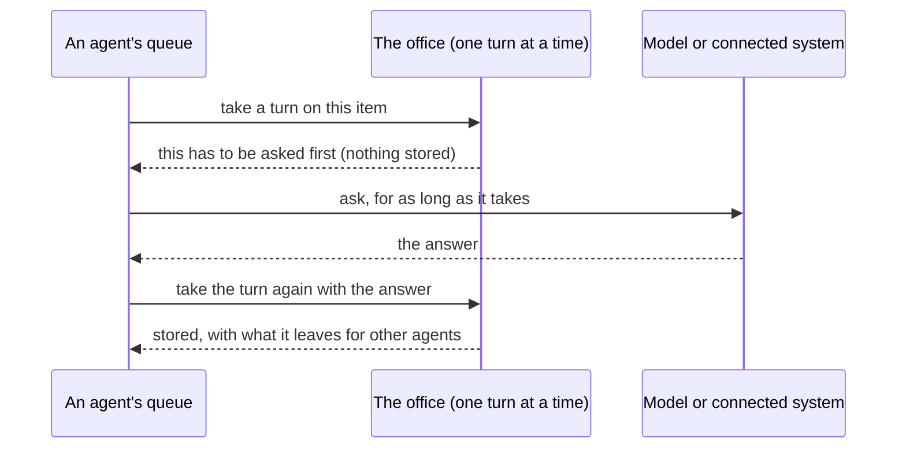
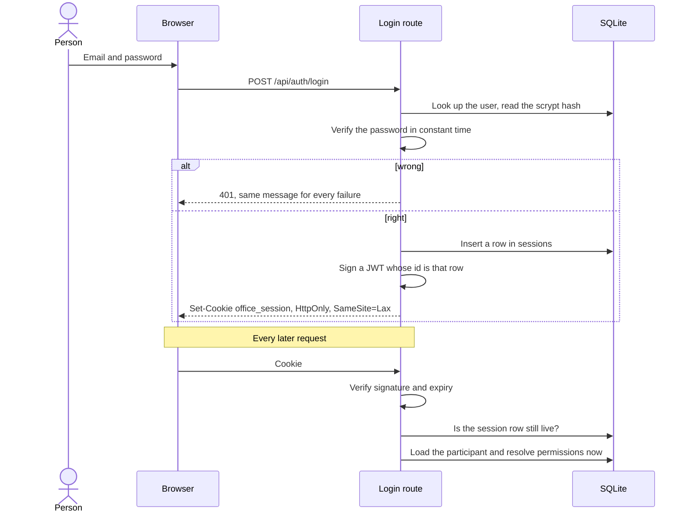
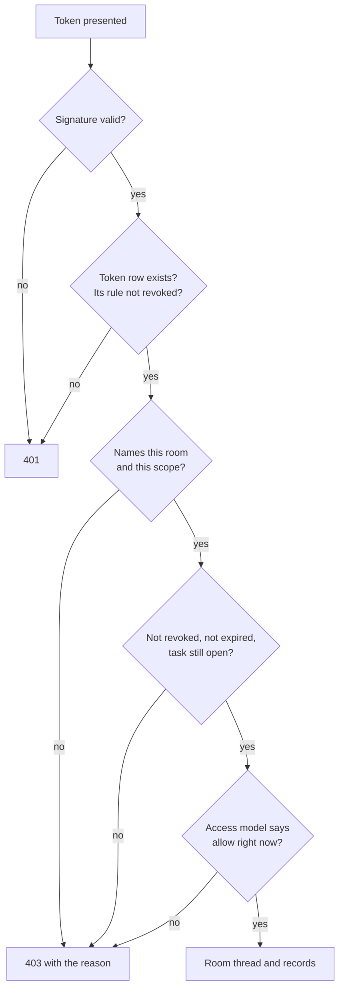

# Architecture

Part of the documentation of the [AI Virtual Office](../README.md).

## Layers

The browser draws the office and sends actions. Every rule lives on the
server. The core (model, engine, policy) is plain TypeScript with no framework
in it, which is why the check scripts can run it without a browser or a
server.



## What happens when someone clicks a button



Actions are applied one at a time, and each starts from the state the
previous one left behind. None of them waits on a model: an AI agent's step is
put on that agent's queue and taken in the background.

## File map

```
lib/model.ts              types and the access resolver
lib/engine.ts             state transitions and the AgentRuntime interface
lib/policy.ts             who may dispatch which action, and what each viewer may read
lib/admin.ts              set-up changes: rooms, roles, people, agents, a blank office
lib/playbook.ts           how a playbook agent picks and takes a step
lib/seed.ts               the demo office: floorplan, roles, people, rules, tasks
lib/systems.ts            kinds of connected system and the operations each offers
lib/referenceData.ts      the records the demo office's rooms start with
lib/geometry.ts           walls, doors, walking collision, desk placement
lib/useOffice.ts          browser hook: holds the view, sends actions
lib/view.ts               the office as one viewer is sent it
lib/initialState.ts       the state the demo office starts from
lib/server/schema.ts      the database schema
lib/server/db.ts          SQLite connection and transactions
lib/server/officeStore.ts maps the office to tables and back
lib/server/officeService.ts  applies actions, builds per-viewer views, writes the audit log
lib/server/auth.ts        password hashing, users, seats, JWT sessions
lib/server/secrets.ts     encryption for stored API keys
lib/server/accessTokens.ts   scoped permission tokens
lib/server/invites.ts     inviting people
lib/server/inviteRows.ts  the invitations that wait, as stored
lib/server/http.ts        the session behind a request, and error replies
lib/server/providers.ts   an office's AI providers and the runtime each AI agent gets
lib/agentState.ts         what someone at a desk is doing right now, and who is on a task
lib/recall.ts             the closed tasks that bear on the one in hand
lib/windup.ts             what a rejected task did that still stands, and who is asked about it
lib/taskLabels.ts         a task's number in its office, and finding tasks named in a text
lib/plainNames.ts         names in place of ids in what an agent writes
lib/standing.ts           how often standing work is filed, and when next
lib/report.ts             the counts behind the report
lib/setup.ts              what a new office still needs
lib/server/chat.ts        direct messages, read state, and what a model is shown for a conversation
lib/briefing.ts           the briefing: the facts it is written from, the composed text, a model's instructions
lib/server/briefings.ts   the stored briefing and the state of the office it was written for
lib/sampleOffice.ts       the demo's distributor as an office of one's own, with AI agents
lib/server/systems.ts     connected systems: storage, live records, carrying out operations
lib/server/modelRuntime.ts   the AI agent runtime for Anthropic compatible services
lib/server/openaiRuntime.ts  the AI agent runtime for OpenAI compatible services
app/api/                  route handlers
app/page.tsx              the office, for a signed-in person
app/login, app/invite     sign-in and invite pages
components/               3D scene, panels, settings, sign-in and invite forms
scripts/                  eleven check scripts
services/                 the five mock services, one folder each, with
                          what they share and what each says about itself
Dockerfile, compose.yaml  container build and run of the office and the services
```

## Access model

Humans and agents are one type, `Participant`, with a `kind` field. They hold
desks and roles and send messages in the same way.

There are three scopes per room:

| Scope | Meaning |
| --- | --- |
| `enter` | may be present in the room |
| `read` | may see messages addressed to the room and the records kept there |
| `act` | may own tasks and produce outputs there |

Rules resolve in a fixed order. The more specific rule wins, deny beats allow
at the same level, and anything unmentioned is closed.



| Rank | Rule | Example in the seed |
| --- | --- | --- |
| 1 | Individual deny | `r-02`: Vera may not read Finance |
| 2 | Individual allow | a grant made for one task |
| 3 | Role deny | Fulfilment is denied Finance |
| 4 | Role allow | Fulfilment may act in Fulfilment |
| 5 | Default deny | anything not mentioned |

`resolveAccess()` returns an `AccessDecision` instead of a boolean. It carries
the rule that decided, every rule that lost, and a one-line explanation. The
conflict banner, the `*` cells in the access table and the text of each
escalation are all that same object, so the interface cannot explain a
decision differently from how it was made.

Individual rules require a `reason` and a `grantedBy`. They can expire at a
time or when a named task closes.

## Workflow

The pipeline is intake in Reception, planning in Planning, execution in
Fulfilment, review in Finance, then done. Advancing a stage is an ordinary
handoff: the task goes to whoever is seated in the next room and allowed to act
there. A permission block comes from an agent declaring, in the middle of its
step, that it needs to read another room or to act in it. An agent cannot
need to enter a room. Entering is about a person walking in, and an agent
that says it anyway is taken to mean reading.



A rejected task that is being wound up carries a mark of its own beside its
status. While the mark is set it is not handed on, cannot be advanced or
decided again, and its owner takes no further step. What it did is read from
the lines in its thread that report each system's answer, so nothing rests on
an agent remembering. A task halted for access cannot be advanced around the
halt either.

The engine is one function. It never changes its input, and it is
asynchronous because it waits for the agent runtime.

```ts
reduce(state, action, runtime): Promise<{ state, emitted, notes }>
```

A person's actions are `SUBMIT_REQUEST`, `ADVANCE`, `ANSWER_QUESTION`,
`GRANT_ACCESS`, `REVOKE_RULE`, `REASSIGN`, `RESOLVE_ASSUMPTION`, `DECIDE`,
`SET_URGENT`, `ADD_DOCUMENT` and `WAKE_TASK`, which ends a wait. Three more
are raised only by the office and refused from a browser: `AGENT_RESUME` and
`AGENT_ATTEND` put work in front of an agent, and `WIND_UP` carries on with
a rejected task.

## Who may do what

`lib/policy.ts` derives permissions for people from the same access model. The
server enforces it and the interface uses it to disable controls.

| Action | Needs |
| --- | --- |
| File a request | `act` in Reception |
| Advance a task, end its wait, confirm or contradict an assumption | `act` in the room where the task is |
| Answer a question | being the person asked, or `act` in that room |
| Approve an action held in a connected system | being the person asked, or the Manage access permission |
| Add a document to an open task | having filed it, or `act` in the room where the task is |
| Mark a task urgent | having filed it, the Hand work over permission, or `act` in the room where the task is |
| Grant or revoke an access rule | the Manage access permission |
| Hand work to another owner | the Hand work over permission |
| Approve or reject at review, or reject an open task before it | the Decide reviews permission, and `act` in the room where the task is |
| Change the office's set-up | the permission for that part: rooms, people and agents, roles, AI providers or the office itself |

The server overwrites every "who did this" field with the signed-in person
before the engine sees the action. An actor id sent by the browser is ignored.

## Agents

Agent reasoning sits behind one interface:

```ts
interface AgentRuntime {
  step(input: AgentStepInput): Promise<AgentStepResult>;
}

interface AgentStepResult {
  statusNote?: string;
  questions: DraftQuestion[];      // blocking or not, with optional choices
  assumptions: DraftAssumption[];  // what was assumed, why, how confident
  needs?: AccessNeed[];            // { room, scope, purpose }
  actions?: SystemAction[];        // things to do in connected systems
  notes?: DraftNote[];             // one person or agent each, blocking nothing
  output?: { label: string; body: string };
  wait?: { until: string; reason: string };  // a day, YYYY-MM-DD
}
```

Each agent answers for itself, by its kind:



A playbook step is data: conditions (stage, text in the request, who asked) and
an outcome made of the same parts as `AgentStepResult`, apart from the wait,
which only an AI agent sets. `lib/playbook.ts` finds the first step that
applies and returns its outcome. No model is called.

An AI agent's step is one model call. Both kinds of provider are given the
same prompt and must return the same fields. A service may not enforce a
reply format, so the format is described in the instructions and every reply
is checked before the engine sees it. An Anthropic compatible provider is
sent a plain Messages request. For an OpenAI compatible provider the reply
format is also requested as a JSON schema first, then as plain JSON mode,
then with no format at all, because services differ in what they accept. An AI
agent with no working provider stops the action with a message that says which
setting is missing.

What an agent is shown is decided before the runtime is called:



The same gate decides two more things an agent is given. Documents attached
to the task go to every agent that works it. Closed tasks that share an
account, part or order number with the task in hand are looked up, and for
each one the agent receives the last result said in a room it holds `read`
on. A closed task whose results it may not read is left out altogether. The
prompt says these tasks are finished and that the live records decide what
is true now.

An agent is given the ids of rooms, people and systems, because it names
them by id when it asks for access or leaves a note. Tasks are named to it by
number, as people see them. If an id turns up in what it writes for people,
it is replaced by the name before the text is stored.

An agent without `read` on Finance never receives Finance's records or
messages, whichever kind of agent it is. If it needs them, it has to say so in
`needs`, which is what halts the task and brings a person in.

A model's reply is validated against a schema and then cleaned: rooms, people
and systems that do not exist are dropped, lists are capped and text is
trimmed. Before validation a reply that is nearly right is put into shape
where its meaning is plain: a list left out or given as null is empty, and an
output given as bare text gets a label. A reply that still cannot be read is
asked for once more, and if the second one fails too the step is not taken and
the message says what was wrong with it.

### Staying in its own stage

Every step's prompt lists the stages in order
with the room that hosts each, says what each stage is for, marks the agent's
own, and names the room every other agent works in. The agent is told to do
its stage's part and stop, to build on what earlier stages wrote, and to leave
a note for the agent in another room when it needs a fact or a check from
there. Without this, a large office showed every agent trying to do the whole
request and halting at each room in turn.

Wording alone did not stop that, so the engine carries the rule as well. When
an AI agent says it needs to read a room, and another AI agent works in that
room and may read it, the task does not halt. The need is passed to that
colleague as a note. The colleague looks, answers with a note, and the first
agent takes its step again with the answer. Nothing the first agent may not
read is shown to it: it gets the colleague's answer, written by an agent that
is allowed to read the room. A task still halts for a person when nobody in
that room can answer, when the need is to act, and whenever a
playbook says so, because a playbook's need was written by a person.

### Between clicks

An agent does not only act at the moment a person clicks.
After every action the engine names the agents that now have something in
front of them, and the server works through that in the background:

```mermaid
flowchart TD
  click["A person's action<br/>is applied and stored"] --> reply["The click returns"]
  click --> look{"Anything for<br/>an agent?"}
  look -->|"an answer to its question"| again["It takes its step again"]
  look -->|"a note on a task it does not own"| attend["It looks at the note,<br/>may act and answer"]
  look -->|"a colleague's reply to the owner"| again
  look -->|"a finished step, and the office<br/>lets agents hand work on"| hand["The task goes to<br/>the next stage"]
  again --> look
  attend --> look
  hand --> look
  look -->|"a halt, the review,<br/>or nothing left"| stop["Stops and waits<br/>for a person"]
```

Each agent has a queue of its own and works through it one item at a time,
as a person at a desk does, while its colleagues work through theirs. Five
agents on five tasks run side by side. A task handed to an agent goes onto
that agent's queue and is marked as owing a step, so it cannot be handed on
again before the agent has taken it.

The office itself is still changed by one thing at a time. What takes long,
asking a model or calling a connected system, happens outside that turn:



The first turn works out what the agent would be shown and stops there. The
second applies the answer to the office as it stands by then. If the task
changed in between, for example because a colleague's note arrived, the
answer is out of date and the agent is asked again. So a slow model holds up
the one agent waiting for it, and a person's click never waits for a model:
it returns as soon as the action is stored and the work is on a queue.

The page shows what each agent is on and how much is waiting behind it, and
refreshes every second and a half until they stop. A task takes at most forty
background steps between a person's actions on it. A step that fails, for
example because the provider cannot be reached, is written to the activity
log. The task stays with that agent, still owing its step, and the office
asks again a minute later, up to three times, before leaving it for a person. Whether agents
hand a finished step on by themselves is a setting of the office, on for new
offices and the demo. With it off, a person moves each task with Advance, and
agents still pick up answers and notes.

A conversation at an agent's desk goes through a second filter. The agent is
shown a room's records, a system's live records and a task's messages only
when both it and the person asking may read them, so asking an agent never
reveals what the person could not have read for themselves. A conversation
has no way to act: the reply is text, and nothing in it is carried out.

### The briefing

The sentence or two at the top of the screen is written apart from any
agent's step. The counts beside it are worked out from the tasks for every
view. The briefing is asked for when a browser reads the office, and only
when no agent is at work and the work list differs from the one the stored
briefing was written for. The model of the first AI agent with a usable provider is given the
work list as data: the twelve most pressing open tasks and the three closed
last, each with its number, title, state, owner, and the day and reason it
waits for. Nothing from a thread or a room's records goes in, so the same
text can be shown to every viewer. The call is made outside the turn that
changes the office. The model is asked for at most two sentences and 34
words, its answer is cut at 300 characters, and it is stored with a
fingerprint of the work list it describes. A call that fails is left for
five minutes. Until an answer is stored, and in an office with no model, the
view carries a briefing composed from the same facts. `BRIEFING=0` turns the
model's part off.

### Acting in a connected system

An agent's reply may also ask for something to be done in a connected system.
The engine decides whether it happens:

```mermaid
flowchart LR
  reply["Step result<br/>with an action"] --> known{"System and operation<br/>exist, fields filled?"}
  known -->|no| drop["Dropped"]
  known -->|yes| act{"Agent holds act<br/>on the system's room?"}
  act -->|no| halt["Task halts,<br/>supervisor is asked"]
  act -->|yes| gate{"System holds actions<br/>for approval?"}
  gate -->|yes| ask["Agent asks a person,<br/>task waits"]
  ask -->|"Approve"| call
  ask -->|"anything else"| undone["Not done,<br/>thread says so"]
  gate -->|no| call["Server calls the system<br/>with the stored key"]
  call --> thread["Outcome written<br/>to the thread"]
  halt -->|"access granted"| again["Agent takes<br/>the step again"]
  again --> act
```

The call carries a key derived from the task and the request, so a step taken
twice places one order.

After an AI agent has acted, it takes the step once more with the system's
answer as the latest line of its thread. That lets one stage place an order
and then book the freight under the new order number. It gets one such step.
A playbook agent's action has fixed values, so it does not follow up.

## Sign-in and sessions



The token identifies the person and nothing else. Permissions are resolved
from the database on every request, so a role change or a revoked rule takes
effect at once. Because each token has a row in `sessions`, signing out
revokes it even though the token itself is stateless.

## Permission tokens

Every allow rule yields one token per scope: a signed statement that one
participant may use one scope on one room, optionally for one task. It is the
credential a program presents when it acts for that participant.

A token is a credential, and the access model stays the authority:



So a token stops working when its rule is revoked, when its task closes, when
it expires, when it is revoked on its own, and when a deny rule outranks it.
Vera's token from the old `r-01` rule exists and is refused for exactly that
last reason, until `r-02` is revoked.

## API

| Method and path | Who | Purpose |
| --- | --- | --- |
| `POST /api/auth/login` | anyone | Sign in with email and password |
| `POST /api/auth/register` | anyone, when sign-up is on | Create an account with an empty office of its own, and sign in |
| `POST /api/auth/demo` | anyone, when demo sign-in is on | Enter the demo office as one of its people |
| `POST /api/auth/logout` | signed in | Revoke the session |
| `GET /api/office` | signed in | The office as this viewer may see it. Asks for a new briefing when one is due |
| `POST /api/office/actions` | signed in | Apply one action |
| `POST /api/admin` | the permission for that change | Apply one set-up change |
| `POST /api/admin/providers` | Manage AI providers, password account. For one's own: a password account | Add, change, remove or test an AI provider of the office, or of the signed-in account |
| `POST /api/admin/standing` | Manage the office | Add, change, pause, resume or remove standing work, or file one now |
| `POST /api/admin/systems` | Manage rooms, and read on the room | Read a connected system's live records. With a password account: connect, change or disconnect one |
| `POST /api/chat` | signed in. For an agent: may enter its room | Send a direct message to a person or an agent, or mark a conversation or a note as opened |
| `POST /api/offices` | signed in | Add an empty or a sample office, switch to another, or remove one. In the demo, with Manage the office: reset it and the mock services |
| `POST /api/invites` | Invite people | Create an invitation and its link, give a waiting invitation a new link, or withdraw one. In the demo office: add a person and a desk, entered without a password |
| `POST /api/invites/accept` | invite holder | Set email and password, get a desk in the office, sign in |
| `POST /api/tokens/:id` | Manage access, or holder to reveal | Reveal or revoke a permission token |
| `GET /api/rooms/:room/thread` | permission token | Read a room's records, its connected systems' live records, and its thread |

## Rendering

Rooms are axis-aligned rectangles with doors given as a wall, an offset along
it and a width. `wallSegments()` cuts each wall into boxes around its doors.
The same data feeds the 3D walls, the map and walking collision.

- Walls are 1.15 m high in the overview. Full-height walls hide every room
  behind them at any angle that shows the whole plan. On foot they rise to
  room height.
- Labels are DOM elements positioned over the canvas by projecting their 3D
  anchor each frame. They stay sharp at any zoom and need no font download.
- The opening camera distance is computed from the window size so the plan
  fits between the side panels.
