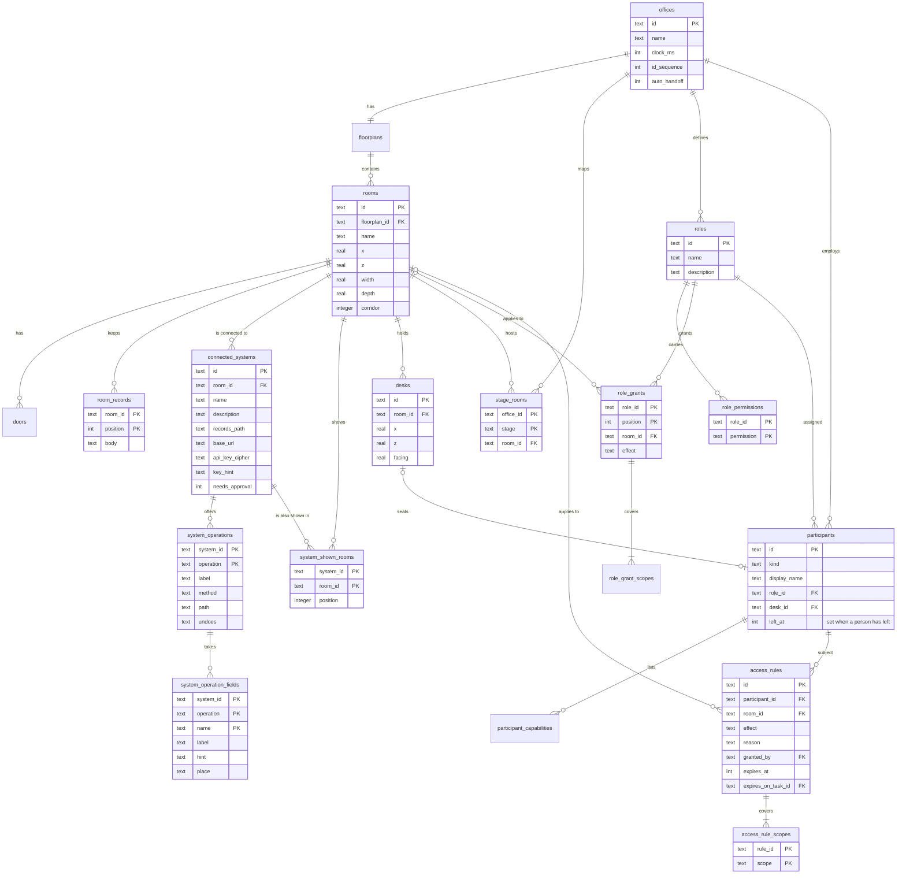
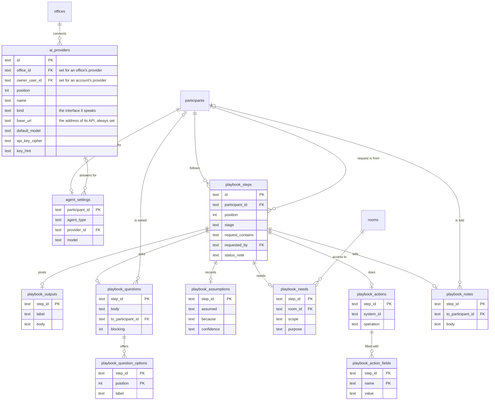
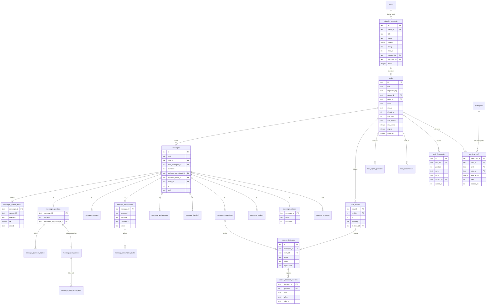
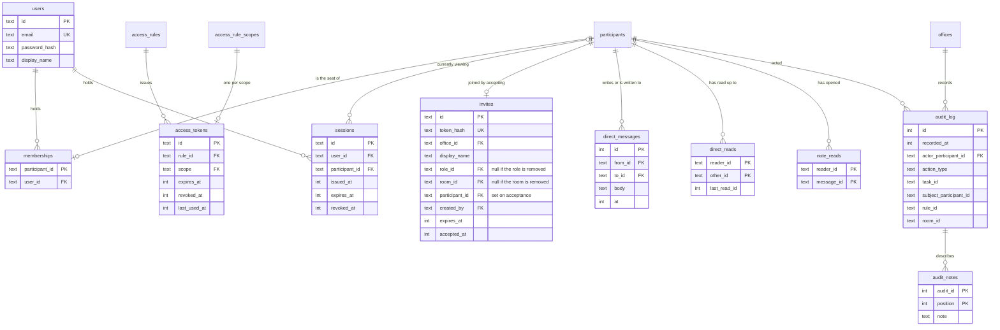

# Database

Part of the documentation of the [AI Virtual Office](../README.md).

SQLite, one file, 66 tables. One database holds many offices. The schema is in
third normal form:

- Every column holds one value. Lists such as scopes, capabilities and
  question options are rows in child tables. There are no JSON or delimited
  columns.
- Every fact is stored once. A desk's occupant lives only in
  `participants.desk_id`, and a room's desks only in `desks.room_id`, though
  the in-memory model carries both directions for convenience.
- No column depends on another non-key column. A permission token stores
  only its rule and scope. The holder and the room are read through the rule.
- Each message kind has its own table. The eleven kinds carry different
  fields, so the shared part lives in `messages` and the rest in a detail
  table keyed by the message id.
- A NULL room on a grant or rule means every room.
- Schema changes are migrations. An older database is brought forward on
  open, one version at a time, each step in its own transaction.
- `position` columns record order. Rules and grants are evaluated in
  sequence and threads are read in sequence, so order is data.

The store rebuilds the engine's state from these tables and writes back only
what an action changed. The engine never mutates, so anything that is still
the same object as before is left alone.

Two tables stand apart from the diagrams below. `schema_meta` holds one row,
the version of the schema, which is 23. `briefings` holds at most one row
per office: the briefing a model last wrote for it, the model's name, the
time, and a fingerprint of the work list it was written for. It is not part
of the engine's state. A briefing is shown only while the office's work list
still gives the same fingerprint.

The diagrams draw 48 of the tables and name the rest in the text beside
them. To stay readable they leave out some columns that only keep order or
time, such as `position`, `office_id` and `created_at`. The schema in
`lib/server/schema.ts` has every column.

## Office, people and access

## Agents, providers and playbooks

An agent's kind, provider and model live in `agent_settings`, one row per
agent. Removing a provider sets `provider_id` to NULL and leaves the agent in
place. A playbook step keeps its conditions on the step row, where a NULL
stage means any stage and a NULL `requested_by` means anyone. Each part of a
step's outcome has its own table and a row there only when the step does that
thing, so no step carries empty columns for parts it does not use. An action's
`system_id` is deliberately not a foreign key: a step keeps its action when the
system is disconnected, and skips it until a system with that id exists again.

## Work and messages

Position 0 in `access_decision_sources` is the rule that decided. The rest
lost, in precedence order. `rule_id` there has no foreign key on purpose: the
decision is kept as evidence after the rule it names has been revoked.

## Accounts, tokens and audit

A user is a sign-in and exists apart from any office. A row in `memberships`
is that user's seat in one office: the human participant they are there. A
session points at one seat at a time, which is what selects the office a
request acts on.

The audit log is append-only. Its subject columns are plain text without
foreign keys, so an entry survives the task or rule it describes.
