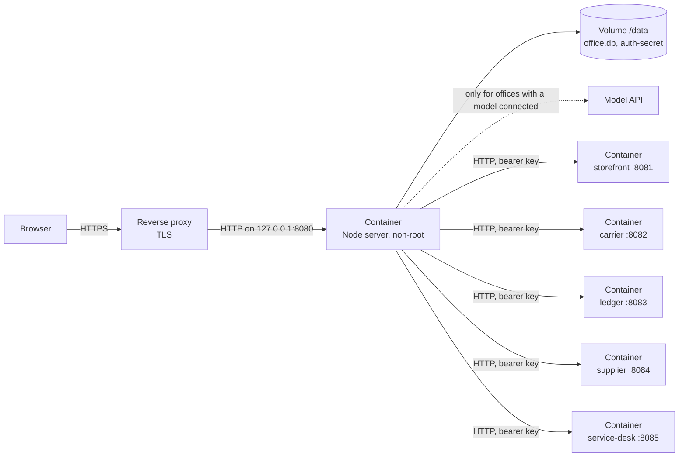

# Running and deploying it

Part of the documentation of the [AI Virtual Office](../README.md).

## Locally

Requires Node 24 or later, for the built-in SQLite module.

```bash
npm install
npm run dev       # http://localhost:3000
npm run verify    # type check, then all eleven check scripts
npm run services  # the five mock services, on ports 8081 to 8085
npm run build     # production server in .next/standalone
```

The database is created at `./data/office.db` on first run, with the demo
office in it. Set `ADMIN_EMAIL` and `ADMIN_PASSWORD` to get an account with its
own empty office. Delete the `data` folder to start again.

Started this way the demo office has no connected systems. To give it the
mock services, run `npm run services` in a second terminal and start the
office with `DEMO_SYSTEMS_KEY=local-systems-key` and one address per service:
`DEMO_STOREFRONT_URL=http://127.0.0.1:8081`,
`DEMO_CARRIER_URL=http://127.0.0.1:8082`,
`DEMO_LEDGER_URL=http://127.0.0.1:8083`,
`DEMO_SUPPLIER_URL=http://127.0.0.1:8084` and
`DEMO_SERVICE_DESK_URL=http://127.0.0.1:8085`. A service with no address is
left out.

To connect a system or an AI provider on this machine by hand, such as a model
served on `127.0.0.1`, also start the office with `ALLOW_PRIVATE_ADDRESSES=1`
or `SIGNUP=0`.

## Configuration

All optional. See `.env.example`.

| Variable | Default | Purpose |
| --- | --- | --- |
| `AUTH_SECRET` | generated and kept beside the database | Signs session and permission tokens. At least 32 characters. |
| `ADMIN_EMAIL`, `ADMIN_PASSWORD` | unset | Creates an account at start-up, with an empty office of its own. |
| `DEMO_LOGIN` | `1` | Creates the demo office and allows password-free entry to it. `0` turns that off. |
| `SIGNUP` | `1` | Lets anyone create an account on the sign-in page. `0` turns that off, which leaves invites and the administrator account. |
| `BRIEFING` | `1` | Lets an office's model write the briefing at the top of the screen. `0` leaves the composed briefing everywhere and makes no model call for it. |
| `ALLOW_PRIVATE_ADDRESSES` | unset | `1` lets a connected system or an AI provider sit at an address inside the server's own network while sign-up is on. |
| `OFFICE_DB_PATH` | `./data/office.db` | Where the SQLite file lives. |
| `OFFICE_PORT` | `8080` | The port on this machine that `compose.yaml` publishes the office on. |
| `ADMIN_NAME` | taken from the email | The administrator's display name. |
| `DEMO_STOREFRONT_URL`, `DEMO_CARRIER_URL`, `DEMO_LEDGER_URL`, `DEMO_SUPPLIER_URL`, `DEMO_SERVICE_DESK_URL` | set by `compose.yaml` | Where the demo office and a sample office find each mock service. A service with no address is not connected. |
| `DEMO_SYSTEMS_KEY` | `sample-systems-key` in `compose.yaml` | The key the office and the mock services share. |

## Docker

The stack is six containers. The office image runs the checks, builds the
server, and runs it as a non-root user on port 8080, with its data on a named
volume. Each of the five mock services runs from its own file and two shared
ones, with no dependencies, also as a non-root user.

```bash
docker compose up -d --build    # http://localhost:8080
```



The office listens on localhost only, so a reverse proxy with TLS belongs in
front of it. The services publish no port: only the office reaches them,
over the stack's own network. An office other than the demo can connect to
them too, at `http://storefront:8081`, `http://carrier:8082`,
`http://ledger:8083`, `http://supplier:8084` and `http://service-desk:8085`,
with the value of `DEMO_SYSTEMS_KEY`. Back up the office by copying the volume.

The deployed site runs the same six containers without compose, as six
applications in one Dokploy project that build from this repository. The
office builds from `Dockerfile` on every push to `main`. Each service builds
from `services/Dockerfile` with the build argument `SERVICE`, has `PORT` and
`API_KEY` in its environment, and is set to watch `services/**`, so it is
rebuilt and restarted only by a push that changes something in that folder.
A service keeps its data in memory, so a restart puts its starting data back,
and without that setting every push to the office would do so. No service
has a domain, so only the office reaches them, by their internal names on
Dokploy's network.

## Plesk

With the Docker extension: start the container on the server with the compose
command above, then add a Docker proxy rule on the domain that forwards `/` to
the container's published port. Plesk's nginx terminates TLS and passes the
`X-Forwarded-Proto` header, which is what marks the session cookie Secure.

A static host is no longer enough. The application needs a running server and
a disk that keeps its files, which rules out hosts that give each request a
fresh filesystem.
