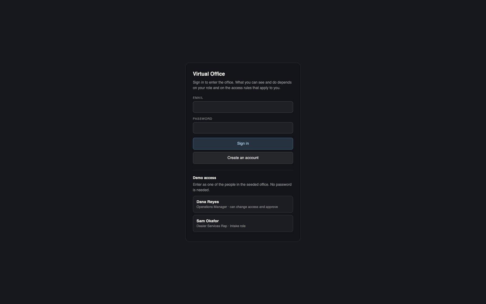

# User guide

Part of the documentation of the [AI Virtual Office](../README.md).

## Everyday use

The seeded office has five rooms along a hall: one for each of the four working
stages of a dealer order, and an operations office for the supervisor. Every
room opens onto the hall and onto nothing else, and the way in from outside is
at one end of it. Every role may walk the hall. No work happens there.

```
        ┌───────────┬───────────┬───────────┐
        │ Reception │ Planning  │  Finance  │
        ├─────┬─────┴─────┬─────┴─────┬─────┤
way in →             H a l l                │
        ├────────┬────────┴───────┬─────────┤
        │   Fulfilment    │    Operations   │
        └─────────────────┴─────────────────┘
```

| Room | Stage | Who sits there | What happens |
| --- | --- | --- | --- |
| Reception | Intake | Iris (agent), Sam Okafor (dealer services rep) | A dealer request is parsed and matched to an account. Iris asks before guessing about anything that changes the price. |
| Planning | Planning | Atlas (agent) | The request is broken into line items and a shipment, with a lead time. |
| Fulfilment | Execution | Vera (inventory agent), Quill (quoting agent) | Stock is checked across branches, transfers are proposed, the quote is assembled. |
| Finance | Review | Ledger (agent) | Dealer tier and credit standing are confirmed. A person approves or rejects. |
| Operations | Supervision | Dana Reyes (operations manager) | Escalations land here. Dana has access to every room. |
| Hall | none | nobody | The corridor every room opens onto. Everyone may walk it. |

A dealer services rep files a request and the agents carry it forward. Orders
that need nothing unusual go straight through to review. The supervisor's job
is the exceptions, and the office is built so they are the first thing on
screen:

- The work list on the left holds every task with its state. Once there
  are more than five it gains a search box, over each task's number, title
  and request, and four filters with counts: all, waiting for a person, moving
  with agents, and closed. The filters stay at the top of the list while it
  scrolls.
- A summary at the top centre is always in view: how many tasks are open,
  how many of them wait for a person, how many agents are at work, how many
  tasks are closed, and how many are urgent when any are. A task counts as
  waiting for a person once no agent is still taking a step on it, so a
  review an agent is checking is not yet counted. The summary is centred in
  the space the side panels leave. While agents work,
  a second line under it names who is on which task. On a phone both sit
  above the section bar, and the summary shows on the office view.
- A briefing under the counts says in a sentence or two what the work is:
  which tasks need a person and what each needs, then what is in an agent's
  hands or waiting for a day. In an office with an AI agent, that agent's
  model writes it, in at most two sentences and 34 words, and it carries a
  small *AI* mark. It is written once the agents have gone quiet and only
  when the office has changed since the last one, so a look at the office
  costs no model call by itself. Until it arrives, and in an office with no
  model such as the demo, the briefing is composed from the same facts with
  no mark. Either way it is written only from what every member already sees
  in the work list: a task's name, its state, who holds it, and the day and
  reason it waits for. Nothing said in a room goes into it, so one briefing
  serves everyone whatever they may read.
- The office is framed in the space the panels leave. The view pulls back
  until the whole plan fits between the work list and the task panel, however
  long the corridor has grown, and takes the full width when no task or
  person is picked.
- A room outlined in amber means an agent asked a question it could not
  answer itself. Someone picks an answer and the task continues.
- A room outlined in red means an agent needed data in a room it may not
  read. The supervisor can grant access for that one task, revoke the rule that
  blocked it, or hand the work to someone who already has access.
- Assumptions are the guesses agents made in order to keep going, such as
  which branch will fill the order. Each one is listed on the task with its
  reasoning and confidence. Confirming one closes it. Marking one wrong halts
  every task that rests on it and asks for the correct value.
- Review always ends with a person. An agent can prepare the pricing sheet,
  and only a human decision completes or rejects the task. A reviewer who
  finds the work unfinished writes what has to change and sends it back. The
  task returns to the room that carries work out, to whoever had it there,
  and comes to review again once that is done. Rejecting a task that has
  already placed an order, booked freight or raised an invoice does not
  close it at once: the reviewer is asked what should happen to those, with
  "Undo all of them" and "Leave them as they are" as ready answers and a box
  for their own words. The task shows as rejected and being wound up until
  the agents have done what was said.
- A request can be turned down before review. Whoever may decide reviews
  sees *Reject this request* on any open task, with a second click to
  confirm: one that is halted on a question, set to wait for a day, or still
  being planned. Its open questions and its wait go with it, and anything it
  already did in a connected system is settled the same way as at review.
  The button waits while an agent is in the middle of a step on the task.
  Approving, and sending work back, stay at review, where there is finished
  work to rule on.

Every permission change records who made it and why. A grant made for one task
counts only for work on that task and expires when the task closes, so an
exception does not turn into standing access. An agent holding such a grant is
not shown that room while it works on a different task, or in a conversation.

## Using the office

### Signing in

The sign-in page takes an email and password. *Create an
account* on the same page asks for a name, an email and a password of at least
10 characters, and signs you in. A new account starts with an empty office of
its own: one room, and you in it with every permission. The email is only the
name you sign in with. Nothing is sent to it.

The page also lists the people of the **demo office** for password-free entry.
The demo office is the seeded distributor described above. It is separate from
every account's own offices and nothing in it carries over to them.



| Demo person | Role | What they can do |
| --- | --- | --- |
| Dana Reyes | Operations Manager, supervises | Everything: grant and revoke access, hand work over, approve, invite people. Reads every room. |
| Sam Okafor | Dealer Services Rep, Intake role | File requests and work in Reception. Cannot read Finance and cannot change access. |

Entering as Sam after Dana is the quickest way to see the enforcement: fewer
messages, disabled controls, and a line on each task saying how many messages
were withheld.

### Moving around

Drag to orbit, scroll to zoom, right-drag to pan. Walls are
drawn low so every room stays visible from any angle.

### Walking

*Walk the office* puts you at the front door at eye level. Move
with W A S D or the arrow keys, hold Shift to move faster, drag to look around
and click someone to inspect them. A map in the corner shows where you are.
Pick a place on the map and you are standing there: a free spot in any room
you may enter, or the nearest one when you pick a wall or a desk. Pick a
person on the map and you are a step back from them, facing them, with the
prompt to talk already up. A room that is closed to you refuses, and says so.
Point at anyone on the map to see their name.

On a phone or a tablet you walk by touch. Tap a place or a person on the map
to go there, drag a finger over the view to look around, and tap the prompt
to talk to whoever you face. A phone opens the walk on the map, with the view
under it, and the map carries its own way back to the overview.
The inbox, the report, settings and sign out stay in reach while you walk.
Escape returns to the overview. The view rises, falls and sways a little with
each stride, and holds still for anyone whose system asks for reduced motion.

Each room's name is on a plate above its doorway, on the side you come to it
from. A doorway into a room you may not enter is closed by a red, see-through
pane that reads "Not Authorized", and it stops you: the same access rule that
hides a room's messages from you keeps you out of the room on foot. Sign in to
the demo as Sam to see it on Finance and Operations. Sam's role does not
cover Fulfilment either, but Sam holds a temporary individual grant for it, so
that doorway is open.

Each desk's monitor shows its occupant's name and state: working, waiting for
access, waiting on an answer, waiting for a decision, or nothing on the desk,
with the task and the last thing they said about it. When you stand within a
few steps of someone in the same room and face them, a prompt appears: press F
and their panel opens with the keyboard in the message box. The prompt says
what to expect: an AI agent answers from what you may both read, a playbook
agent reports where its work stands, since it follows written steps and cannot
hold a conversation, and a message to a person is theirs alone to read.

### Messages

Everyone's panel has a *Right now* line and a message box. Type
and press Enter. A message to a person is delivered to their inbox, and anyone
may write to anyone. A message to an agent is answered at once, and you can
talk to an agent only if you may enter the room it sits in. An agent can
answer for work it no longer holds as well as for what is on its desk: it
knows the tasks it wrote on and passed along or saw closed, and where each
stands now, as far as you may both read them. Either way, only the two of you
can read what is said. The activity log records that a message
was sent and never what it said. No task, rule or record changes because of a
message: for work, file a request.

### Inbox

The *Inbox* button on the title card carries a count. Inside:

| Section | What it holds | Clicking a row |
| --- | --- | --- |
| Waiting for you | Questions addressed to you, requests for access addressed to you, and tasks at review if you may decide reviews | Opens the task |
| Notes left for you | Notes agents addressed to you in task threads, unopened ones marked | Opens the task and marks the note opened |
| Between agents | Every note one agent left another, with who wrote to whom and on which task. Listed for people who may see everything | Opens the task |
| Conversations | Everyone you have exchanged messages with, the latest line and how many are new | Opens their panel with the keyboard in the message box |

### Notes

An agent can leave a note for one person or one other agent while
it works on a task. It is for something they should know that the handoff and
the outputs do not say, such as a detail the reviewer should check. A note
lives in the task's thread, only its author and the one it is for can read it
(and people who may see everything), and it blocks nothing. The owner of the
task reads its notes the next time it takes a step. An AI agent that does not
own the task looks at the note shortly after it is left: it may do its own
part, such as booking freight in a system that is its to use, and may answer
with one note. It cannot halt or take over a task that is not its own. Whoever filed
a request also gets a note when a connected system refuses or cannot be
reached, because the task carries on regardless.

### Reading the office

Every name tag says Human, AI or PB, where PB marks an
agent that follows a playbook. People are rounded
figures. Agents are faceted and carry a slowly turning ring. A pulsing marker
above a figure means that figure owns a halted task.

A lamp on each desk, and the light it throws on the floor, takes the colour of
the desk's state: blue for work in hand, amber for a question that waits, red
for access that is missing, purple for a decision that is due. A desk with
nothing on it stays dark. The light is steady while work waits and beats while
an agent is taking its step. During that step the agent leans in to its desk,
its ring runs fast, and its name tag says which task it is on.

The open tasks a person or an agent holds are named at the foot of their desk,
each in the colour of its state, with a red edge on an urgent one. The task in
hand comes first. Click one to open it. The same tasks lie on the desk as
folders, which is how they read on foot.

Work is shown as it happens. A ring spreads from a desk each time its occupant
adds a line to a thread. When something is meant for someone else, it travels
in an arc to their desk: a task handed on in blue, a question in amber, an
answer in green, a note between agents in teal. Only what you may read is
shown, and nothing is replayed from before you opened the office. With the
system set to reduce motion, the lamps, folders and task names stay and the
rings and arcs are left out.

### The work list

*Work in the office*, on the left, lists every task with its status. Click one
to open it. *New request* files a new dealer request into Reception and opens
it. Text documents can be attached to it, and it can be marked urgent.

### The task panel

With a task selected, the panel on the right shows:

- A line under the task's details names the agent working on it at the
  moment, any colleague answering a note on it, and agents that have it
  waiting behind other work.
- *Documents* lists the text documents attached to the task. Each opens in
  place, and more can be added while the task is open.
- *Your move* lists what you can do at this moment. The buttons change with
  the state of the task and with your own permissions. A control you may not
  use is disabled, with the reason beside it.
- *Assumptions* lists every guess recorded on the task, each with Confirm and
  That's wrong.
- *Thread* is the message history you are allowed to read. A task named in
  it, such as T-12, shows that task's card when pressed, and the card opens
  the task. Someone who
  manages rooms sees *Keep as a record* beside each result and answer. It
  opens the line for editing, with a choice of room, and adds it to that
  room's records, where every agent that reads the room is told it.

### A person's or an agent's panel

Click a figure in the scene and the panel on the right shows that person or
agent: their role, what they can do, whether a live model backs them, and a table of rooms
against the three access scopes. A cell marked `*` was decided between
competing rules. Hover it for the explanation. Supervisors also see that
participant's permission tokens, with *Copy token* and *Revoke token*.

### Activity

The panel at the bottom left is a plain-language log of what each action did,
limited to rooms you can read.

### The buttons on the title card

*Inbox* opens what is waiting on you.
*Invite* invites a person and lists the invitations nobody has accepted yet,
with their count on the button. The link is shown once, when it is made. *New
link* replaces a lost or expired one, and the old link stops working.
*Withdraw* takes an invitation back. Nobody is in the office before they
accept. *Report* shows how the office is doing, for people
who see everything. *Settings* opens the set-up screen described next. They
stay on screen while you walk the office.

## Settings

How an office is set up can be changed without touching code. Every change is
checked on the server, stored, and written to the audit log.

Settings opens as a list of pages on the left and the open page on the right.
The pages of the office you are in come first, under its name. The two that
belong to your account, whichever office you are in, come after.

| Page | Needs the permission | What you can do |
| --- | --- | --- |
| General | Manage the office | Rename the office. Choose whether agents hand work on by themselves. Clear all work, or remove the office. In the demo office: reset it to how it first loaded. |
| Rooms | Manage rooms | Rename a room or change its purpose. Add a room, which takes the next free place along the corridor while the corridor lengthens to make space, or build it against a wall of a room you choose. Either way a door joins the two. A room can be marked as a corridor: every role may walk it, nobody has a desk there and no stage is hosted there. Remove an empty room. Choose which room hosts each workflow stage. |
| Records | Manage rooms | Edit the records kept in each room you can read, one fact per line. A line from a task's thread can also be kept as a record straight from the task panel. |
| Connected systems | Manage rooms | See each connected system with the room it is operated from and what agents can do in it. Show what it holds right now. Connect a system, reword what agents are told about it, choose further rooms that are shown its records, and choose whether each action waits for approval. |
| Standing work | Manage the office | Set up a request the office files by itself every day, every weekday or every week, with its title, details and whether it is urgent. Pause one, remove one, or file it now. Not available in the demo office. |
| People and agents | Manage people and agents | Add an AI agent or a playbook agent with a desk and a role. An agent added with no name is given one that nobody in the office has. Choose an agent's provider and model, or write its playbook. Rename anyone, change their role, or move their desk. Remove an agent that has no history. Remove a person: their sign-in to this office ends at once, and if the office's record names them they are listed under *People who have left* with their name kept on that work. A person who still owns open work has to hand it over first. |
| Roles and access | Manage roles | Three parts under one page. Roles: add, rename or remove a role. Permissions: tick what each role held by people may do. Room access: Tick allow or deny for each scope in each room, or set a whole row in one choice: work here, look in, walk through, keep out or not set. |
| Access rules | Manage access | See every individual rule in a table and revoke one. Add rules for a person or agent by ticking cells and giving a reason. |
| AI providers | Manage AI providers | Add, edit, test and remove the office's own providers. Each holds a type, a default model and an API key. See which providers people have brought in from their accounts. |
| Your offices | none | See every office your account has a seat in. Open another one. Add a new, empty office, or a sample office with AI agents. Remove one you manage. |
| Your AI providers | none, with a password account | Add, edit, test and remove providers that belong to your account. They can be used in every office you have a seat in. |

A page appears only for someone whose role carries its permission.

### Permissions

A role carries any of eleven permissions, ticked in a table of
permissions against roles:

| Permission | Lets a person |
| --- | --- |
| Manage access | Grant and revoke individual access rules and permission tokens. Escalations go to people with this permission. |
| Hand work over | Give a task to a different owner. |
| Decide reviews | Approve or reject work at the review stage, or send it back with what has to change. Reject a request at any earlier stage. |
| See everything | Read every message and the whole activity log. |
| Invite people | Add a person to the office with a role and a desk. |
| Manage people and agents | Add, configure and remove agents. Rename people, change roles, move desks. |
| Manage rooms | Add, rename and remove rooms. Choose where each stage happens. Edit the records and connected systems of rooms they can read. |
| Manage roles | Add and remove roles and change what each role may do. |
| Manage AI providers | Add, change and remove AI providers and their API keys. |
| Use shared AI providers | Give agents an AI provider that another person brought to this office from their own account. |
| Manage the office | Rename the office, clear all work, or remove the office. |

Nobody can hand out more than they hold. A person can tick only the
permissions their own role carries, and can give or invite into only a role
whose permissions are a subset of their own. Permissions are for people: a
role held by an agent cannot carry any.

### Room access

Each role has a table with a row per room, and an Allow box
and a Deny box for each of enter, read and act. An empty pair means not set.
Individual rules are added from the same kind of table.

### Agents

An agent is one of two kinds, chosen when it is added and
changeable afterwards:

- An **AI agent** names one of the office's AI providers and, optionally, a
  model other than the provider's default.
- A **playbook agent** follows an ordered list of steps. Each step has
  conditions under *When* (the stage the work is at, text the request
  contains, who the request is from) and an outcome under *Then* (a line for
  the activity log, an output, a question, an assumption, a need for access to
  a room, something to do in a connected system, a note for someone). The agent takes the first step whose conditions all hold. When no
  step applies it does nothing and says so.

### AI providers

An office can hold several. A provider is any service that
speaks one of two common interfaces: OpenAI chat completions or Anthropic
Messages. That covers the hosted services, gateways in front of them, and a
model served on your own machine. Every provider is set up the same way:
choose the interface, give the address of its API and the model id it
expects, and add its key if it needs one. No service is assumed and nothing
is filled in for you. *Test* checks the address, the key and the model. It
asks the provider for its list of models, and a provider that keeps no such
list is sent a request for a single token. A key is
encrypted before it is stored and is never sent back to the page: afterwards
the table shows only its last four characters. The shared demo office cannot
hold a key.

A provider can also belong to your account, under *Your AI providers*. It is
then listed in every office you have a seat in, and you can give it to agents
there without entering the key again. Other people in the office see that it
is yours. They can give it to an agent only if their role has the *Use shared
AI providers* permission, and they never see its address or its key. It stops
being usable in an office once you no longer have a seat there.

### A sample office

Under *Offices*, *Add the sample office* creates the
demo's distributor as an office of your own: the same five rooms, roles and
records, the mock services where the server has them, five AI
agents on the provider you pick from your account, and you as its manager. It
starts with no work. Unlike the public demo it is yours alone, so model calls
are spent only by people you invite.

### Records and systems

A room's records are sentences, one per line, such
as a policy or an account's terms. A connected system is operated from one room:
whoever may read that room is shown its records, and whoever may act there can
use it. Its records can also be shown in further rooms, for people and agents
who need the figures and should not get the rest of the room. Nobody can use
the system from those rooms, so a denial on the room it is operated from still
holds. To
connect one, give its address and API key. The office asks the system to
describe itself and stores the answer: a name, a description of when and how
to use it, and the operations it offers with the fields each one takes. The
description is what an agent is told about the system. You can reword it in
Settings, for example to say which jobs it is for in your office or what to
check first. Leave it empty and the system's own wording comes back.

The office has no list of system types. Any service that answers three calls
can be connected: `GET /v1/manifest` for the description and the operations,
a records address named in the manifest that returns plain lines, and the
operations themselves, each answering with a sentence that says what it did or
why it refused. Two optional parts of that format are what let the office
settle a rejected task. An operation can say which other operation it takes
back, as cancelling an order takes back placing one. And an answer can give
the number of the record it made or took back, such as SO-1001. With both,
the office knows from its own record what a task did that still stands, and
an agent asked to take something back can only name a record that task made.
The five mock services are built this way:

| Service | Live records | Operations | Refuses, for example |
| --- | --- | --- | --- |
| Storefront | Products with list price and stock per branch, and recent orders | Place an order, cancel an order | An order the branch cannot fill in full |
| Freight carrier | Service levels with their rates, and recent shipments | Book a shipment, cancel a shipment | A parcel above 500 kg, or a second booking for the same order |
| Accounts ledger | Dealer accounts with tier, credit limit, balance, payment record and holds, and recent invoices | Raise an invoice, void an invoice, record a payment, put an account on hold or release it | An invoice on a held account or past the credit limit, an order invoiced twice, a large invoice for a dealer that pays late |
| Supplier portal | What the factory charges, its minimum order and case size, lead time and what it can ship now, and purchase orders | Raise a purchase order, expedite one by air, cancel one | An order below the minimum or not in whole cases. A short run ships in part and backorders the rest |
| Service desk | Units in the field by serial number with their warranty, and tickets | Open a ticket, authorize a return, schedule a technician visit, close a ticket | A return for a unit out of warranty, a visit on a weekend or a fully booked day |

The room's access rules cover the system. Someone with `read` on the room is
shown the system's records as they are at that moment. An agent with `act` on
the room may use its operations, and an agent without it halts the task and
asks its supervisor, exactly as it does for a room it cannot read. A system
can also be set to hold each action until a person approves it: the agent asks
"May I place an order in Storefront?" with the details, the task waits, and the
action is carried out only if the person asked, or someone who manages access,
chooses Approve. Declining, or typing any other answer, leaves it undone. What the
system answered is written to the thread, including a refusal such as a branch
that does not hold enough stock. A system's address and API key are entered
once, the key is stored encrypted, and neither a manager without `read` on the
room nor any agent ever receives them. The demo office's systems are fixed.

The screen refuses changes that would leave the office broken, and says why: a
room that hosts a stage or still has people in it cannot be removed, the last
person who can manage roles cannot lose that, and a role still in use cannot
be deleted.

### A new office

A new office starts empty: a corridor and one room on it with you inside, two starter roles, no
agents, no work and no rules. Until the first request is filed, the panel on
the right lists what the office still needs, worked out from the office
itself: a role that may work in each room that hosts a stage, an agent who can
take each stage, a provider with a working key for each AI agent. Each step
names what is missing and opens the Settings tab where it is done. Demo access cannot add offices.
